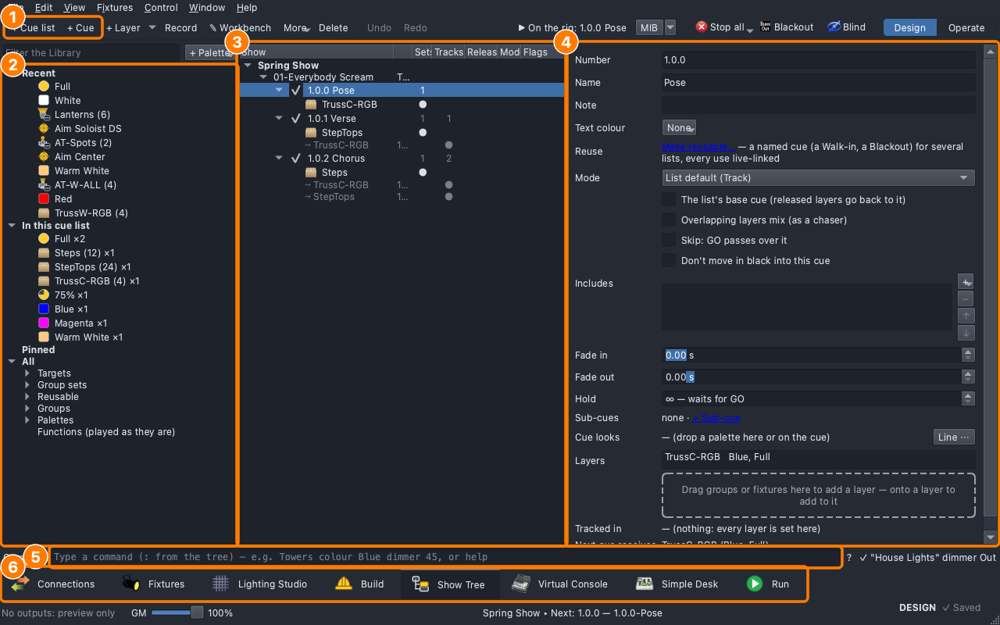
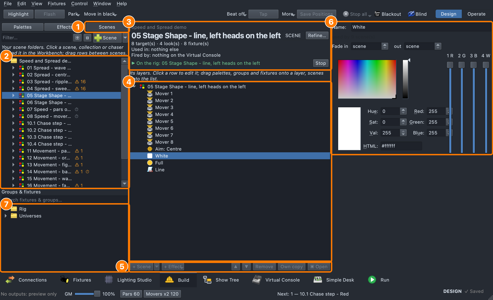
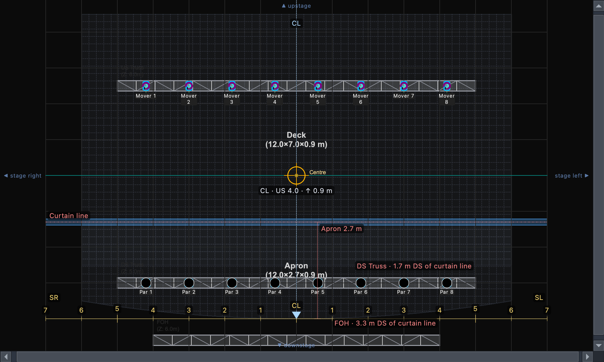
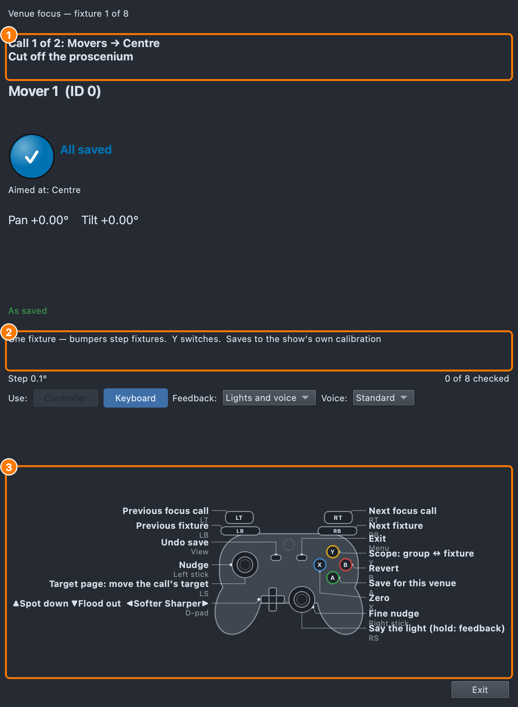
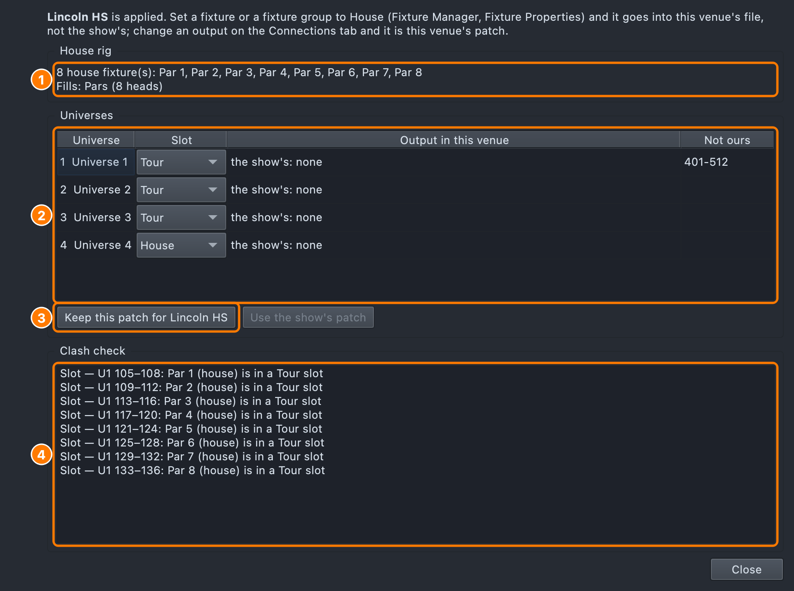
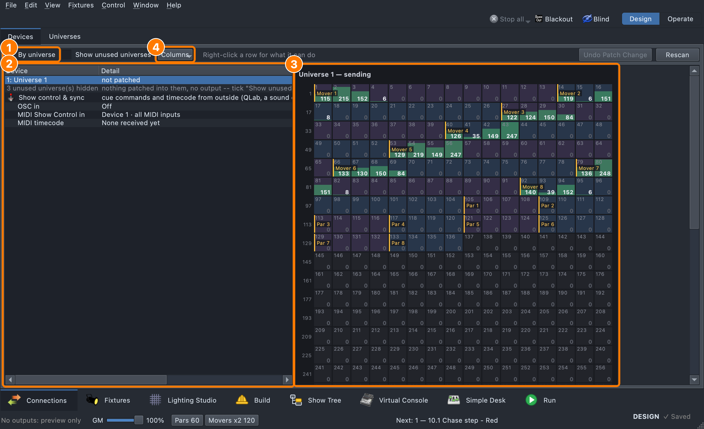
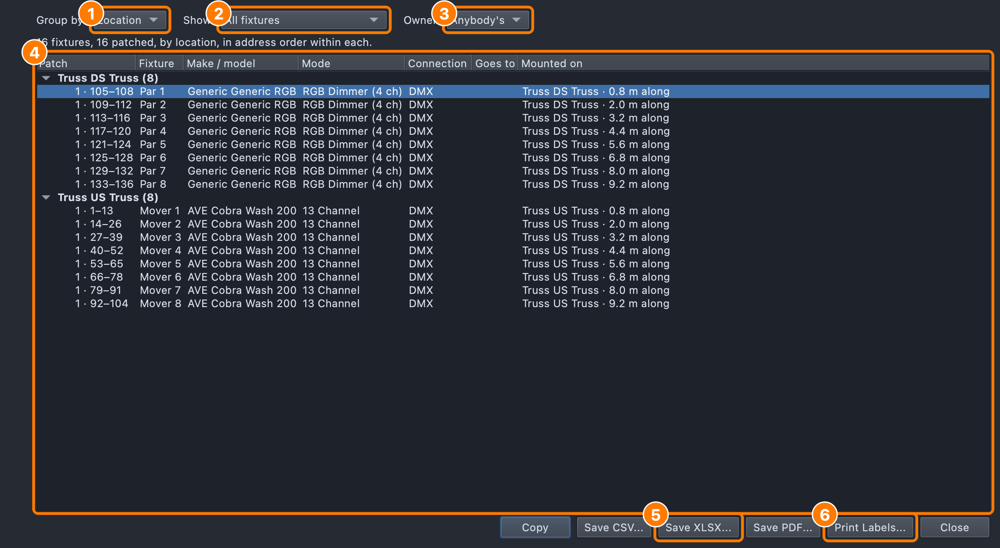
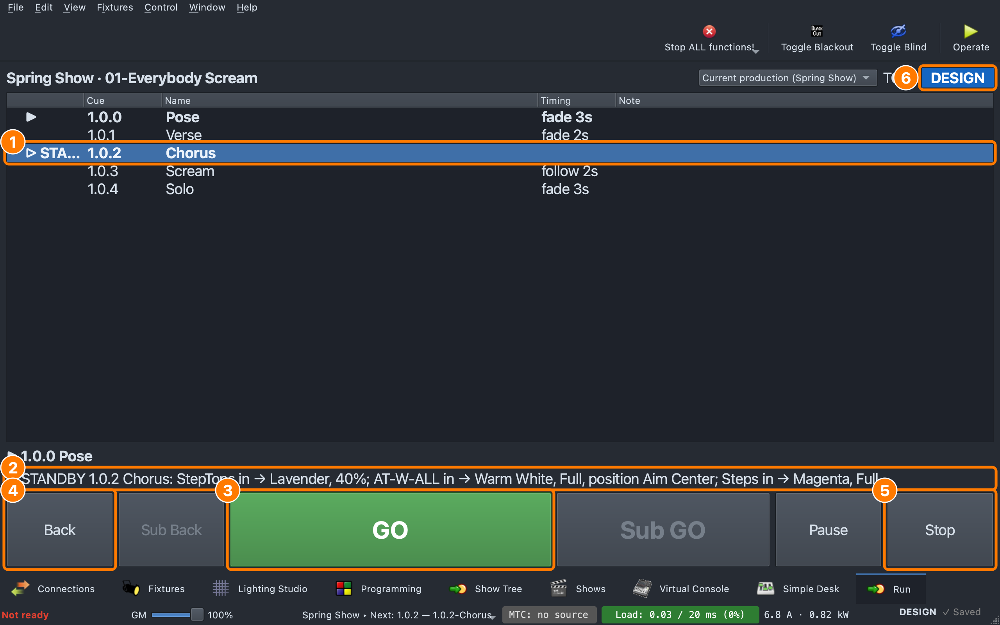
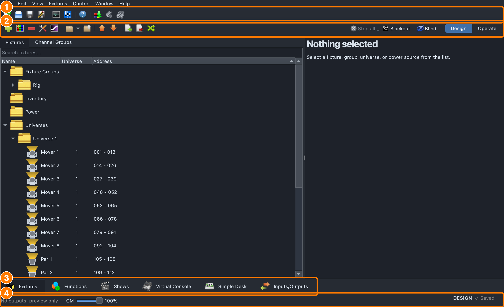
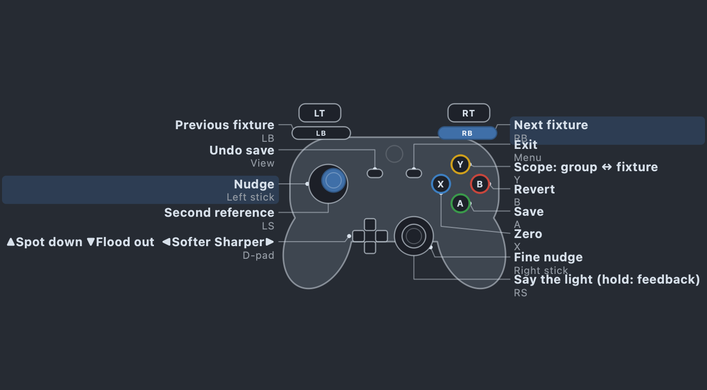

<p align="center">
  
</p>

<h1 align="center">qlcconsole</h1>
<p align="center"><em>Design the rig, write the show as cues, focus it in every room, and run it live.</em></p>

<p align="center">
  <a href="https://github.com/sandinak/qlcconsole/releases/latest">
    </a>
  <a href="https://github.com/sandinak/qlcconsole/commits/main/">
    </a>
  <a href="https://github.com/sandinak/qlcconsole/blob/main/COPYING">
    </a>
</p>

<p align="center">
  
</p>

**qlcconsole** is a lighting console for macOS (with Windows and Linux
builds), a fork of [QLC+](https://www.qlcplus.org/) 4.14.2 (Q Light
Controller Plus). It keeps everything QLC+ does and adds a console-style
way to work: the rig built in 3D before anything is patched, the show
written as cue lists with tracking, the focus done from the stage with a
game controller, and a show that moves from room to room with its
corrections, house rig and outputs kept per venue.

It is built for:

- **Show choir and school theatre crews**: a show with a few dozen to a
  few hundred fixtures, programmed by students and run by a board op
  calling GO.
- **Teachers**: a [course](docs/course/README.md) that takes a crew from
  "what does lighting do?" to running a real show, on a virtual copy of a
  show choir stage that is never connected to real lights.
- **Touring shows**: one show file, many rooms; the tour package travels,
  each venue keeps its own house rig, patch and focus.

qlcconsole is a personal fork and **is not affiliated with the QLC+
project**. If you want a general-purpose, cross-platform controller with a
large community and forum, use [QLC+](https://www.qlcplus.org/) itself.
QLC+ shows (.qxw) open in qlcconsole, and the **Classic QLC+** view keeps
QLC+'s own tabs.

**Contents:** [Major features](#major-features) ·
[Download](#download-and-install) · [Getting started](#getting-started) ·
[For teachers](#for-teachers) · [Documentation](#documentation) ·
[For developers](#for-developers) · [Support](#support) ·
[Licence and credits](#thank-you)

## Major features

Every picture here is taken from the app itself, offscreen, by its own
tests. Each feature links to its page in the user guide, which is also
built into the app: **F1** opens the page for whatever you are looking at.

### The Show Tree: the show as cues



The whole show is one tree: **production → cue list → cue → layer**. A
layer is a group and the looks it plays (colour, intensity, position,
gobo, beam), each a palette. Cue lists **track** as on an Eos or MA: a
cue carries on whatever it doesn't change, and grey rows say where a
value came from. The tree's **S T R M F** columns count what each cue
sets, tracks in and releases, and show its mode (Block, Cue-only) and
flags (base, skip, no move in black, venue focus). **Hits** are busking
states fired from Virtual Console buttons; a show can hold several
**productions**, and sub-cues step with Sub GO. A command line types it
all too (`Towers colour Blue dimmer 45`).
→ [Show Tree](docs/features/show-tree.md)

### Build and the Workbench



**Build** makes what the tree schedules: palettes, effects, scenes and
collections. The **Workbench** shows a scene, collection or chaser as
layers you drop palettes, groups and fixtures onto, with **+ Scene** and
**+ Effect ▾**, an inline look editor, an effect browser, scene
transitions (a look arriving fixture by fixture) and WLED effects, all
previewed live on the rig. The Show Tree borrows the same Workbench to
edit a cue.
→ [Build](docs/features/build.md) · [Effects](docs/features/effects.md)

### The Lighting Studio and the Rig Overview



The **Lighting Studio** is the plot: trusses, towers, risers, steps,
hangers, scenery and fixtures mounted on them, in Top, Front, Side or a
free 3D angle, with plot symbols, locks per object and per layer, and
**Plot layers** that follow the rig. The **Stage** layer holds the stage
marks (centre line, **curtain line**, **number line**) and the **apron**,
so every target reads in crew terms: *SL 2.4 · US 3.1 m*. **Stage
targets** (a mark, a riser, a soloist) let moving heads aim at places
instead of pan and tilt values. The **Rig Overview** (⇧⌘R, the picture at
the top) is the show seen from the house: beams that land where they're
aimed, haze, gobos, LED bars glowing in their live colour.
→ [Lighting Studio](docs/features/lighting-studio.md) ·
[Stage targets](docs/features/stage-targets.md)

### Focus from the stage



Every focus tool is on one **Focus ▾** menu, driven from an Xbox or
PlayStation controller (or the keyboard) by someone standing on stage:

- **Quick focus**: the rig, a head at a time, into the show's own
  calibration.
- **Venue focus**: the show's **focus calls** ("Movers → Centre") in
  order, each correction saved **for this venue**, never into the show.
- **Focus this cue** (in Build, **Focus this look**): change a cue's own
  position, zoom, focus, colour or gobo from the stage, kept as one Show
  Tree step.

One controller layout serves all three. The laptop says each light aloud
(**Voice**: Terse, Standard or Verbose) and the pad's light bar and rumble
confirm a save. A **scramble** practice knocks the movers off their marks
for a crew to focus back against the clock, and the **focus report**
(HTML, PDF or CSV) is the paperwork.
→ [Venue focus](docs/features/focus-calls.md) ·
[Quick focus](docs/features/lighting-studio.md#quick-focus) ·
[Focus this cue](docs/features/refine.md)

### Venues: house rig and tour package



The **venue chip** in the footer (*Venue: Lincoln HS*) says which room the
show is set up for; it and **View ▸ Venue…** open one venue menu: switch,
new, rename, rig and universes, venue focus, the focus report. Fixtures
belong to the **Tour**, the **House** or a **Rental**; each venue keeps its
house rig, its outputs for every universe, the channels that are not
ours, its truss trims and its target positions, in a file beside the
show. A **clash check** runs before a venue is applied and turns the chip
amber with a count when the room and the show disagree.
→ [House rig and tour package](docs/features/venues.md)

### Connections, devices and show control



**Connections** replaces QLC+'s I/O manager with one device tree: this
computer, its protocols and interfaces (Art-Net, sACN, WLED, USB DMX),
each node and port, and the universes on them, with live DMX beside it.
Every patch is edited in **one connection window**, from Connections or
from the Fixture Manager, and has undo. Patches follow the network when a
show opens on another machine. **Show control** sits in the same tree:
OSC and MIDI Show Control in (QLab firing cues by number) and MIDI
timecode.
→ [Connections and patch](docs/features/other-improvements.md#connections--patch) ·
[Show control](docs/features/show-control.md)

### The patch list and labels



Fixtures can be stocked as an **inventory** and placed on the plot before
they have addresses; the **Patch dialog** then addresses a selection in
one go, to the nearest node with room. The **patch list** groups the rig
by location, universe or type, filters by kind and owner, and exports to
CSV, Excel and PDF; **Print Labels** makes tape labels ("Spot 3 D101") for
a Brother label printer or a sheet.
→ [Fixture Manager](docs/features/fixture-manager.md) ·
[The patch list](docs/features/fixture-manager.md#the-patch-list)

### Run and the Cue Runner



The **Run** tab is the board op's view: the cue list with what is
running and on standby, a description of what GO will do, and big GO,
Back, Sub GO, Pause and Stop targets, with GO on the keyboard. The
**Cue Runner** is the same runner as a Virtual Console widget. **Design**
and **Operate** keep a running show from being edited by accident, and
the readiness footer says *Ready* only when nothing is unpatched,
clashing or unrouted.
→ [The cue runner](docs/features/show-tree.md#the-cue-runner)

### Three views: Classic QLC+, qlcconsole, Everything



**View ▸ Workspace** picks the tabs: **qlcconsole** (Connections,
Fixtures, Lighting Studio, Build, Show Tree, Virtual Console, Simple Desk,
Run), **Classic QLC+** (QLC+'s tabs, names, order and toolbars, for
someone coming from QLC+), or **Everything**. A view only shows and hides
tabs; the show is the same. An old QLC+ show opens in Classic QLC+, and
**File ▸ Upgrade This Show…** gives it a Show Tree.
→ [Getting started: views](docs/features/getting-started.md#views)

### Controllers and the follow spot



Xbox, DualShock 4 and DualSense pads (Bluetooth or USB) drive the focus
tools and a joystick **Followspot** effect that can fade a head out near
its limits or when scenery blocks it. A pad that falls asleep or wakes
up is picked up again by name, never silently lost; with two pads, the
first to press Start owns the tools. MIDI devices are followed the same
way, and the **Control Map** binds a MIDI trigger straight to a
function.
→ [Controllers coming and going](docs/features/other-improvements.md#controllers-and-midi-devices-coming-and-going) ·
[Effects: Followspot](docs/features/effects.md)

### And more

The readiness footer and its fixes, Blind / Park / Highlight, cloud
storage safety and the show cache, fixture definition updates, Eos show
import (with its special circuits and subs), power distribution, the
show timeline following timecode, and software updates that never
install during a show.
→ [What's new](docs/features/whats-new.md) ·
[Other improvements](docs/features/other-improvements.md) ·
[CHANGELOG](CHANGELOG.md)

## Download and install

Releases are on
[GitHub Releases](https://github.com/sandinak/qlcconsole/releases). Under a
release's **Assets**:

| Computer | File | Notes |
|---|---|---|
| Mac (Apple silicon or Intel, macOS 12+) | `qlcconsole-<version>-universal-<date>-<rev>.dmg` | Signed and notarized: open the DMG and drag the app to Applications |
| Windows (64-bit) | `qlcconsole-<version>-win64-setup.exe` | Not code-signed, so Windows warns before it installs |
| Linux (x86_64) | `qlcconsole-<version>-x86_64.AppImage` | Make it executable and run it |

Each release has a `SHA256SUMS` file to check the download against. The
app checks GitHub for updates and installs them at quit, never during a
show; schools can turn that off
([Software updates](docs/features/updates.md)). Students should follow the
course's [install page](docs/course/install.md), which says which release
the lessons use.

How big a show a computer can run (about 80 universes on a Raspberry Pi 5,
256 on a Linux i7, 768 on an Apple M4, at a load heavier than a real show)
is measured on the [Performance](docs/performance.md) page.

## Getting started

Open the app, then **File ▸ Open** a show, or start a new one. Start with
[Getting started](docs/features/getting-started.md): the tabs and views,
show files and autosave, importing a QLC+ or Eos show, and four ways a
show comes together (designing first, patch first, at a venue, a row of
like structures). The
[feature guide index](docs/features/README.md#the-rough-shape-of-a-show-end-to-end)
walks a show end to end, from inventory to GO.

To learn by doing, the course's [Lesson 1.1](docs/course/level-1/lesson-01/handout.md)
writes the first cues of a song on the teaching show, with the mouse.

## For teachers

[**Lighting a show choir with the Show Tree**](docs/course/README.md) is a
course for high-school show choir tech crews, released under CC BY 4.0:

- Level 0, *First look*, and Level 1, *Basics*: a song into cues (colour,
  intensity, direction, timing, GO), written and checked against the app.
- Level 2, *Intermediate* (tracking, palettes, effects, moving lights,
  busking), and Level 3, *Advanced* (patching, the rig, focus and venues,
  show control, running a real show), with four of Level 3's lessons
  written.

Each lesson has a teacher guide, a student handout, a slides outline, an
exit ticket and work for home, and starts from its own show file. There
is a [browser version](docs/course/web/index.html) of the Show Tree for
students without the app. Start with the [course plan](docs/course/COURSE_PLAN.md);
to help write it, see [For volunteers](docs/course/VOLUNTEER.md).

## Documentation

All of it is in [`docs/`](docs/README.md):

- [User guide](docs/features/README.md): every feature, the same pages as
  the in-app help.
- [Course](docs/course/README.md): lessons, handouts and teacher guides.
- [Performance](docs/performance.md): how much one computer can drive,
  measured, with the method and the data.
- [Design notes and reviews](docs/README.md#design-notes): why things work
  the way they do.
- [Developer docs](docs/README.md#for-developers): building, the test
  gate, the test map, releasing.

## For developers

qlcconsole is C++ and Qt 6 (6.8 or later) widgets, built with CMake. The
engine (`engine/src`: Doc, fixtures, functions, the Show Tree model, DMX)
has no UI; `ui/src` holds the tabs, editors and consoles.

```sh
cmake -S . -B build                      # once, or when sources are added
cmake --build build -j"$(sysctl -n hw.perflevel0.logicalcpu 2>/dev/null || nproc)"
build/main/qlcconsole -o your-show.qlcc  # always open a show with -o
```

- **The test gate.** `./check-all.sh` (`make check`) builds three legs
  (Qt 6 Debug, Release, and Debug with warnings as errors) together and
  runs their test programs concurrently, then the timing-sensitive ones
  alone; it ends with `gate=0` when everything passes. `make quick` builds
  one leg and tests only what a change touches, for iterating. `make pool`
  (`./check-all.sh --remote auto --rev SHA`) runs the whole gate of a
  commit on whichever Mac of the pool is idle. CI builds and tests macOS
  and Linux on every push.
- **The help and the course are tested.** `helpbrowser_test` checks every
  link, heading and picture in the user guide; `courseshow_test` does the
  course's lessons with the mouse and takes their pictures;
  `./help-shots.sh` retakes the guide's pictures from the real app,
  offscreen.
- **Where to read next:** [CLAUDE.md](CLAUDE.md) (architecture, build and
  conventions), [CONTRIBUTING.md](CONTRIBUTING.md) (coding style, PNGs
  without colour profiles), [docs/TEST_MAP.md](docs/TEST_MAP.md) (which
  test covers what), [RELEASE.md](RELEASE.md) (version numbers, signed
  macOS releases, Windows and Linux builds).

This is primarily a personal fork built around one show workflow, so the
bar for outside contributions differs from upstream's; see
[CONTRIBUTING.md](CONTRIBUTING.md). A change that is really about QLC+
itself belongs [upstream](https://github.com/mcallegari/qlcplus).

## Support

See [SUPPORT.md](SUPPORT.md). Fork-specific bugs and questions go to
[this repo's issues](https://github.com/sandinak/qlcconsole/issues); general
QLC+ questions are better served by the
[upstream QLC+ forum and docs](https://www.qlcplus.org/forum/).
When something isn't doing what you expect, try
[Troubleshooting](docs/features/troubleshooting.md) first.

## Thank you

qlcconsole is built entirely on top of the work of the QLC+ and Q Light
Controller communities. The following list recognizes the contributors whose
work this fork inherits and builds on.

<details>
<summary>QLC+ 5</summary>

*   Eric Arnebäck (3D preview features)
*   Santiago Benejam Torres (Catalan translation)
*   Luis García Tornel (Spanish translation)
*   Nils Van Zuijlen, Jérôme Lebleu (French translation)
*   Felix Edelmann, Florian Edelmann (fixture definitions, German translation)
*   Jannis Achstetter (German translation)
*   Dai Suetake (Japanese translation)
*   Hannes Bossuyt (Dutch translation)
*   Aleksandr Gusarov (Russian translation)
*   Vadim Syniuhin (Ukrainian translation)
*   Mateusz Kędzierski + smaks6 (Polish translation)

</details>

<details>
<summary>QLC+ 4</summary>

*   Jano Svitok (bugfix, new features and improvements)
*   David Garyga (bugfix, new features and improvements)
*   Lukas Jähn (bugfix, new features)
*   Robert Box (fixtures review)
*   Thomas Achtner (ENTTEC wing improvements)
*   Joep Admiraal (MIDI SysEx init messages, Dutch translation)
*   Florian Euchner (FX5 USB DMX support)
*   Stefan Riemens (new features)
*   Bartosz Grabias (new features)
*   Simon Newton, Peter Newman (OLA plugin)
*   Janosch Frank (webaccess improvements)
*   Karri Kaksonen (DMX USB Eurolite USB DMX512 Pro support)
*   Stefan Krupop (HID DMXControl Projects e.V. Nodle U1 support)
*   Nathan Durnan (RGB scripts, new features)
*   Giorgio Rebecchi (new features)
*   Florian Edelmann (code cleanup, German translation)
*   Heiko Fanieng, Jannis Achstetter (German translation)
*   NiKoyes, Jérôme Lebleu, Olivier Humbert, Nils Van Zuijlen (French translation)
*   Raymond Van Laake (Dutch translation)
*   Luis García Tornel (Spanish translation)
*   Jan Lachman (Czech translation)
*   Nuno Almeida, Carlos Eduardo Porto de Oliveira (Portuguese translation)
*   Santiago Benejam Torres (Catalan translation)
*   Koichiro Saito, Dai Suetake (Japanese translation)

</details>

<details>
<summary>Q Light Controller</summary>

*   Stefan Krumm (Bugfixes, new features)
*   Christian Suehs (Bugfixes, new features)
*   Christopher Staite (Bugfixes)
*   Klaus Weidenbach (Bugfixes, German translation)
*   Lutz Hillebrand (uDMX plugin)
*   Matthew Jaggard (Velleman plugin)
*   Ptit Vachon (French translation)

</details>

---

<p align="center">
<a href="https://github.com/mcallegari/qlcplus/graphs/contributors">
  
</a>
</p>

---

## License

<a href="https://github.com/sandinak/qlcconsole/blob/main/COPYING">
  
</a>

Licensed under the **Apache 2.0** License. See [COPYING](COPYING) for the
full text.

QLC+ and Q Light Controller portions: Copyright © Heikki Junnila, Massimo
Callegari, and the [QLC+ contributors](https://github.com/mcallegari/qlcplus/blob/master/COPYING).
qlcconsole additions: Copyright © Branson Matheson.

---
<p align="center">
  
  
  
</p>
