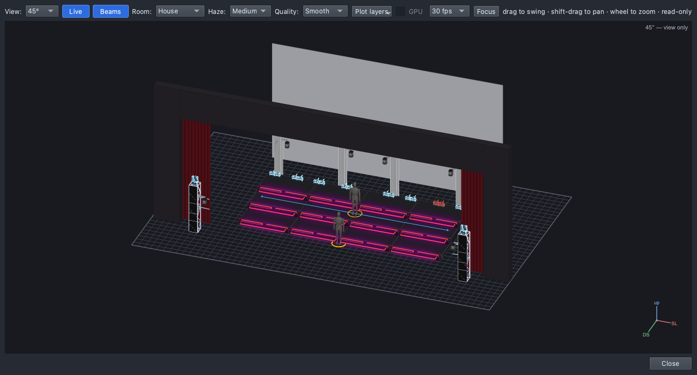
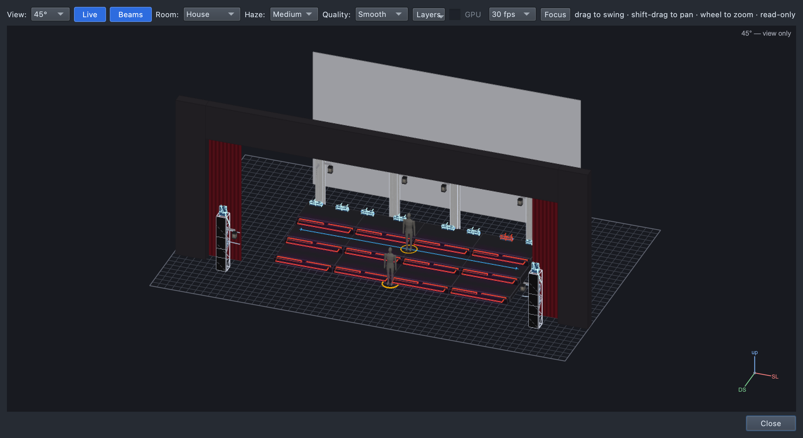
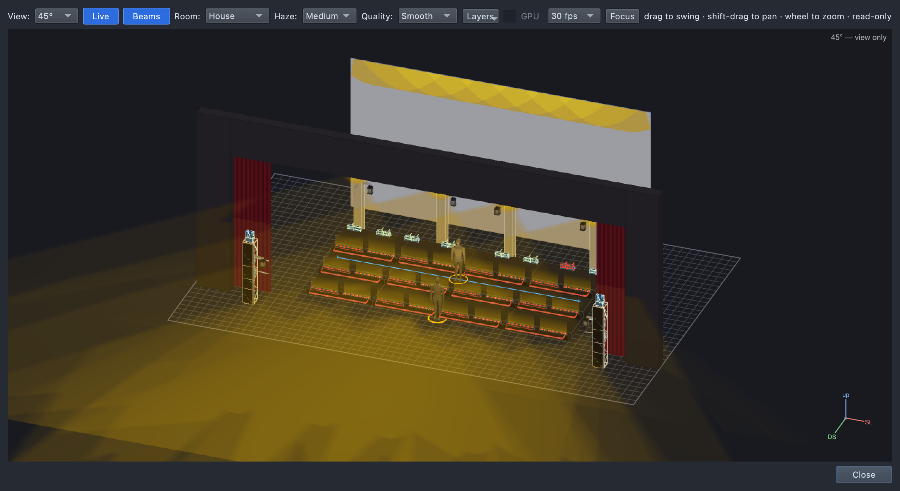
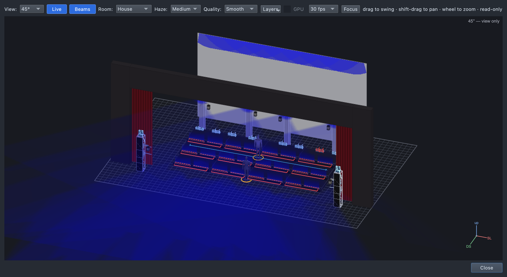
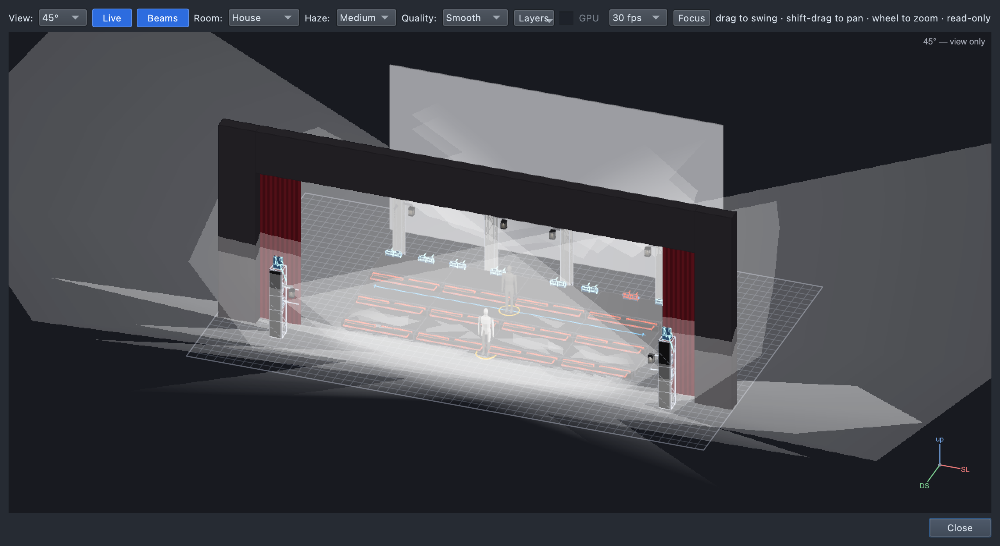
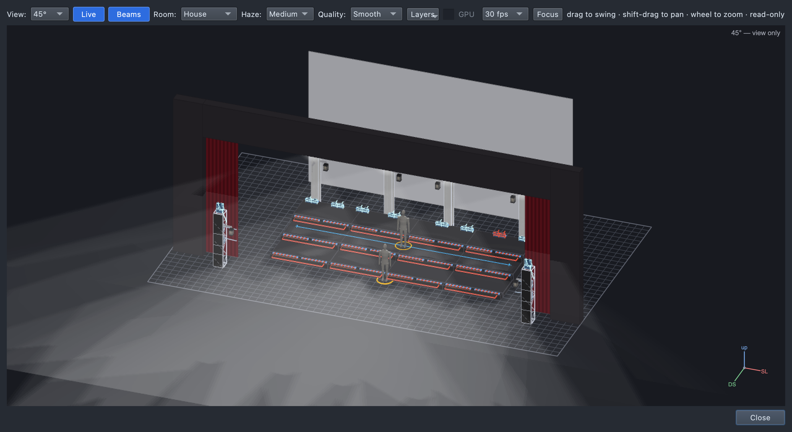
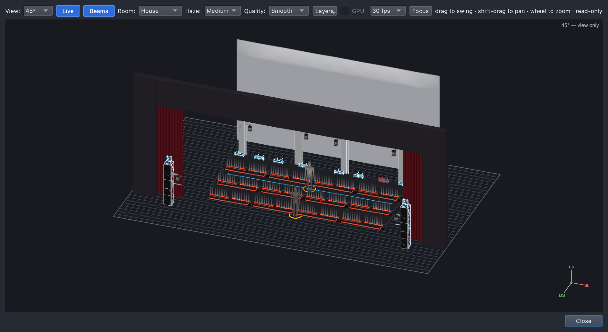

## The four qualities of light

Every change on stage changes at least one of these.

| Quality | |
|---|---|
| **Intensity**: bright and dim |   |
| **Colour**: warm and cool |   |
| **Direction**: front, back, below |    |
| **Movement** | Fades, chases and moving beams: watch for them. |

## The four jobs of light

1. **Visibility:** the audience sees the performers, especially faces.
2. **Focus:** the light tells the audience where to look.
3. **Mood:** the light sets how a moment feels.
4. **Energy:** the light follows the music.

## Steps

1. **Watch 1:** watch the number as the audience would. Write down one
   thing that stood out.
2. **Watch 2:** watch **only the lighting**. Each time it changes, log a
   row:

   | When (a lyric, "first chorus") | What changed (which quality?) | Why? (which job?) |
   |---|---|---|
   | | | |
   | | | |
   | | | |

   *Example:* "First chorus: brighter and pinker (intensity, colour),
   matching the jump in energy."

## Exit ticket

1. Name the **four qualities** of light.
2. Name **two jobs** light does in a show choir number.
3. Describe **one** lighting change from today's video. What changed, and
   why do you think the designer chose it?
4. A singer's face is in shadow. Light from which **direction** would
   fix it?

## At home

Do one (no app this week):

- **Watch:** a live performance with stage lighting (a concert, a talent
  show, a musical clip). Log **three** changes in the same three columns
  and bring the log, with what you watched.
- **Paper:** for each of the seven pictures above, name a song or moment
  it would suit, and why.
