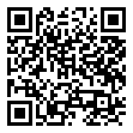

# Lesson 0.1 — What light does

**Teacher guide** · Level 0, lesson 1 · 50 minutes · no computers

**Give students:** <https://sandinak.github.io/qlcconsole/class/0-1/> (the show file, the steps, the exit ticket and the at-home task; nothing else)

## Objectives

Students can:

1. name the four **qualities** of light: intensity, colour, direction,
   movement;
2. name the four **jobs** of light in a show choir number: let the
   audience see (**visibility**), tell them where to look (**focus**),
   set the **mood**, match the **energy**;
3. describe a light change they saw, using those words ("the colour went
   from blue to warm, to make it feel friendlier").

## Before class

- [ ] Pick a **2-minute clip** of a show choir number with clear light
  changes (a competition video works well: an opener or a ballad with a
  big finish). Check it plays in the room, with sound.
- [ ] The projector, for the clip and the [slides](slides.md).
- [ ] Print the [handout](handout.md) (one each) and the
  [exit ticket](exit-ticket.md).
- [ ] Optional: print the seven pictures from
  [`images/lesson-0-1/`](../../images/lesson-0-1/) as cards, for the
  picture sort in part 4.

## Vocabulary (introduce in this order)

**intensity**, **colour** (warm / cool), **direction** (front, back, side,
below), **movement**, **cue**, **focus** (where the audience looks),
**mood**, **energy**. Each is in the handout's word table and the
[Glossary](../../GLOSSARY.md).

## Timing

| Min | Part | What happens |
|---|---|---|
| 0–5 | **Hook** | "Close your eyes. Imagine our show in the dark." |
| 5–15 | **Watch 1: the singers** | Play the clip; then *what did you notice?* |
| 15–25 | **The words** | The four qualities and four jobs, with the pictures |
| 25–35 | **Watch 2: only the light** | Play the clip again; students fill in the light log |
| 35–45 | **Share and sort** | Groups share one change each; the picture sort |
| 45–50 | **Exit ticket** | On paper |

## 1. Hook (5 min)

Ask: *"What would our show be like with only the house lights on? With no
light at all?"* Take two or three answers. Land it: **light is part of the
performance**, not just so people can see.

## 2. Watch 1: the singers (10 min)

Play the clip once with no instructions. Then ask: *"What did you
notice?"* Most answers will be about the singing and the dancing. That's
fine: write them on the board. Then ask: *"Did anyone notice the lights?
What did they do?"* Usually only a few did. **Key point:** good light is
often felt more than seen.

## 3. The words (10 min)

Use [slides](slides.md) 4–8 and the pictures from our virtual stage:

| Quality | The question it answers | Pictures |
|---|---|---|
| **Intensity** | How bright? | `intensity-full`, `intensity-low` |
| **Colour** | What colour? Warm (amber) or cool (blue)? Deep or pale? | `colour-warm`, `colour-cool` |
| **Direction** | Where does it come from? Front, back, side, below? | `direction-front`, `direction-back`, `direction-below` |
| **Movement** | Does it change while we watch? Fades, chases, moving beams. | (in the clip) |

Then the four jobs, with an example from the clip for each if you can:

- **Visibility:** the audience can see faces. *Every number needs faces lit.*
- **Focus:** the brightest place is where the eye goes (a
  soloist).
- **Mood:** what the song feels like (blue = night, calm; amber =
  warm, friendly; red = danger, energy).
- **Energy:** the light matches the music (dim and still in a verse, big
  and moving in the chorus).

## 4. Watch 2: only the light (10 min)

Play the clip again. Students watch **only the light** and fill in the
**light log** on the handout: each time the light changes, a line with
*when*, *what changed* (which quality) and *why* (which job). Pause the
clip once or twice if they are writing too fast.

## 5. Share and sort (10 min)

- Each group shares **one** change from their log: "At the chorus, the
  colour went from blue to pink and it got brighter, to show more energy."
- **Picture sort** (if you printed the cards): groups sort the seven
  pictures by quality, then pick the one they would use for a sad ballad
  and the one for a big opener, and say why.

## 6. Exit ticket (5 min)

[Exit ticket](exit-ticket.md) — answers below.

## Extension (fast groups)

On the back of the handout: describe the light for **one moment** of our
song, "Everybody Scream" (our design makes it dark and dramatic): what quality,
what job?

## At home

[At home](at-home.md): log three light changes in any performance (a
concert, a music video, a TV talent show), or sort the pictures on paper.

## Answer key

- **Exit ticket:** 1 — intensity, colour, direction, movement. 2 — visibility;
  focus; mood; energy (any two). 3 — any change described with a
  quality and a job, e.g. "it went dim and blue in the verse to make it
  calm". 4 — front light (it lights faces).
- **Picture sort:** intensity — `intensity-full`, `intensity-low`; colour —
  `colour-warm`, `colour-cool`; direction — `direction-front`,
  `direction-back`, `direction-below`.

## How this lesson was checked

There are no app steps in this lesson. Its pictures are of the teaching
show, taken by the course test (`ui/test/courseshow`, `lessonPictures`):
each is one group in one colour and level, on the virtual stage.
