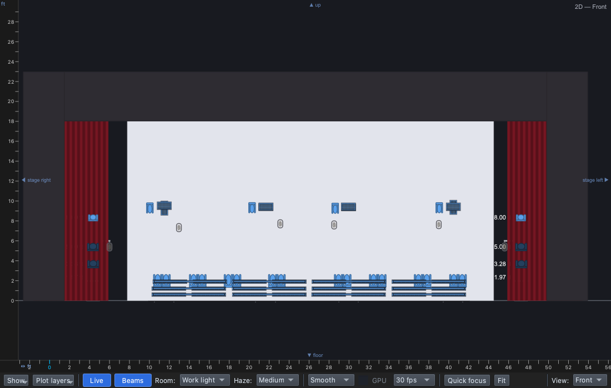

# Lesson 0.2 — The virtual stage

**Student handout**

## Today you will

- learn the stage directions;
- open qlcconsole and find every part of our stage;
- play a finished light show with **GO**.

## Words for today

| Word | Means |
|---|---|
| **Upstage / downstage (US / DS)** | Toward the back / the front of the stage. |
| **Stage right / stage left (SR / SL)** | The **singers'** right and left, as they face the audience. From the audience, stage right is on your **left**. |
| **Centre stage (CS)** | The middle. On our risers, the middle row. |
| **Risers** | The steps the choir stands on: three rows, **US**, **CS** and **DS**, of four units each. |
| **Cyc** | The big white cloth at the back (say "sike"). Light paints it. |
| **Truss** | A metal frame that holds lights. We have four tall ones across the back: two SR, two SL. |
| **Audience tower (AT)** | A tower of lights out in the audience, one each side: **AT1** on stage right, **AT2** on stage left. They light faces from the front. |
| **House** | Where the audience sits. |
| **Rig** | All the lights and what they hang on. |
| **Rig Overview** | qlcconsole's picture of our stage. It shows what the lights are doing. |
| **GO** | The button that plays the next cue. |

## Part 1 — Stage directions (everyone)

Stand up and face the board, as if you were the choir and the board were
the audience. Your teacher will call out directions. Then fill in:

- The back of the stage is ______________.
- The singers' right is ______________.
- If I sit in the audience, stage right is on my ______________.

## Part 2 — Find the stage (at the laptop)

Roles: **Driver** (mouse), **Navigator** (reads each step aloud and checks
*You should see*), **Designer** (watches the stage and answers the
questions). Switch roles after each part.

**On Windows or Linux:** where it says ⌘, press **Ctrl**.

### Open the show

1. Open qlcconsole. **File → Open** → `lesson-1-1-finish.qlcc` (in
   **Documents → qlcconsole**).
   - *You should see:* the qlcconsole window. The footer, bottom left,
     says **Not ready** in red. That's normal: this show isn't connected
     to real lights, so nothing you do can break anything.
2. **View → Rig Overview** (⇧⌘R).
   - *You should see:* a new window with our stage, seen from the house at
     an angle (**View: 45°**). The cyc at the back, risers in the middle,
     tall trusses behind them, and a tower on each side.

**(1)** **View**: which way you look at the stage. **(2)** **Live**: shows
what the lights are doing (keep it on, blue). **(3)** **Room**: how much
light is in the room.

### Find the parts

3. Set **Room** to **Work light**: the lights a stage crew uses to see.
   - *You should see:* the whole stage clearly, in grey.

4. **Drag** in the picture to swing round the stage, and use the **mouse
   wheel** (or two fingers on a trackpad) to zoom. Find each of these and
   tick it:

   - [ ] the **cyc** (the white wall at the back)
   - [ ] the **risers**: the **DS** row (front), **CS** (middle), **US**
     (back)
   - [ ] the four **trusses** behind the risers: two **SR**, two **SL**
   - [ ] **AT1** (the stage-right audience tower) and **AT2** (stage left)
   - [ ] the **proscenium**: the big frame, with red drapes at the sides
   - [ ] the **house**: where the audience sits
   - [ ] two people standing on stage: one on the CS row, one **downstage
     centre** in front of the risers. They're stand-ins for singers.

5. Set **View** to **Top**.
   - *You should see:* the stage from above, like a map. Stage right is on
     the **left**, downstage at the **bottom**. The towers are the two
     boxes at the bottom corners.

6. Set **View** to **Front**: the stage as the audience sees it, flat.
   Then back to **45°**.

### Play the show

7. Set **Room** back to **House**. Move the Rig Overview so you can see it
   and the main window together.
8. In the main window, click the **Run** tab at the bottom (⇧⌘0).
9. Press **GO** (or **Space**). Watch the stage. Press it again, and once
   more: three cues.
   - *You should see:* 1) the cyc turns **blue**; 2) the risers light up
     warm from the tops of the steps; 3) **magenta** lines along the front
     of every riser.

10. Press **Stop** to end it.

You'll build these three cues yourself in Lesson 1.1.

## Stuck?

| Problem | Try |
|---|---|
| The Rig Overview disappeared | It's behind the main window: **View → Rig Overview** brings it back. |
| Everything is dark | Set **Room** to **Work light**. Is **Live** blue? |
| The stage is upside down or tiny | Pick **View: 45°** again. |
| GO does nothing | Is the **Run** tab showing? Is `lesson-1-1-finish.qlcc` open? |

## Done early? (Extension)

1. Set **Room** to **Blackout** and play the three cues again. Now you see
   only the light. Which cue lights the singers from **below**?
2. Find the **lanterns** (round lights hanging from the trusses) and the
   eight **upstage beams** along the back riser.
3. Which part of the rig do you think lights the singers' faces? Why?
