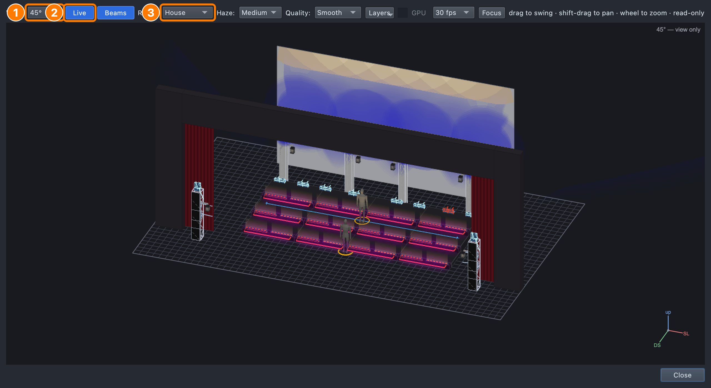
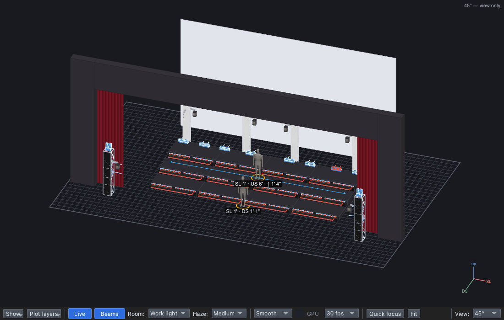
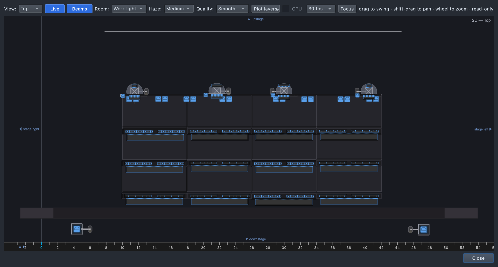
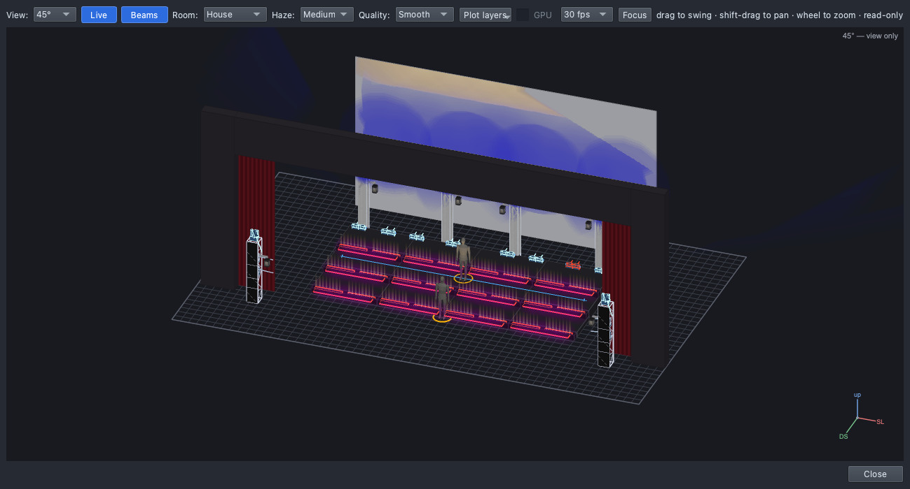
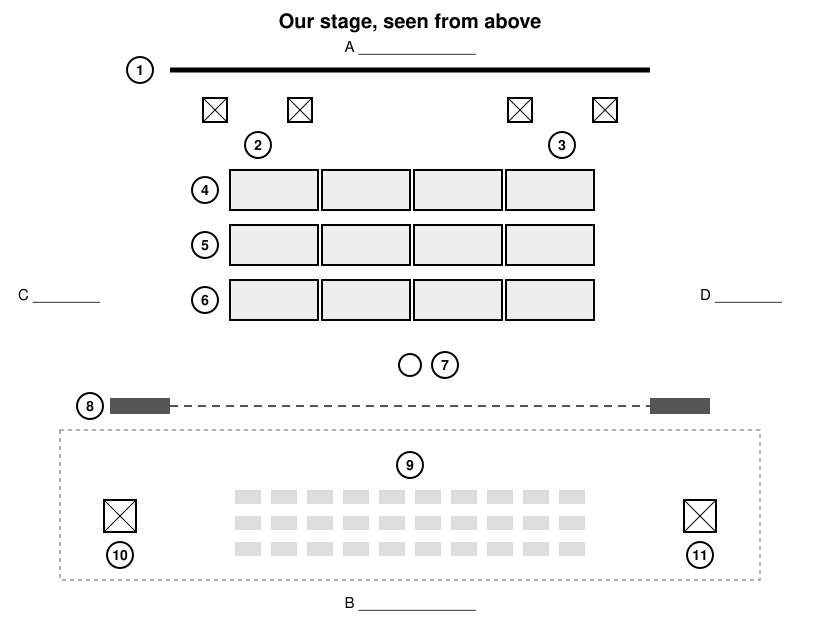

## Stage directions

Stand facing the board as if it were the audience, follow your teacher's
calls, then fill in:

- The back of the stage is ______.
- The performers' right is ______.
- From a seat in the house, stage right is on my ______.

Roles: Driver, Navigator, Designer. Switch after each part.

## Steps

1. **File → Open** → `lesson-1-1-finish.qlcc`. The footer reads *No
   outputs: preview only*: expected in class.
2. **View → Rig Overview** (⇧⌘R).

   

   **View** sets the angle, **Live** shows what the lights do (leave it
   blue), **Room** sets the room light, **Fit** brings the whole stage
   back.

3. Set **Room** to **Work light**.
4. Drag to orbit; scroll (or two fingers) to zoom. Find each:
   - the **cyc**;
   - the risers: **DS**, **CS** and **US** rows;
   - the four **trusses**, two SR and two SL;
   - **AT1** (stage right) and **AT2** (stage left);
   - the **proscenium**, the frame round the stage opening;
   - the **house**;
   - two stand-in singers: one on CS, one **downstage centre**.

   

5. Set **View** to **Top**: stage right on the left, downstage at the
   bottom.

   

6. Set **View** to **Front**, then back to **45°**.
7. Set **Room** back to **House**.
8. In the main window, click the **Run** tab (⇧⌘8).
9. Press **GO** (or Space) three times: a blue cyc, then warm risers, then
   magenta on the risers. Close the **Switch to Operate** line with **×**.

   

10. Press **Stop**.

**Stuck?** Rig Overview gone: **View → Rig Overview** (⇧⌘R). Everything
dark: **Room → Work light**, and **Live** blue. Stage tiny or upside
down: **Fit**.

## Exit ticket: label the stage

Name each numbered part and the four directions **A–D**.

1. Stage left is *whose* left?
2. A singer walks from the DS row to the US row. Upstage or downstage?
3. In qlcconsole, where can you see what the lights are doing?

## At home

Do one:

- **App:** make a folder **Documents → qlcconsole**, download
  `lesson-1-1-finish.qlcc` into it, and open the Rig Overview. With
  **Room: Work light**, screenshot the stage and label five parts. Play
  the three cues: which works best for you, and why?
- **Paper:** teach the stage directions to someone at home, then swap.
  Draw a plan of a stage you know and label US, DS, SL and SR, and where
  the lights were.
