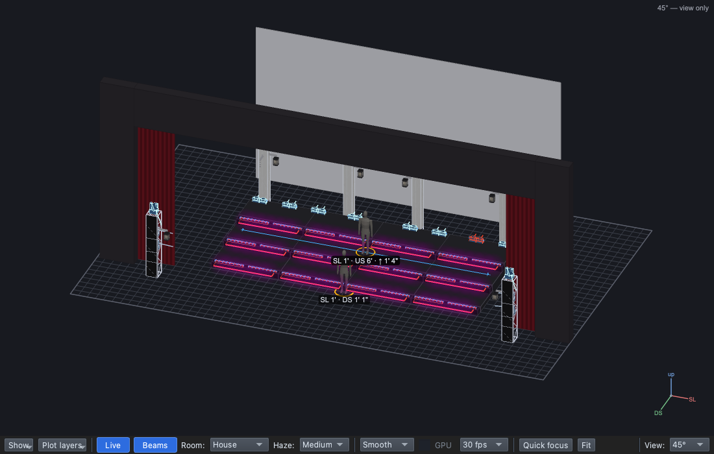
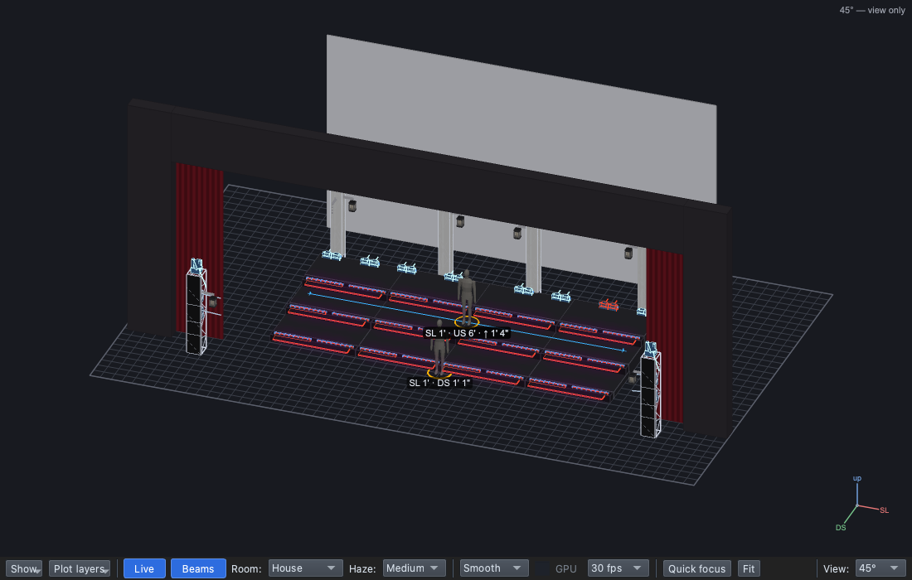
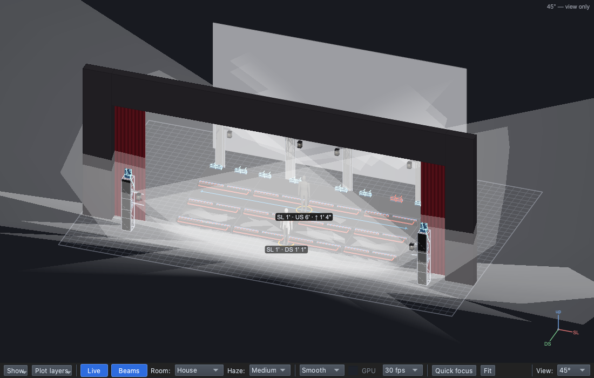
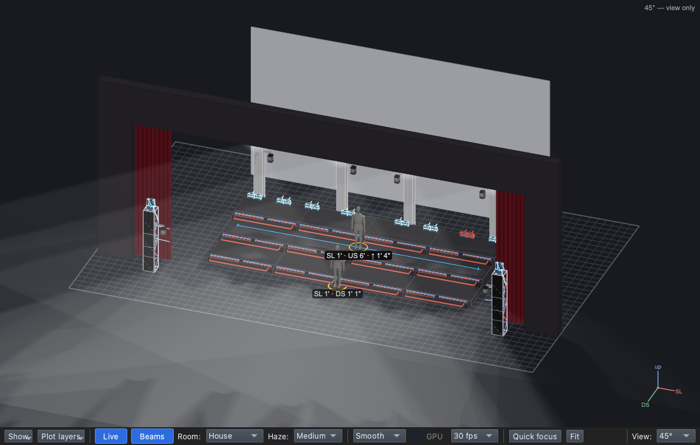
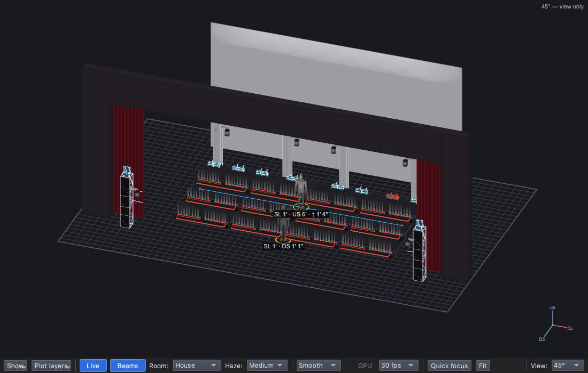

## Why

The jobs from Lesson 0.1 need controls. Every change you will program
changes one of four qualities. Name the quality and you can say exactly
what you want: "cooler and dimmer", not "different".

## The four qualities

| Quality | |
|---|---|
| **Intensity**: bright and dim |   |
| **Colour**: warm and cool |   |
| **Direction**: front, back, below |    |
| **Movement** | Fades, chases and moving beams: watch for them. |

## Steps

1. For each pair of pictures, say which quality changed and what it does
   to the moment.
2. Watch the clip again, **only for the lighting**. Each time it changes,
   log a row:

   | When | What changed (which quality?) | Why? (which job?) |
   |---|---|---|
   | | | |
   | | | |
   | | | |

   *Example:* "First chorus: brighter and pinker (intensity, colour), for
   the jump in energy (rhythm, mood)."

## Exit ticket

1. Name the **four qualities** of light.
2. A singer's face is in shadow. Light from which **direction** would
   fix it?
3. Describe **one** change from the clip: which quality changed, and
   which job did it do?

## At home

Do one:

- **Watch:** a live performance with stage lighting. Log **three**
  changes in the same three columns and bring the log, with what you
  watched.
- **Paper:** for each of the seven pictures above, name a song or moment
  it would suit, and why.
