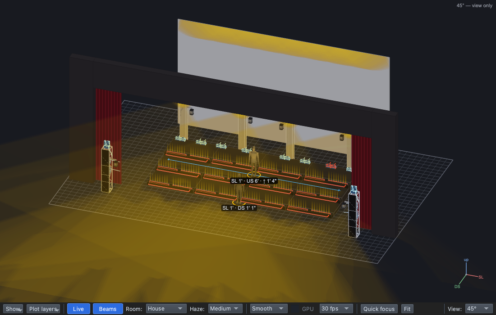
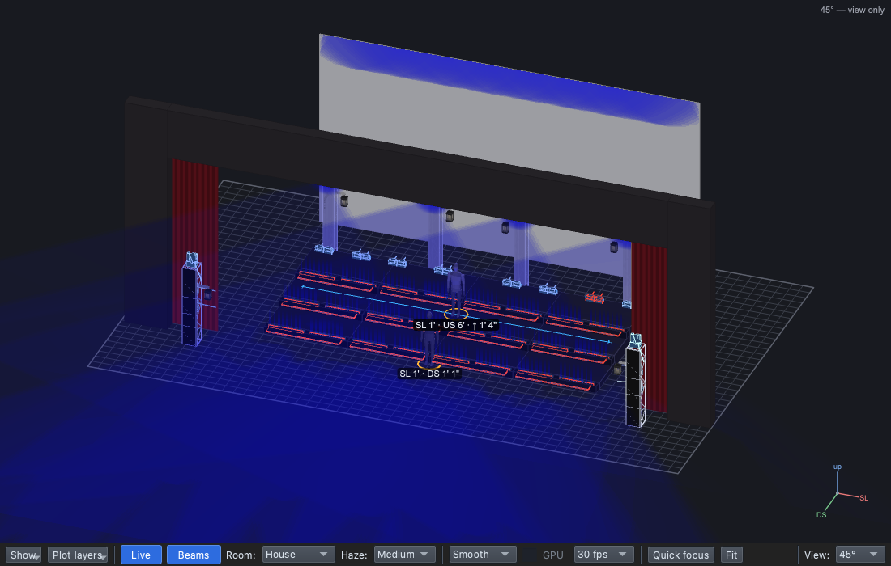

# Lesson 0.4 — What the audience reads

No computers. Where the eye goes on a stage, how a soloist is picked out
of a choir, what colour and direction say, and why a cue is a change the
audience feels. About 25 minutes; pairs with Lesson 0.3.

| For | File |
|---|---|
| Teacher | [Teacher guide](https://github.com/sandinak/qlcconsole/blob/main/docs/course/level-0/lesson-04/teacher-guide.md) · [Slides outline](https://github.com/sandinak/qlcconsole/blob/main/docs/course/level-0/lesson-04/slides.md) |
| Students | [Handout](handout.md) · [Exit ticket](exit-ticket.md) · [At home](at-home.md) |
| Show files | none (no computers) |

| Warm | Cool |
|---|---|
|  |  |
