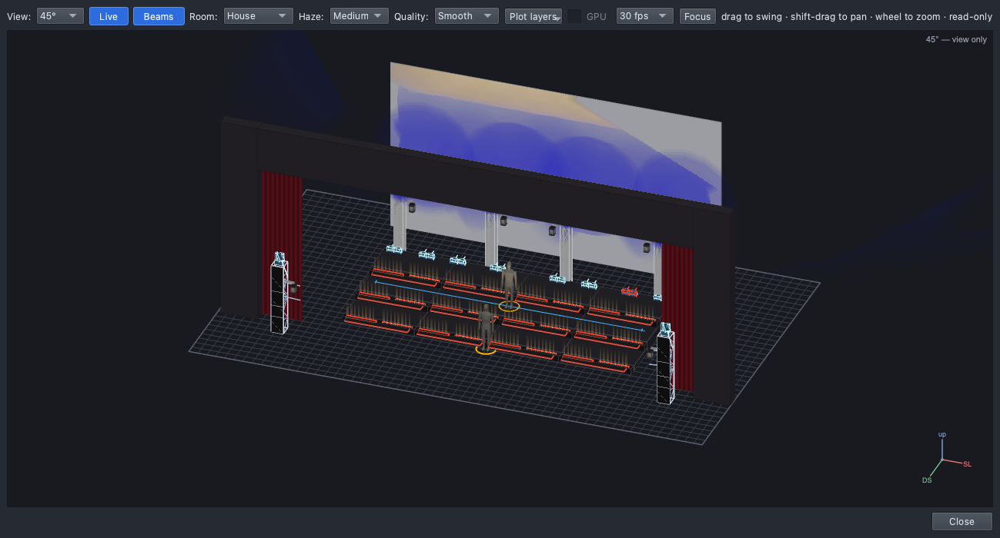

# Lesson 0.5 — Lighting a song

No computers; one song played twice. How a designer thinks before any
equipment: the song's sections, why each looks different, lighting the
staging and choreography, and a **song map** marking where the light
should change. About 25–30 minutes; pairs with Lesson 0.6, which adds to
the same map.

| For | File |
|---|---|
| Teacher | [Teacher guide](https://github.com/sandinak/qlcconsole/blob/main/docs/course/level-0/lesson-05/teacher-guide.md) · [Slides outline](https://github.com/sandinak/qlcconsole/blob/main/docs/course/level-0/lesson-05/slides.md) |
| Students | [Handout](handout.md) · [Exit ticket](exit-ticket.md) · [At home](at-home.md) |
| Show files | none (no computers) |

| Verse | Chorus |
|---|---|
|  |  |
