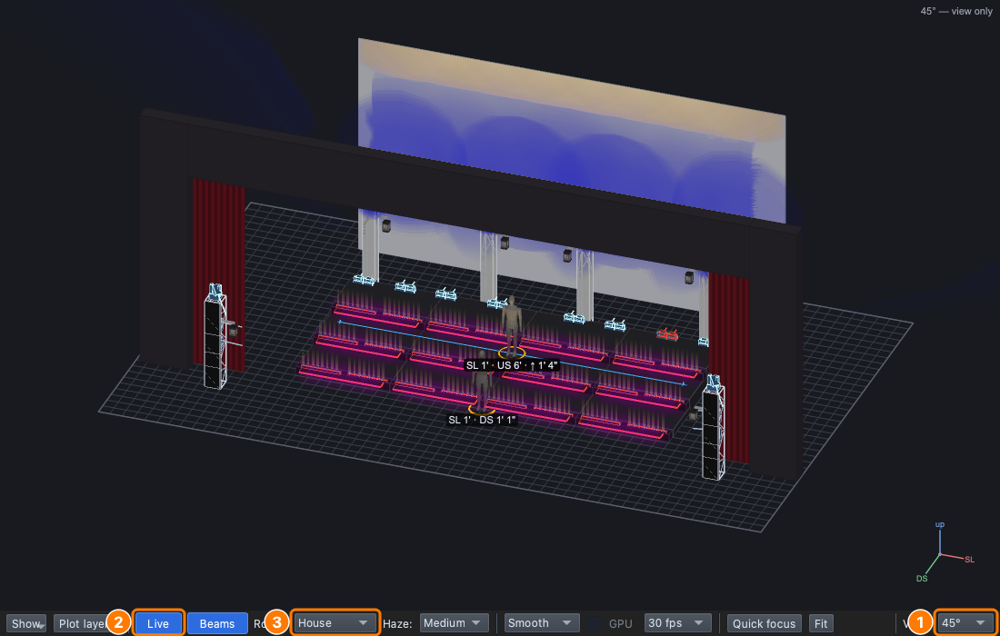
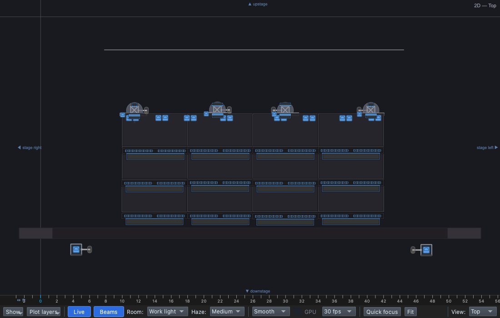
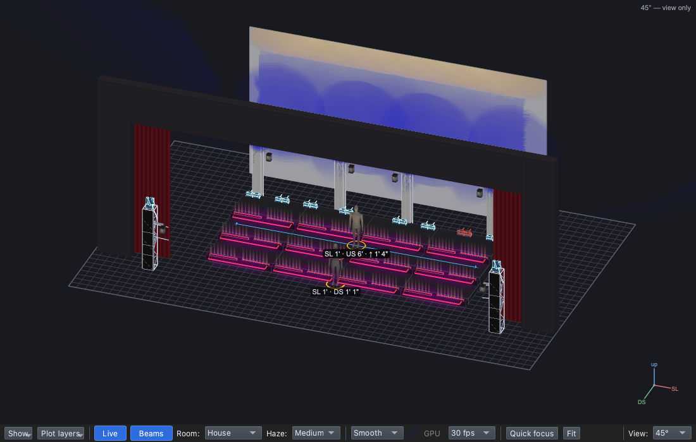

# Lesson 0.8 — The virtual stage

**Student handout**

## Why this matters

Lessons 0.1–0.7 were about what light should do. Now you need the place
it happens. A crew names every part of the stage the same way, so "the
DS row, from AT2" means one place to everyone, on the headsets and on
the cue sheet. Our stage is also in the app, so you can light it before
the real rig is up.

## Today you will

- learn the stage directions crews use;
- open qlcconsole and find every part of our stage and rig;
- play back a finished lighting sequence with **GO**.

## Words for today

| Word | Means |
|---|---|
| **Upstage / downstage (US / DS)** | Toward the back / the front of the stage. |
| **Stage right / stage left (SR / SL)** | The **performers'** right and left as they face the audience, so from the house, stage right is on your **left**. |
| **Centre stage (CS)** | The middle of the stage. On our risers, the middle row. |
| **Risers** | The platforms the choir stands on: three rows, **US**, **CS** and **DS**, of four units each. |
| **Cyc** (cyclorama, pronounced "sike") | The large white cloth across the back of the stage, lit to fill the background with colour. |
| **Truss** | A metal frame that lights are rigged on. We have four upright trusses across the back, two SR and two SL. |
| **Audience tower (AT)** | A tower of lights out in the house, one on each side: **AT1** stage right and **AT2** stage left. They give us front light on the performers. |
| **House** | Where the audience sits. |
| **Rig** | All the lighting fixtures and everything they hang on. |
| **Rig Overview** | qlcconsole's 3D view of our stage, showing what every light is doing. |
| **GO** | The button that plays the next cue. |

## Part 1 — Stage directions (everyone)

Stand and face the board as if you were the choir and the board were the
audience. Follow your teacher's calls, then fill in:

- The back of the stage is ______________.
- The performers' right is ______________.
- From a seat in the house, stage right is on my ______________.

## Part 2 — Find the stage (at the laptop)

Roles: **Driver** (mouse), **Navigator** (reads each step aloud and checks
*You should see*), **Designer** (watches the stage and answers the
questions). Switch roles after each part.

**On Windows or Linux:** where it says ⌘, press **Ctrl**.

### Open the show

1. Open qlcconsole, choose **File → Open** and open
   `lesson-1-1-finish.qlcc` (in **Documents → qlcconsole**).
   - *You should see:* the qlcconsole window, with **No outputs: preview
     only** in grey at the bottom left of the footer. That's expected: the
     course shows aren't connected to any real lights.
2. Choose **View → Rig Overview** (⇧⌘R).
   - *You should see:* a new window showing our stage from the house at
     an angle (**View: 45°**): the cyc at the back, the risers in the
     middle, tall trusses behind them and a tower on each side.

The controls are in the bar along the bottom of the Rig Overview.
**(1)** **View**, at the right-hand end, sets the angle you look from,
**(2)** **Live** shows what the lights are doing (leave it on, in blue),
and **(3)** **Room** sets how much light there is in the room. **Fit**
puts the whole stage back in view after you have zoomed or dragged it.

### Find the parts

3. Set **Room** to **Work light**, the plain lighting a crew works under.
   - *You should see:* the whole stage clearly, in grey.

4. **Drag** in the picture to orbit the stage, and use the **mouse wheel**
   (or two fingers on a trackpad) to zoom. Find and tick each of these:

   - [ ] the **cyc** at the back
   - [ ] the **risers**: the **DS** row (front), **CS** (middle) and
     **US** (back)
   - [ ] the four **trusses** behind the risers, two **SR** and two **SL**
   - [ ] **AT1** (the stage-right audience tower) and **AT2** (stage left)
   - [ ] the **proscenium**, the large frame around the stage opening,
     with red drapes at the sides
   - [ ] the **house**, where the audience sits
   - [ ] two figures on stage standing in for singers: one on the CS row,
     one **downstage centre** in front of the risers

5. Set **View** to **Top**.
   - *You should see:* a plan view, looking straight down, with stage
     right on the **left** and downstage at the **bottom**. The towers
     are the two boxes in the bottom corners.

6. Set **View** to **Front** to see the stage flat, as the audience does,
   then go back to **45°**.

### Play the show

7. Set **Room** back to **House**, and arrange the Rig Overview so you can
   see it beside the main window.
8. In the main window, click the **Run** tab at the bottom (⇧⌘8).
9. Press **GO** (or **Space**) and watch the stage. Press it twice more,
   for three cues in all.
   - *You should see:* first the cyc turns **blue**, then the risers are
     lit warm from the tops of the steps, then **magenta** lines run along
     the front of every riser.
   - The first GO also puts a line across the top of the window: *GO
     played in Design…* with **Switch to Operate**. Close it with **×**:
     we're only looking today.

10. Press **Stop** to end the sequence.

In Lesson 1.1 you'll program these three cues yourself.

## Stuck?

| Problem | Try |
|---|---|
| The Rig Overview disappeared | It was closed: **View → Rig Overview** (⇧⌘R) opens it again, in front of the main window. |
| Everything is dark | Set **Room** to **Work light**, and check that **Live** is blue. |
| The stage is upside down or tiny | Pick **View: 45°** again, or click **Fit**. |
| GO does nothing | Check that the **Run** tab is showing and `lesson-1-1-finish.qlcc` is open. |

## Done early? (Extension)

1. Set **Room** to **Blackout** and play the three cues again, so you
   see only the light. Which cue lights the singers from **below**?
2. Find the **lanterns** (the round lights hanging from the trusses) and
   the eight **upstage beams** along the back riser.
3. Which part of the rig do you think lights the singers' faces, and why?
