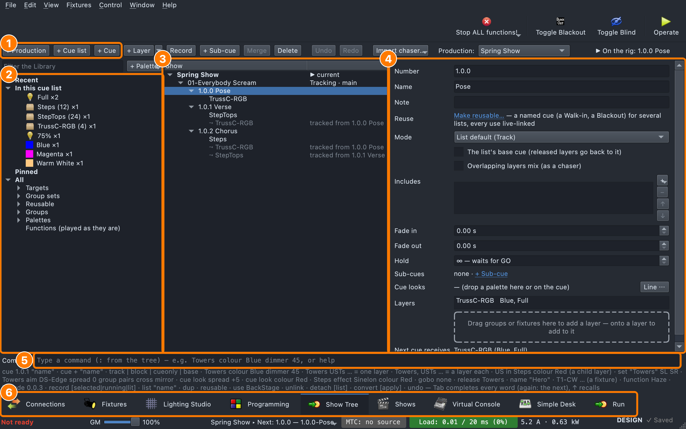
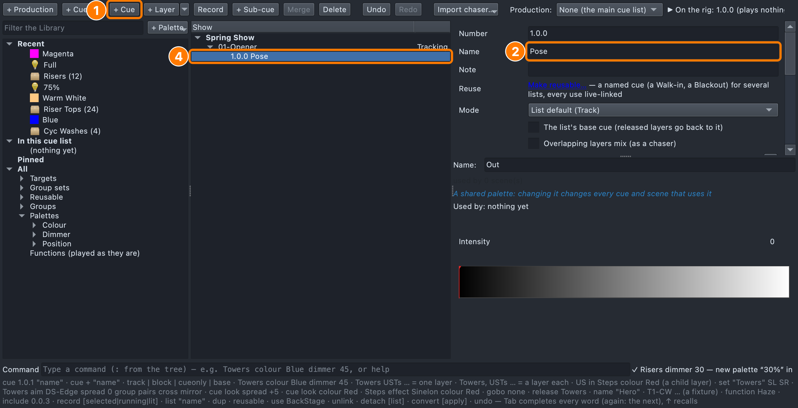
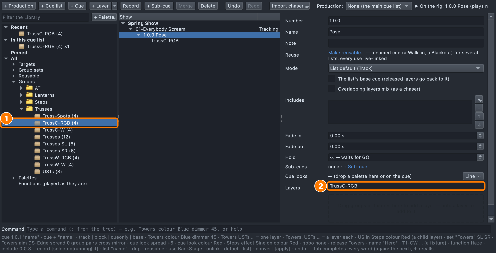
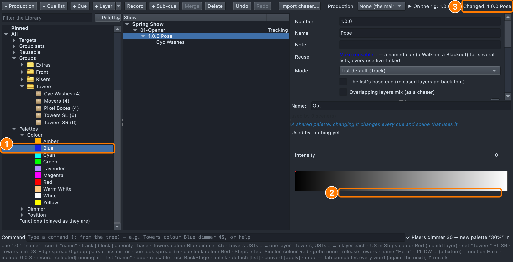
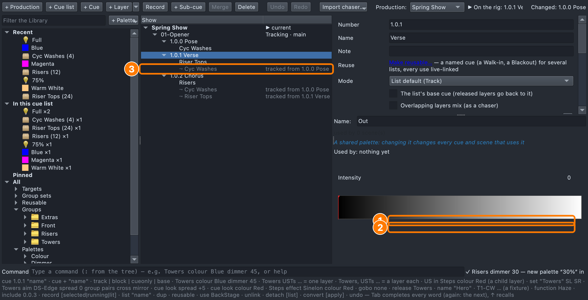
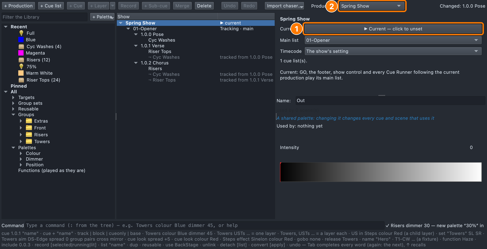
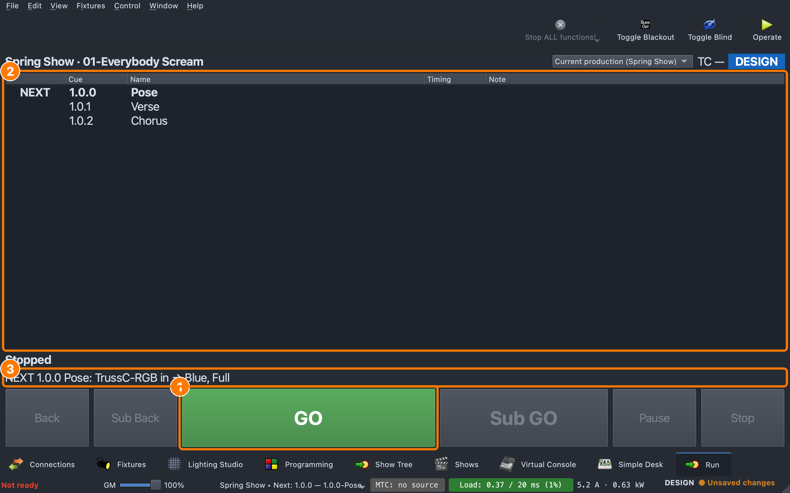
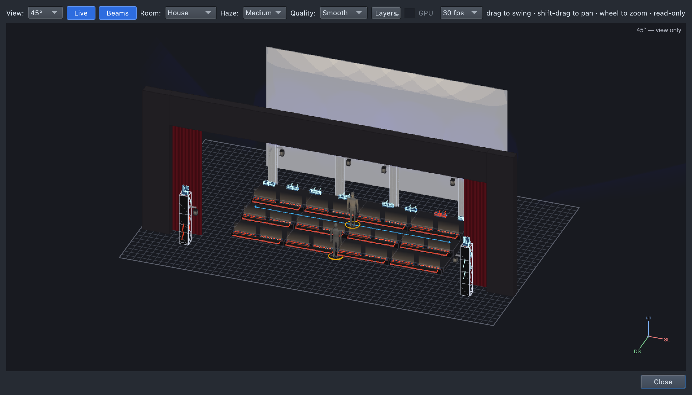
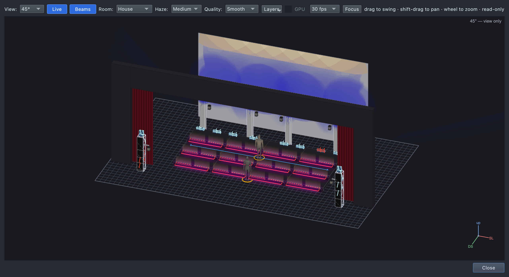

# Lesson 1.1 — From a song to cues: your first three looks

**Student handout**

## Today you will

- turn a song into a list of moments (**cues**);
- build three cues in the Show Tree, each with a group of lights in a
  colour at a level;
- play your cues with **GO**.

## Words for today

| Word | Means |
|---|---|
| **Cue** | A moment in the song where the light changes. Each cue has a number (1.0.0, 1.0.1…) and a name. |
| **Cue list** | All the cues for one song, in order. |
| **Production** | The whole show: all its cue lists. |
| **Group** | A set of lights we always use together, like *Risers* or *Cyc Washes*. |
| **Layer** | One group doing one thing in a cue: "the Cyc Washes, blue, full". |
| **Look** | What a layer does: its **colour** and its **intensity** (level). |
| **Palette** | A saved colour or level with a name, like *Blue* or *Half*. You drag it onto a layer. |
| **Intensity** | How bright. *Full* is all the way up; *Out* is off. |
| **Cyc** | The big white cloth at the back of the stage (say "sike"). Light paints it. |
| **Track / tracked** | A light stays on in the next cue until you change it. |
| **GO** | The button that plays the next cue. |

## Part 1 — Design it (on paper, everyone)

Our song: **"Opener"**. Before the music starts, the choir stands frozen
on the risers (the **pose**). The verse is quiet and close. The chorus is
loud and joyful.

Fill in the **Why** column — what should the audience feel?

| Cue | When | Why (feel) | Lights |
|---|---|---|---|
| 1.0.0 Pose | Before the first note | | Cyc Washes: Blue, Full |
| 1.0.1 Verse | First words | | Riser Tops: Warm White, 75% |
| 1.0.2 Chorus | First chorus | | Risers: Magenta, Full |

## Part 2 — Build it (at the laptop)

Roles: **Driver** (mouse), **Navigator** (reads each step aloud and checks
*You should see*), **Designer** (holds this sheet, watches the stage).
Switch roles after each cue.

**On Windows or Linux:** where it says ⌘, press **Ctrl**.

### Get ready

1. Open qlcconsole. **File → Open** → `lesson-01-start.qlcc`.
2. Click the **Show Tree** tab at the bottom (or press ⇧⌘6).
3. Open the stage: **View → Rig Overview** (⇧⌘R). Move it so you can see
   it and the Show Tree together.
   - *You should see:* a dark stage with three rows of risers, a white cyc
     at the back, towers on both sides.
   - The footer says **Not ready** in red. That's normal in class: this
     show isn't connected to real lights.



The tab has: **(1)** the buttons that make things, **(2)** the
**Library** — groups and palettes to drag, **(3)** the **tree** of your
show, **(4)** the **page** for what you clicked, **(5)** the command line
(for later), **(6)** the tabs.

### Make the song

4. Click **+ Production**. Type `Spring Show`, click **OK**.
   - *You should see:* **Spring Show** in the tree, selected.
5. Click **+ Cue list**. Type `01-Opener`, click **OK**.
   - *You should see:* **01-Opener** under Spring Show, marked *Tracking*.
   - The `01` means its cues start at **1.0.0**.

### Cue 1.0.0 — Pose

6. Click **+ Cue**. The **Name** box on the page is ready: type `Pose`
   and press **Return**.
   - *You should see:* **1.0.0 Pose** in the tree.



   **(1)** + Cue, **(2)** the Name box, **(3)** the big empty box under
   **Layers** — the drop area, **(4)** your cue in the tree.

7. In the Library, open **All → Groups → Towers**. Drag **Cyc Washes**
   onto the empty box under **Layers** (3).
   - While you drag, the top right says *"a new layer on Cyc Washes in
     1.0.0 Pose"*.
   - *You should see:* a row **Cyc Washes** under Layers.



8. Open **All → Palettes → Colour**. Drag **Blue** onto the **Cyc
   Washes** row. Then open **Dimmer** and drag **Full** onto the same row.
   - *You should see:* the row says **Cyc Washes   Blue, Full**, and in the
     Rig Overview the cyc glows a soft blue.



   **(1)** the palette in the Library, **(2)** the layer it lands on,
   **(3)** the top right says what changed.

   **Always give a layer a colour *and* a level.** These LED lights show
   a colour at full by themselves, but lights with a dimmer (like the
   Front Wash, in a later lesson) stay dark with only a colour — and a level
   you chose is part of your design.

### Cue 1.0.1 — Verse

9. Click **+ Cue**, type `Verse`, press **Return**.
   - *You should see:* **1.0.1 Verse**. On its page a grey row
     **⤳ Cyc Washes … tracked from 1.0.0 Pose** — the cyc *stays* blue.
     Lights stay on until you change them.
10. From **Groups → Risers**, drag **Riser Tops** onto the drop area. Drag
    **Warm White** and **75%** onto the **Riser Tops** row.
    - *You should see:* the risers lit warm from the step tops, the cyc
      still blue.



   **(1)** the cyc, carried on from Pose (grey), **(2)** your new layer,
   **(3)** the same grey row in the tree.

### Cue 1.0.2 — Chorus

11. Click **+ Cue**, type `Chorus`, press **Return**.
12. From **Groups → Risers**, drag **Risers** onto the drop area. Drag
    **Magenta** and **Full** onto the **Risers** row.
    - *You should see:* bright magenta lines on the front of every riser,
      warm risers, blue cyc.

### Play it

13. Click **Spring Show** in the tree. On its page click **Make current**.
    - *You should see:* the button now says **▶ Current — click to
      unset**. This tells GO which show to play.



14. Click the **Run** tab (⇧⌘0). Press **GO** (or **Space**) three times.
    - *You should see:* NEXT moves down the list; the stage goes Pose →
      Verse → Chorus.



   **(1)** GO, **(2)** your cues, **(3)** what the next GO will change.

15. **Save** with your name: **File → Save As** → `Lesson01-yourname.qlcc`.

## What it should look like

| Pose | Verse | Chorus |
|---|---|---|
|  |  |  |

## Stuck?

| Problem | Try |
|---|---|
| A dialog asked something you didn't expect | Cancel, then click the right row in the tree first (the production for + Cue list). |
| The group landed in the wrong cue | **Undo** (⌘Z) and click the right cue first. |
| GO does nothing | Step 13: make the production current. |
| Nothing lights in the Rig Overview | Is a **cue** selected in the tree (the stage shows the selected cue)? Is **Live** on in the Rig Overview? |
| You can't find a palette | Type its name in **Filter the Library** at the top left. |

## Done early? (Extension)

1. Change the chorus so the **cyc goes magenta too**: click **1.0.2
   Chorus**, click the grey **Cyc Washes** row, and on its Colour row use
   **⋯ → Set in this cue → Magenta**. Watch the tree: Cyc Washes is now
   the chorus's own layer.
2. **Type it.** Open `lesson-01-start.qlcc` again and build the same three
   cues by typing in the **Command** line at the bottom (click it, type a
   line, press Enter):

   ```
   production "Spring Show"
   list "01-Opener"
   cue + "Pose"
   "Cyc Washes" colour Blue dimmer Full
   cue + "Verse"
   "Riser Tops" colour "Warm White" dimmer 75
   cue + "Chorus"
   Risers colour Magenta dimmer Full
   production current
   ```

   Names with spaces go in quotes. `dimmer 75` finds the palette **75%**.
3. Add a fourth cue, **1.0.3 Button** — the big final hit. What would you
   light?
