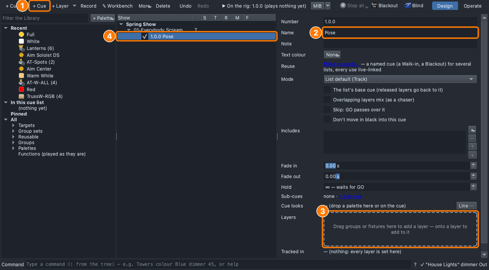
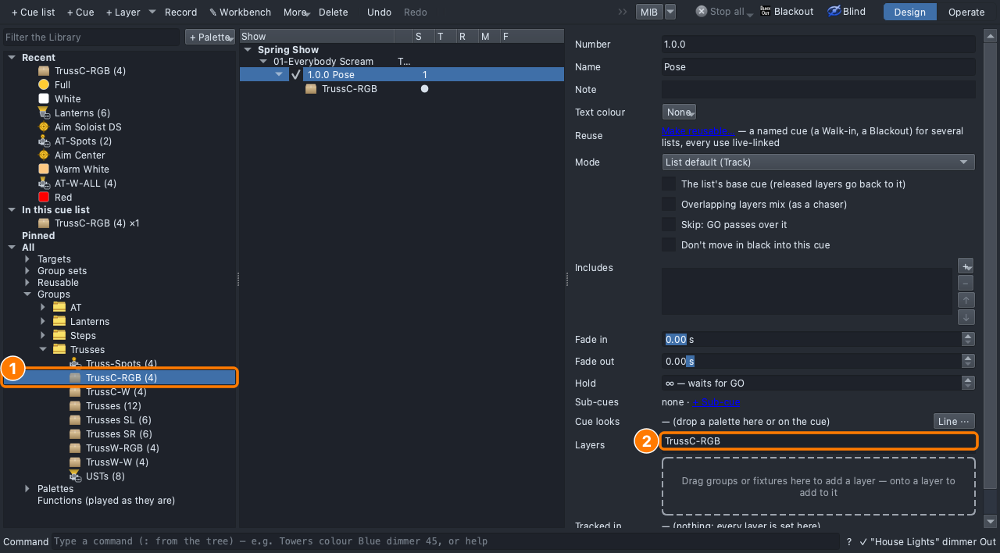
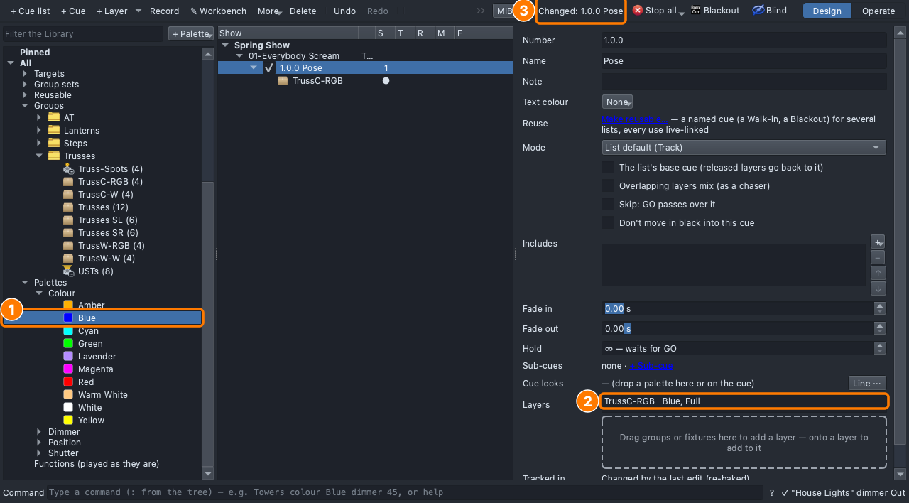
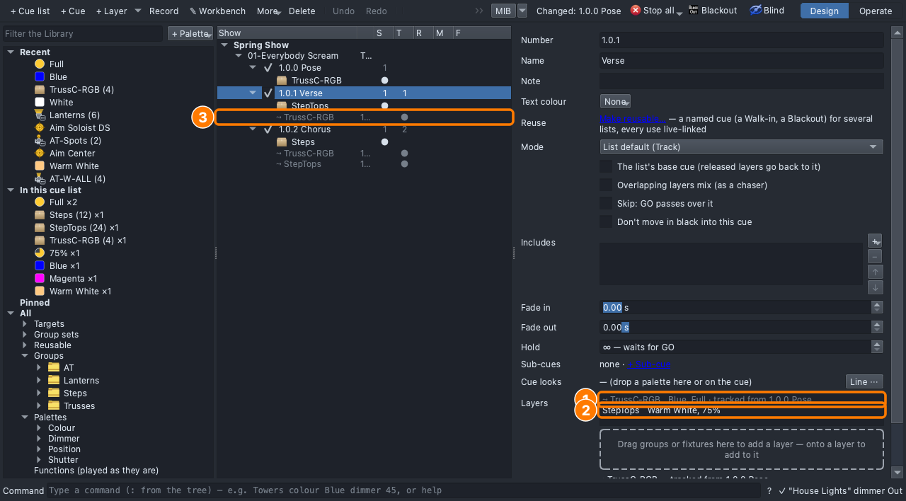
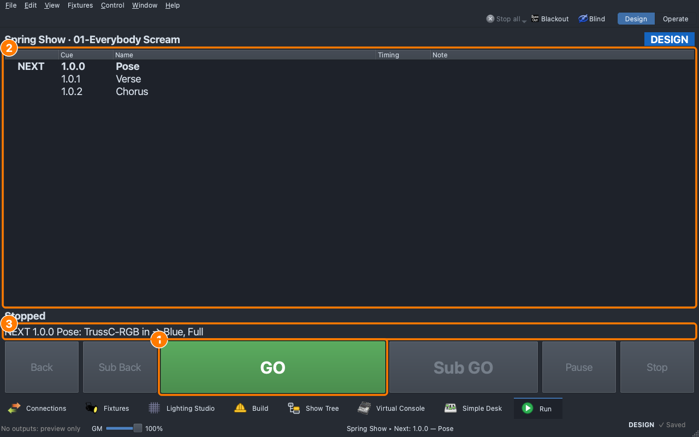
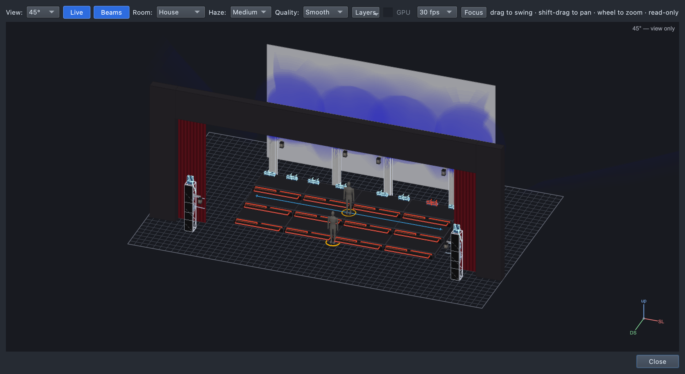

# Lesson 1.1 — From a song to cues: your first three looks

**Student handout**

## Today you will

- break a song down into the moments where the lighting changes (its
  **cues**);
- program three cues in the Show Tree, each one a group of lights at a
  colour and a level;
- play the cues back with **GO**.

## Words for today

| Word | Means |
|---|---|
| **Cue** | A planned lighting change, tied to a moment in the song. Each cue has a number (1.0.0, 1.0.1…) and a name. |
| **Cue list** | All of one song's cues, in order. |
| **Production** | The whole show: every cue list in it. |
| **Group** | A named set of lights that are always used together, like *Steps* or *TrussC-RGB*. |
| **Our group names** | **Trusses** are the four upright trusses across the back. **TrussC-RGB** is the colour (RGB) pixels of the truss boxes that light the **C**yc; **TrussW-RGB** is the ones that **W**ash out over the stage. **Steps** is the LED strips on the front of each riser step (rows **US**, **CS** and **DS**), and **StepTops** is the bars on top of the steps. |
| **Layer** | One group doing one thing in a cue, such as "TrussC-RGB, blue, at full". |
| **Look** | What a layer does: its **colour** and its **intensity** (level). |
| **Palette** | A saved, named colour or level, such as *Blue* or *Half*, that you drag onto a layer. |
| **Intensity** | How bright, from **Full** down to **Out**. |
| **Cyc** (cyclorama, pronounced "sike") | The white cloth across the back of the stage, lit to fill the background with colour. |
| **Tracking** | A light holds its state into the following cues until a cue changes it. A value carried on that way is **tracked**. |
| **GO** | The button that plays the next cue. |

## Part 1 — Design it (on paper, everyone)

Our song is **"Everybody Scream"**, and today we light its first three
moments: the **pose** before the first note, with the choir frozen on the
risers; the first **verse**; and the first **chorus**.

Fill in the **Why** column: what should the audience feel at each moment?

| Cue | When | Why (feel) | Lights |
|---|---|---|---|
| 1.0.0 Pose | Before the first note | | TrussC-RGB: Blue, Full |
| 1.0.1 Verse | First words | | StepTops: Warm White, 75% |
| 1.0.2 Chorus | First chorus | | Steps: Magenta, Full |

## Part 2 — Build it (at the laptop)

Roles: **Driver** (mouse), **Navigator** (reads each step aloud and checks
*You should see*), **Designer** (holds this sheet, watches the stage).
Switch roles after each cue.

**On Windows or Linux:** where it says ⌘, press **Ctrl**.

### Get ready

1. Open qlcconsole, choose **File → Open** and open
   `lesson-1-1-start.qlcc`.
2. Click the **Show Tree** tab at the bottom (or press ⇧⌘5).
3. Open the stage with **View → Rig Overview** (⇧⌘R), and arrange it so
   you can see it and the Show Tree together.
   - *You should see:* a dark stage with three rows of risers, a white cyc
     at the back and trusses across the back on both sides.
   - The footer says **No outputs: preview only**, in grey. That's
     expected in class, because the course show isn't connected to real
     lights.


The tab is laid out as **(1)** the buttons that create things, in the
bar along the top of the window, **(2)** the **Library** of groups and
palettes to drag from, **(3)** the **tree** of your show, **(4)** the
**page** for whatever you've selected, **(5)** the command line (for
later), and **(6)** the tabs.

### Make the song

4. Click **+ Production**, type `Spring Show` and click **OK**.
   - *You should see:* **Spring Show** in the tree, selected.
5. Click **+ Cue list**, type `01-Everybody Scream` and click **OK**.
   - *You should see:* **01-Everybody Scream** under Spring Show, marked
     *Tracking*. The `01` sets its cue numbers to start at **1.0.0**.

### Cue 1.0.0 — Pose

6. Click **+ Cue**. The **Name** box on the page is ready for typing, so
   type `Pose` and press **Return**.
   - *You should see:* **1.0.0 Pose** in the tree.



   **(1)** + Cue, **(2)** the Name box, **(3)** the drop area: the dashed
   box under **Layers** that reads *"Drag groups or fixtures here to add
   a layer"*, and **(4)** your cue in the tree.

7. In the Library, open **All → Groups → Trusses** and drag **TrussC-RGB**
   onto the dashed box under **Layers** (3).
   - While you drag, the note in the top bar, just left of **Stop all**,
     reads *"a new layer on TrussC-RGB in 1.0.0 Pose"*. It tells you
     where a drop will land, so read it before you let go.
   - *You should see:* a **TrussC-RGB** row under Layers.



8. Open **All → Palettes → Colour** and drag **Blue** onto the
   **TrussC-RGB** row. Then open **Dimmer** and drag **Full** onto the
   same row.
   - *You should see:* the row reads **TrussC-RGB   Blue, Full**, and in
     the Rig Overview the cyc turns a clear blue, brightest at the top
     because the cyc boxes aim upward.



   **(1)** the palette in the Library, **(2)** the layer it lands on, and
   **(3)** the note in the top bar saying what changed.

   **Always give a layer both a colour *and* a level.** These LED
   fixtures show a colour at full on their own, but fixtures with a
   dimmer channel (like the AT-W-ALL front washes in a later lesson) stay
   dark with a colour alone. The level is also part of your design, so
   choose it deliberately.

### Cue 1.0.1 — Verse

9. Click **+ Cue**, type `Verse` and press **Return**.
   - *You should see:* **1.0.1 Verse**, and on its page a grey row,
     **⤳ TrussC-RGB … tracked from 1.0.0 Pose**. The cyc stays blue
     because it tracks: lights hold their state until a cue changes them.
10. From **Groups → Steps**, drag **StepTops** onto the drop area, then
    drag **Warm White** and **75%** onto the **StepTops** row.
    - *You should see:* the risers lit warm from the step tops, with the
      cyc still blue.



   **(1)** the cyc, tracked from Pose (in grey), **(2)** your new layer,
   and **(3)** the same grey row in the tree. The tree keeps it short: the
   row shows only the cue it came from, **1.0.0**, and the cue's own row
   has **1** under **S** (Sets: set in this cue) and **1** under **T**
   (Tracks in). Hold the
   pointer over either one to see the colour and level it carries.

### Cue 1.0.2 — Chorus

11. Click **+ Cue**, type `Chorus` and press **Return**.
12. From **Groups → Steps**, drag **Steps** onto the drop area, then drag
    **Magenta** and **Full** onto the **Steps** row.
    - *You should see:* bright magenta lines across the front of every
      riser, warm riser tops and a blue cyc.

### Play it

Your production is the one GO plays. It's the only production in the
show, so there's nothing to choose.

13. Click the **Run** tab (⇧⌘8) and press **GO** (or **Space**) three
    times.
    - *You should see:* NEXT steps down the list as the stage goes from
      Pose to Verse to Chorus.



   **(1)** GO, **(2)** your cues, and **(3)** what the next GO will
   change.

14. **Save** under your own name with **File → Save As** →
    `Lesson01-yourname.qlcc`.

## What it should look like

| Pose | Verse | Chorus |
|---|---|---|
|  |  |  |

## Stuck?

| Problem | Try |
|---|---|
| A dialog asked something unexpected | Cancel it, select the right row in the tree first (the production, for + Cue list), and try again. |
| The group landed in the wrong cue | **Undo** (⌘Z), click the right cue, and drag again. |
| GO does nothing | Check that the cue list has cues, then click the **Run** tab again. |
| Nothing lights in the Rig Overview | The stage shows the selected cue, so make sure a **cue** is selected in the tree, and that **Live** is on in the Rig Overview. |
| You can't find a palette | Type its name in **Filter the Library** at the top left. |

## Done early? (Extension)

1. Make the **cyc go magenta in the chorus** as well. Click **1.0.2
   Chorus**, click the grey **TrussC-RGB** row, and on its Colour row use
   **⋯ → Set in this cue → Magenta**. In the tree, TrussC-RGB is now a
   layer of the chorus itself rather than a tracked one.
2. **Type it.** Open `lesson-1-1-start.qlcc` again and build the same
   three cues from the **Command** line at the bottom (click it, type a
   line, press Enter; the **?** button beside it shows what you can type):

   ```
   production "Spring Show"
   list "01-Everybody Scream"
   cue + "Pose"
   TrussC-RGB colour Blue dimmer Full
   cue + "Verse"
   StepTops colour "Warm White" dimmer 75
   cue + "Chorus"
   Steps colour Magenta dimmer Full
   ```

   Names with spaces go in quotes, and `dimmer 75` finds the palette
   **75%**.
3. Add a fourth cue, **1.0.3 Button**, for the final hit of the song (the
   **button**). What would you light, and how?
