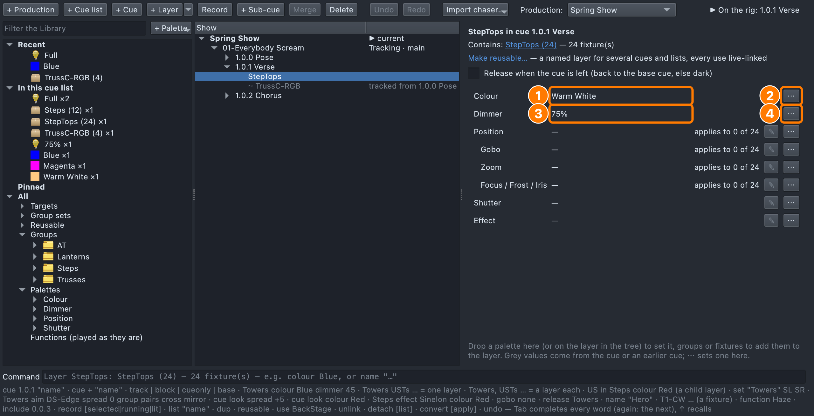
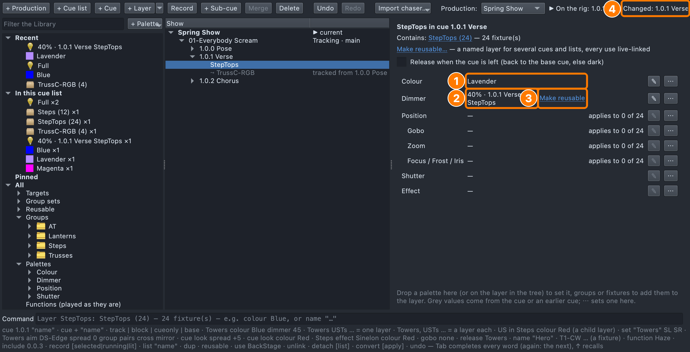
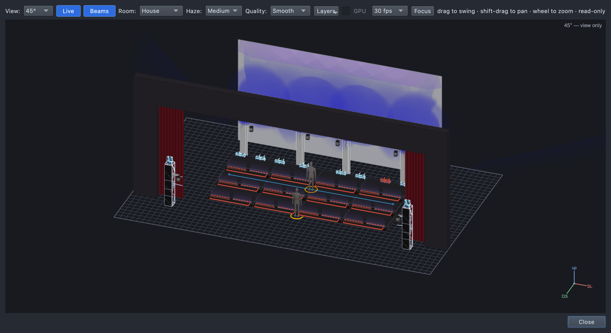
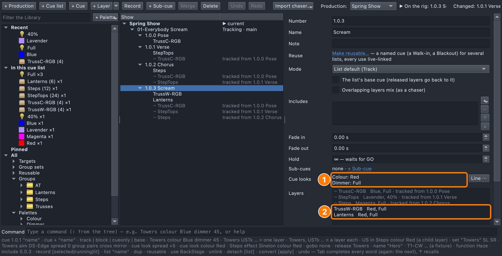
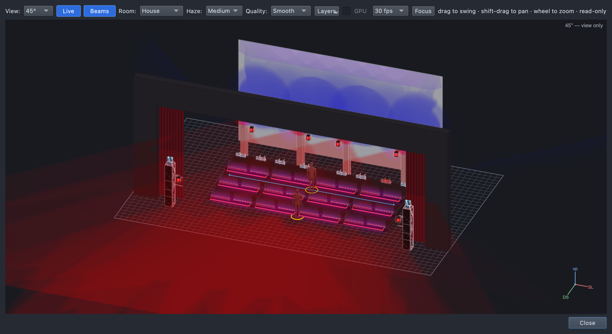

# Lesson 1.2 — Colour and intensity tell the mood

**Student handout**

## Today you will

- choose colours and levels to create a **mood**;
- change a look you've already programmed, without rebuilding it;
- give a whole cue one colour with a **cue look**.

## Words for today

| Word | Means |
|---|---|
| **Warm / cool** | Warm colours (amber, warm white, red) read as friendly, close or hot. Cool colours (blue, lavender, cyan) read as calm, cold, night-time or eerie. |
| **Saturated / pale** | A saturated colour is deep and strong (Red, Blue). A pale one has white mixed in and is softer (Lavender). |
| **Contrast** | How different two moments are. A dark verse makes the chorus that follows feel bigger. |
| **Mood** | The feeling of a moment. |
| **⋯ (the "more" button)** | The button at the end of each row on a layer's page, with the ways to change that row. |
| **One-off value** | A colour or level that isn't one of our palettes, stored on a single layer only. |
| **Make reusable** | Turns a one-off value into a palette, so you can use it anywhere in the show. |
| **Cue look** | A colour or level applied to the **whole cue**: it reaches every layer in the cue that doesn't set its own. |
| **Undo / Redo** | ⌘Z reverses the last change; ⇧⌘Z reapplies it. |

## Part 1 — Design it (on paper, everyone)

**The director's note:** *"The verse is too cosy for 'Everybody Scream'.
Make it feel cold and a little eerie. And when they scream, I want the
whole stage to go red."*

1. **Mood sort.** Put each colour under the mood it suits best: Amber,
   Warm White, Red, Magenta, Lavender, Blue, Cyan, Green.

   | Calm | Happy | Eerie | Angry / exciting |
   |---|---|---|---|
   | | | | |

2. **The cue sheet.** Fill in the **Why** column:

   | Cue | When | Why (feel) | Lights |
   |---|---|---|---|
   | 1.0.1 Verse *(change it)* | First words | | StepTops: **Lavender, 40%** (was Warm White, 75%) |
   | 1.0.3 Scream *(new)* | The first scream | | TrussW-RGB and Lanterns, the whole cue: **Red, Full** |

## Part 2 — Build it (at the laptop)

Roles: **Driver** (mouse), **Navigator** (reads each step aloud and checks
*You should see*), **Designer** (holds this sheet, watches the stage).
Switch roles after each part.

**On Windows or Linux:** where it says ⌘, press **Ctrl**.

### Get ready

1. Open qlcconsole, choose **File → Open** and open
   `lesson-1-2-start.qlcc`, which picks up where Lesson 1.1 finished, with
   Pose, Verse and Chorus.
2. Click the **Show Tree** tab (⇧⌘6), open **View → Rig Overview**
   (⇧⌘R) and put it beside the main window.

### Make the verse colder

3. In the tree, click **1.0.1 Verse**.
   - *You should see:* the risers lit warm from the step tops, and a blue
     cyc.

4. On the page, click the **StepTops** row under **Layers**.
   - *You should see:* the layer's own page, *StepTops in cue 1.0.1
     Verse*, with a row for each attribute: **Colour** Warm White and
     **Dimmer** 75%.

   **(1)** the Colour row and **(2)** its **⋯** button; **(3)** the Dimmer
   row and **(4)** its **⋯**.

5. On the **Colour** row, click **⋯ → Set to → Lavender**.
   - *You should see:* the row reads **Lavender**, and the top right
     reads **Changed: 1.0.1 Verse, 1.0.2 Chorus**. The chorus changed too,
     because StepTops tracks into it.
6. On the **Dimmer** row, click **⋯ → Level…**. A small window asks for
   the **Level (%)**; type **40** and click **OK**.
   - *You should see:* the row reads **40% · 1.0.1 Verse StepTops**, with
     **Make reusable** beside it. 40% isn't one of our palettes, so it's
     stored as a **one-off** value on this layer. On stage, the risers are
     now dimmer and cooler.
7. Click **Make reusable**.
   - *You should see:* the row reads just **40%**. It's now a palette in
     the Library, under **Palettes → Dimmer → Show Tree → 40%**, and you
     can drag it like Half or Full.

   **(1)** the new colour, **(2)** the level you set, **(3)** **Make
   reusable**, and **(4)** what changed.

8. **Try Undo.** Press ⌘Z three times and the verse is warm again; press
   ⇧⌘Z three times and it's cool again. Every change can be stepped back
   and forward like this.

### Cue 1.0.3 — Scream

9. In the tree, click **1.0.2 Chorus**, then click **+ Cue**, type
   `Scream` and press **Return**.
   - *You should see:* **1.0.3 Scream**, with grey rows for everything
     tracking in from the earlier cues.
10. From **Groups → Trusses**, drag **TrussW-RGB** onto the dashed box
    under **Layers**. Then, from **Groups → Lanterns**, drag **Lanterns**
    onto the dashed box as well.
    - *You should see:* two new rows, **TrussW-RGB** and **Lanterns**,
      with no colour yet.
11. Drag **Red** (Palettes → Colour) onto the **dashed box** itself, not
    onto a row. While you drag, the top right reads *"Red → cue look on
    1.0.3 Scream: reaches 2 of 2 layers"*. Then drag **Full** (Palettes →
    Dimmer) onto the dashed box the same way.
    - *You should see:* **Cue looks: Colour: Red, Dimmer: Full**, both
      rows reading **Red, Full**, and the stage flooded red.

   **(1)** the cue looks and **(2)** the two layers they reach.

### Compare and save

12. Click **Pose**, **Verse**, **Chorus** and **Scream** in turn and
    watch the stage. Is there real **contrast** between the verse and the
    chorus?
13. Save with **File → Save As** → `Lesson1-2-yourname.qlcc` in
    **Documents → qlcconsole**.

## Stuck?

| Problem | Try |
|---|---|
| There are no ⋯ buttons | The ⋯ buttons are on the layer's page, so click the **StepTops** row on the cue's page first. |
| The small Level window is behind the main window | Click the qlcconsole icon in the Dock, or press ⌘Tab. |
| Red went onto only one layer | It was dropped on a row. Undo (⌘Z) and drop it on the **dashed box**. |
| The rows in Scream are still empty after the drop | Check that **1.0.3 Scream** is the cue selected in the tree. |
| Something else went wrong | Undo (⌘Z) one step at a time. |

## Done early? (Extension)

1. **Any colour.** On the verse's StepTops **Colour** row, click
   **⋯ → Colour…**, pick a colour in the colour window and click **OK**.
   The row shows its code, like **#6a0dad-ish**, with **Make reusable**.
   Is it better than Lavender? If not, undo it.
2. **A puzzle.** Click **1.0.0 Pose** and drag **Green** onto its dashed
   box. The top right reads *"reaches 0 of 1 layers"*. Why didn't the cyc
   turn green? (Undo afterwards.)
3. Give the **chorus** a new mood with **⋯ → Set to** on its Steps row.
   What does it say now?
