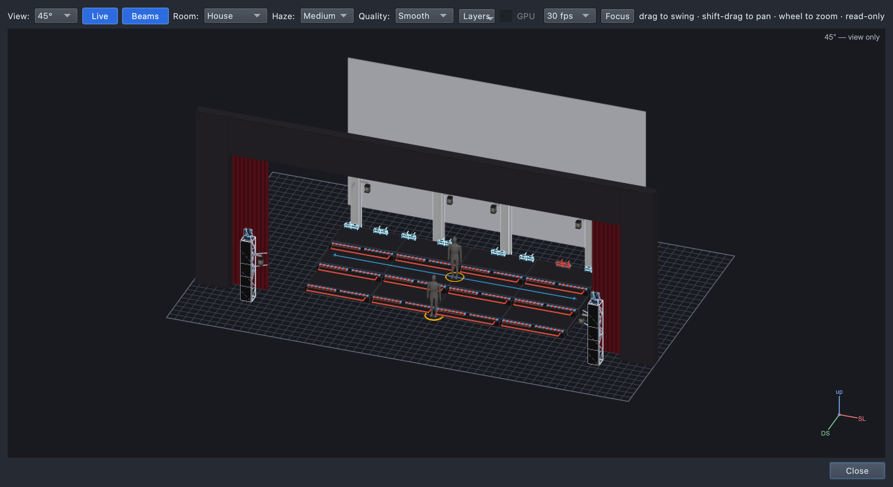

# Lesson 1.3 — Direction: aim the light

**Student handout**

## Today you will

- light the singers' faces from the front;
- aim moving lights at a place on stage;
- build a solo: a dark stage and two spots on one singer.

## Words for today

| Word | Means |
|---|---|
| **Front light** | Light from the audience side. It shows faces. Ours is on the **audience towers**. |
| **Back light** | Light from behind. It outlines the singers and separates them from the background. |
| **Side light** | Light from the side. It shapes bodies; great for dance. |
| **Uplight** | Light from below. Dramatic, even spooky. Our step tops uplight the choir. |
| **Moving light (mover)** | A light that can point itself anywhere: it **pans** (turns left and right) and **tilts** (up and down). |
| **Position** | Where a moving light points. Without one, it points wherever it happens to be. |
| **Stage target** | A named place on our stage that lights can aim at: **Center** (the middle of the CS row), **Soloist DS** (downstage centre, in front of the risers). |
| **Aim** | Point a moving light at a stage target. |
| **Spot** | A narrow light for one person. Our **AT-Spots** are two. |
| **Shutter** | A spot's "eyelid", like a camera's shutter. Closed, no light comes out, however bright you set it. |
| **Block cue** | A cue that starts from a dark stage: only what you put in it. |

## Part 1 — Design it (on paper, everyone)

Our verse has light from **below** (the step tops) and **behind** (the
cyc), but the faces are dark. And after the scream, one singer steps down
to sing alone.

| Cue | When | Why (feel) | Lights |
|---|---|---|---|
| 1.0.1 Verse *(add)* | First words | | **AT-W-ALL**: Warm White, Full, **aimed at Center** |
| 1.0.4 Solo *(new)* | After the scream, one singer alone | | Starts dark (**Block**). **AT-Spots**: White, Full, shutter **Open**, **aimed at Soloist DS** |

Where will the audience look in the solo? Why? ______________________

## Part 2 — Build it (at the laptop)

Roles: **Driver** (mouse), **Navigator** (reads each step aloud and checks
*You should see*), **Designer** (holds this sheet, watches the stage).
Switch roles after each part.

**On Windows or Linux:** where it says ⌘, press **Ctrl**.

### Get ready

1. Open qlcconsole. **File → Open** → `lesson-1-3-start.qlcc`. (Lesson
   1.2's finish.)
2. Click the **Show Tree** tab (⇧⌘6). Open **View → Rig Overview** (⇧⌘R)
   beside it.

### Faces in the verse

3. Click **1.0.1 Verse**. From **Groups → AT**, drag **AT-W-ALL** onto the
   dashed box under **Layers**.
   - *You should see:* a new row, **AT-W-ALL**.
4. Drag **Warm White** and then **Full** onto the **AT-W-ALL** row.
   - *You should see:* warm light from the two audience towers on the
     front of the risers and the singer in front. Some of it spills onto
     the floor and the house: we didn't choose where it goes.

5. In the Library, open **All → Targets**. Drag **Center** onto the
   **AT-W-ALL** row. While you drag, the top right says *"Aim at Center →
   layer AT-W-ALL in 1.0.1 Verse"*.
   - *You should see:* the four beams swing in onto the middle of the
     risers. The top right says **Changed: 1.0.1 Verse, 1.0.2 Chorus,
     1.0.3 Scream**: the faces stay lit in the next cues too.

6. Click the **AT-W-ALL** row to see its page.
   - *You should see:* **Position: Aim Center**.

   **(1)** the target in the Library, **(2)** the Position row.

### Cue 1.0.4 — Solo

7. Click **1.0.3 Scream**. Click **+ Cue**, type `Solo`, press **Return**.
   - *You should see:* **1.0.4 Solo**, with many grey rows: everything
     from the earlier cues is still on, including the red.
8. On the Solo's page, set **Mode** to **Block**.
   - *You should see:* the grey rows are gone, the tree says **⊘ block**
     beside 1.0.4, and the stage is dark. A Block cue starts from nothing.
9. From **Groups → AT**, drag **AT-Spots** onto the dashed box. Drag
   **White** and **Full** onto the **AT-Spots** row.
   - *You should see:* … nothing! The stage stays dark. Why?

10. Spots have a **shutter**, and it's closed. In the Library, open
    **Palettes → Shutter** and drag **Open** onto the **AT-Spots** row.
    - *You should see:* two pools of light on the floor at the foot of
      the towers. The spots have no **position** yet, so they point
      straight down.

11. From **All → Targets**, drag **Soloist DS** onto the **AT-Spots** row.
    The top right says *"Aim at Soloist DS → layer AT-Spots in 1.0.4
    Solo"*.
    - *You should see:* both spots swing onto the singer standing in front
      of the risers. She's the brightest thing on stage.

   **(1)** Mode: Block, **(2)** the spots' layer, **(3)** ⊘ block in the
   tree.

12. Click the **AT-Spots** row to see everything a spot needs.

   **(1)** a level, **(2)** a position, **(3)** an open shutter (and a
   colour).

### Save

13. **File → Save As** → `Lesson1-3-yourname.qlcc` in **Documents →
    qlcconsole**.

## Stuck?

| Problem | Try |
|---|---|
| I can't find the targets | In the Library: **All → Targets**. Or type `Center` in **Filter the Library**. |
| The Solo still shows the red scream | Set its **Mode** to **Block**. |
| The spots are dark | Did you drop **Open** (Palettes → Shutter) on the AT-Spots row? |
| The spots light the floor by the towers | They need a position: drop **Soloist DS** on their row. |
| It's hard to see the spots | In the Rig Overview, set **Room** to **Dim**. |
| Something else went wrong | Undo (⌘Z), one step at a time. |

## Done early? (Extension)

1. **Move the spots.** On the AT-Spots page, on the **Position** row,
   click **⋯ → Set to → Aim Center**. Where do they go now? Undo (⌘Z) to
   put them back on the soloist.
2. **Back light.** In the Solo, drag **TrussW-RGB** onto the dashed box,
   then **Blue** and **25%** onto its row. The wash boxes behind the
   risers glow dim blue behind the soloist. Does it help her stand out
   from the dark risers?
3. Which direction is missing from our rig: front, back, side or below?
