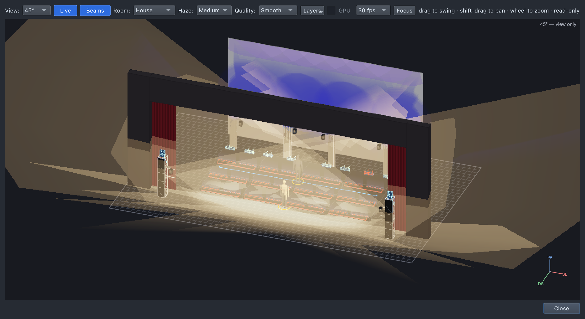
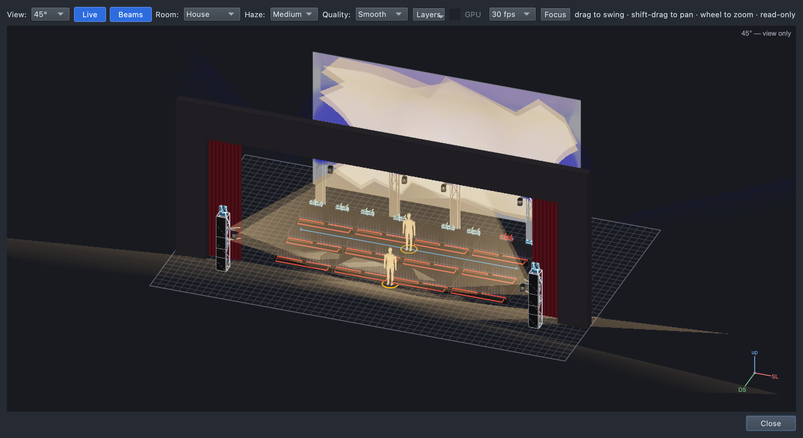
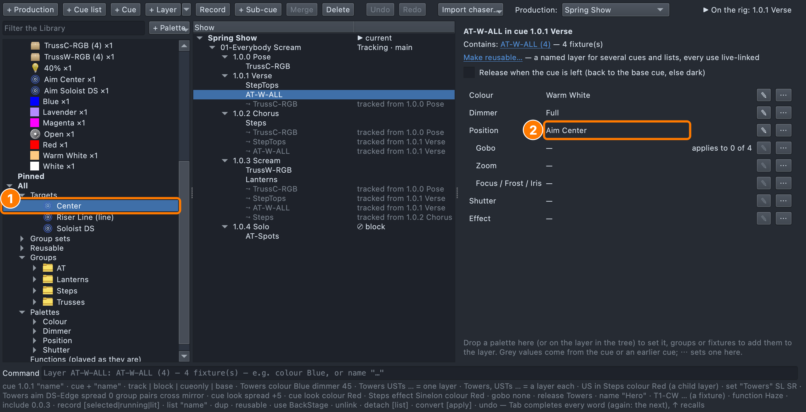
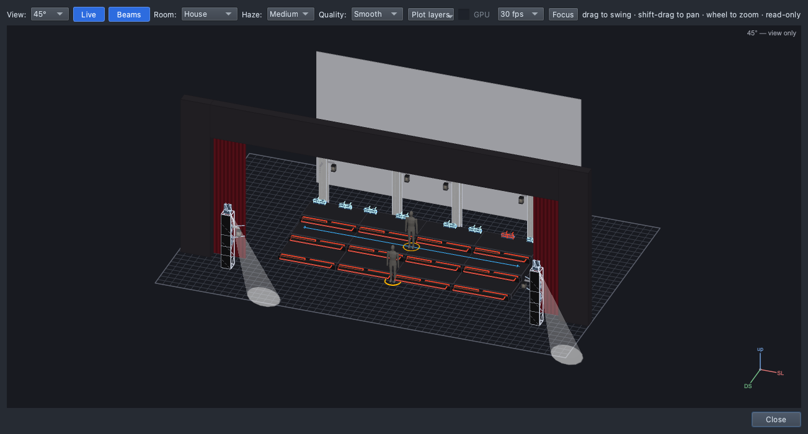
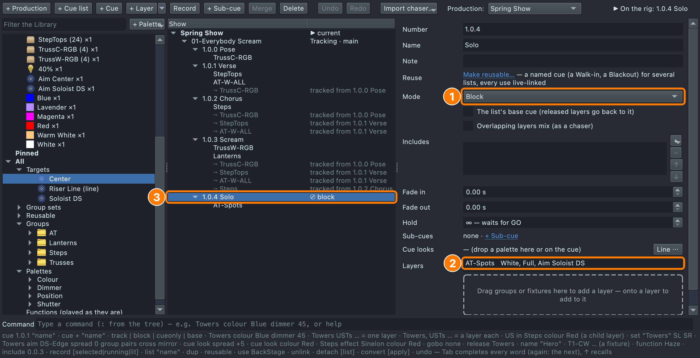
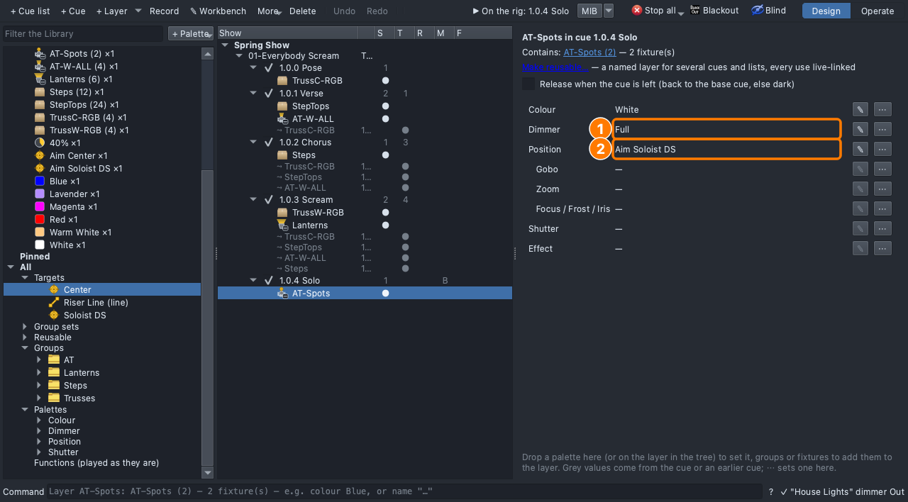

# Lesson 1.3 — Direction: aim the light

**Student handout**

## Why this matters

Visibility comes first: an audience that can't see faces can't follow
the song ([Lesson 0.1](../../level-0/lesson-01/handout.md)). Front light
is the part of a look that shows them
([Lesson 0.3](../../level-0/lesson-03/handout.md)), and a special picks
one singer out of the choir
([Lesson 0.4](../../level-0/lesson-04/handout.md)).

## Today you will

- add front light so the audience can see the singers' faces;
- aim moving lights at a spot on stage;
- build a solo: a dark stage with two spots on one singer.

## Words for today

| Word | Means |
|---|---|
| **Front light** | Light from the audience side, which is what shows faces. Ours comes from the **audience towers**. |
| **Back light** | Light from behind the performers, which outlines them and separates them from the background. |
| **Side light** | Light from the side, which sculpts bodies and is a staple of dance lighting. |
| **Uplight** | Light from below: dramatic, and sometimes eerie. Our step tops uplight the choir. |
| **Moving light (mover)** | A fixture that can be pointed remotely: it **pans** (turns left and right) and **tilts** (up and down). |
| **Position** | Where a moving light points. Until you give it one, it points wherever it was last left. |
| **Stage target** | A named spot on our stage that lights can aim at: **Center** (the middle of the CS row) and **Soloist DS** (downstage centre, in front of the risers). |
| **Aim** | Point moving lights at a stage target. |
| **Spot** | A narrow, hard-edged light for one performer, like our two **AT-Spots**. |
| **Shutter** | A spot's built-in shutter blocks the beam. While it's closed, no light comes out, however high the level. Ours opens by itself when the spot is given a level. |
| **Block cue** | A cue that starts from a dark stage, with nothing tracking into it: only what you put in it is on. |

## Part 1 — Design it (on paper, everyone)

Our verse has light from **below** (the step tops) and **behind** (the
cyc), but the singers' faces are in the dark. And after the scream, one
singer steps down to sing alone.

| Cue | When | Why (feel) | Lights |
|---|---|---|---|
| 1.0.1 Verse *(add)* | First words | | **AT-W-ALL**: Warm White, Full, **aimed at Center** |
| 1.0.4 Solo *(new)* | After the scream, one singer alone | | Starts dark (**Block**). **AT-Spots**: White, Full, **aimed at Soloist DS** |

In the solo, where will the audience look, and why? ______________________

## Part 2 — Build it (at the laptop)

Roles: **Driver** (mouse), **Navigator** (reads each step aloud and checks
*You should see*), **Designer** (holds this sheet, watches the stage).
Switch roles after each part.

**On Windows or Linux:** where it says ⌘, press **Ctrl**.

### Get ready

1. Open qlcconsole, choose **File → Open** and open
   `lesson-1-3-start.qlcc` (where Lesson 1.2 finished).
2. Click the **Show Tree** tab (⇧⌘5) and open **View → Rig Overview**
   (⇧⌘R) beside it.

### Faces in the verse

3. Click **1.0.1 Verse**. From **Groups → AT**, drag **AT-W-ALL** onto the
   dashed box under **Layers**.
   - *You should see:* a new **AT-W-ALL** row.
4. Drag **Warm White**, then **Full**, onto the **AT-W-ALL** row.
   - *You should see:* warm light from the two audience towers on the
     front of the risers and on the singer in front. Some of it spills
     onto the floor and into the house, because nobody has told the
     washes where to point yet.

5. In the Library, open **All → Targets** and drag **Center** onto the
   **AT-W-ALL** row. While you drag, the top bar reads *"Aim at Center →
   layer AT-W-ALL in 1.0.1 Verse"*.
   - *You should see:* the four beams swing in onto the middle of the
     risers, and the top bar reads **Changed: 1.0.1 Verse, 1.0.2
     Chorus, 1.0.3 Scream**, because the front light tracks into the
     following cues.

6. Click the **AT-W-ALL** row to open its page.
   - *You should see:* **Position: Aim Center**.

   **(1)** the target in the Library and **(2)** the Position row.

### Cue 1.0.4 — Solo

7. Click **1.0.3 Scream**, then click **+ Cue**, type `Solo` and press
   **Return**.
   - *You should see:* **1.0.4 Solo**, with a long list of grey rows:
     everything from the earlier cues is still on, red included.
8. On the Solo's page, set **Mode** to **Block**.
   - *You should see:* the grey rows disappear, **B** (Block) appears in
     the tree's **M** (Mode) column beside 1.0.4, and the stage goes dark.
9. From **Groups → AT**, drag **AT-Spots** onto the dashed box, then drag
   **White** and **Full** onto the **AT-Spots** row.
   - *You should see:* two pools of light on the floor at the foot of
     the towers. A spot's **shutter** rests closed, and the console opens
     it when the spot is given a level. The spots have no **position**
     yet, so they're pointing straight down.

10. From **All → Targets**, drag **Soloist DS** onto the **AT-Spots** row.
    The top bar reads *"Aim at Soloist DS → layer AT-Spots in 1.0.4
    Solo"*.
    - *You should see:* both spots swing onto the singer standing in front
      of the risers, who is now the brightest thing on stage.

   **(1)** Mode: Block, **(2)** the spots' layer, and **(3)** B in the
   tree's M column.

11. Click the **AT-Spots** row to see everything a spot needs to light
    someone.

   **(1)** a level and **(2)** a position (plus a colour). The shutter
   opens by itself; a **Shutter** palette on this row would set it
   instead.

### Save

12. Save with **File → Save As** → `Lesson1-3-yourname.qlcc` in
    **Documents → qlcconsole**.

## Stuck?

| Problem | Try |
|---|---|
| You can't find the targets | They're in the Library under **All → Targets**, or type `Center` in **Filter the Library**. |
| The Solo still shows the red scream | Set its **Mode** to **Block**. |
| The spots are dark at Full | Check that **Settings → Advanced → Auto-open shutters** is on. |
| The spots light the floor by the towers | They need a position: drop **Soloist DS** on their row. |
| The spots are hard to see | In the Rig Overview, set **Room** to **Dim**. |
| Something else went wrong | Undo (⌘Z) one step at a time. |

## Done early? (Extension)

1. **Move the spots.** On the AT-Spots page, on the **Position** row,
   click **⋯ → Set to → Aim Center**. Where do they land now? Undo (⌘Z)
   to put them back on the soloist.
2. **Back light.** In the Solo, drag **TrussW-RGB** onto the dashed box,
   then **Blue** and **25%** onto its row, so the wash boxes behind the
   risers glow a dim blue behind the soloist. Does it help separate her
   from the dark risers?
3. Which direction is missing from our rig: front, back, side or below?
