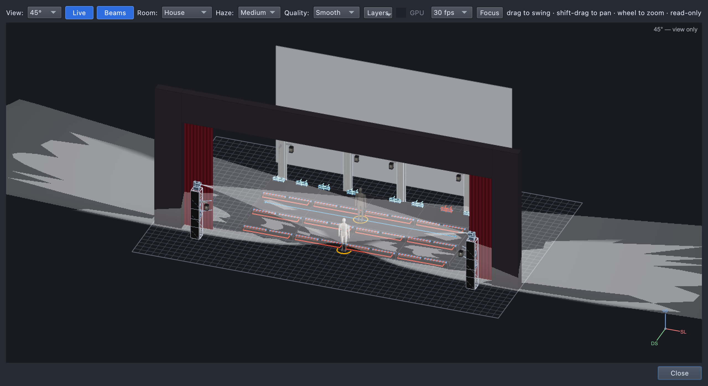

# Lesson 1.3 — Direction: aim the light

Every number needs faces lit. Students add front light to the verse from
the audience towers and aim it at the risers, then build a solo: a dark
stage and two spots that find the soloist.

| For | File |
|---|---|
| Teacher | [Teacher guide](teacher-guide.md) · [Slides outline](slides.md) |
| Students | [Handout](handout.md) · [Exit ticket](exit-ticket.md) · [At home](at-home.md) |
| Show files | [`lesson-1-3-start.qlcc`](../../shows/lesson-1-3-start.qlcc) · [`lesson-1-3-finish.qlcc`](../../shows/lesson-1-3-finish.qlcc) |

