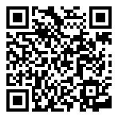

# Lesson 1.3 — Direction: aim the light

**Teacher guide** · Level 1, lesson 3 · 50 minutes

**Give students:** <https://sandinak.github.io/qlcconsole/class/1-3/> (the show file, the steps, the exit ticket and the at-home task; nothing else)

## Objectives

Students can:

1. say what light from the front, back, side and below does, and why
   every number needs faces lit from the front;
2. aim moving lights at a **stage target** (Center, Soloist DS), and
   explain why a moving light needs a **position**;
3. build a **Block** cue that starts from a dark stage, and light one
   person with spots (colour, level, position; the shutter opens by itself).

## Before class

- [ ] [`lesson-1-3-start.qlcc`](../../shows/lesson-1-3-start.qlcc) on each
  laptop (Lesson 1.2's finish).
- [ ] On the projector: the start file open, Show Tree tab, **View → Rig
  Overview** beside it.
- [ ] Print the [handout](handout.md) and the [exit ticket](exit-ticket.md).
- [ ] Optional: a desk lamp or a phone torch, for the design idea.

## Vocabulary (introduce in this order)

**front / back / side light**, **uplight**, **moving light (mover)**,
**position**, **stage target**, **aim**, **spot**, **shutter**, **Block
cue**. Each is in the handout's word table and the
[Glossary](../../GLOSSARY.md).

## Timing

| Min | Part | What happens |
|---|---|---|
| 0–10 | **Design idea** (no computers) | A torch on a face: four directions |
| 10–20 | **Teacher demo** (projector) | Front light on the verse; Aim Center |
| 20–40 | **Hands-on** (pairs/triads, roles) | Handout Part 2, steps 1–12 |
| 40–45 | **Check / share** | Two groups show their solo |
| 45–50 | **Exit ticket** | On paper |

## 1. Design idea (10 min)

1. Dim the room. A volunteer sits facing the class. Shine the torch at
   their face from four places, and ask each time *what does it feel
   like?*
   - **From the front** (where the audience is): we see the face clearly.
     Friendly, plain.
   - **From behind**: a glowing outline, a dark face. Mysterious; it
     separates them from the background.
   - **From the side**: half the face. Dramatic, sculpted.
   - **From below**: spooky (the campfire story).
2. Ask: *"Which of these does our verse have now?"* (*From below — the
   step tops — and the cyc behind.*) *"So can the audience see their
   faces?"* (*Not well.*)
3. **Every number needs faces lit, from the front.** Our front lights are
   on the **audience towers**: **AT-W-ALL** (four washes) and
   **AT-Spots** (two spots for soloists).
4. These are **moving lights**: they can point anywhere. So as well as a
   colour and a level, they need a **position**. We give it by aiming at a
   **stage target**: a named place on stage, like *Center* or *Soloist
   DS*.

**Key idea to land:** choose where the light comes **from** (the group)
and where it goes **to** (the aim).

## 2. Teacher demo (10 min)

On the projector:

1. Click **1.0.1 Verse**. Drag **AT-W-ALL** (Groups → AT) onto the dashed
   box; drag **Warm White** and **Full** onto its row. Faces appear on the
   front row. Point out the spill into the house: "It lights *something*,
   but we didn't choose where."
2. Open **All → Targets** in the Library. Drag **Center** onto the
   **AT-W-ALL** row. Read the hint aloud: *"Aim at Center → layer AT-W-ALL
   in 1.0.1 Verse"*. The beams swing in onto the risers.
3. Click the AT-W-ALL row: the **Position** row says **Aim Center**.

## 3. Hands-on (20 min)

- Groups of 2–3 with **Driver / Navigator / Designer** roles; switch after
  each part of the handout.
- Students without a laptop: the **design station** — the torch and a
  volunteer: find the most dramatic direction for the solo, and sketch
  it.

### What to watch for

| You see | Likely cause | Say |
|---|---|---|
| The aim landed somewhere unexpected | Dropped on the dashed box or another row | "Undo, and drop it on the **AT-W-ALL** row. Read the note in the top bar while you drag." |
| The Solo has all the earlier lights in it | Mode isn't **Block** | "Set **Mode** to **Block** on the Solo's page." |
| Two pools of light on the floor by the towers | Expected: no position yet | "Where are they pointing? Give them a place to aim at." |
| Hard to see the spots | Busy stage, or Room is bright | "Set **Room** to **Dim** in the Rig Overview." |

## 4. Check for understanding (while circulating)

- "Why did you need to aim the washes?" (*A moving light needs a position,
  or it lights wherever it happens to point.*)
- "What does Block do to the Solo?" (*It starts from nothing: only its own
  layers.*)

## 5. Share (5 min)

Two groups show **1.0.3 Scream → 1.0.4 Solo** on the projector. Where does
your eye go in the solo? (*The soloist: the brightest place.*)

## 6. Exit ticket (5 min)

[Exit ticket](exit-ticket.md) — answers below.

## Extension (fast groups)

From the handout: re-aim the spots with **⋯ → Set to** on the Position
row; add a blue back light behind the soloist.

## At home

[At home](at-home.md): a second solo on a computer, or a lighting plot of
a solo on paper.

## Answer key

- **Exit ticket:** 1 — the front: the audience towers (AT-W-ALL, AT-Spots).
  2 — it can point anywhere, so it needs a position (an aim), or it lights
  whatever it happens to point at. 3 — the console opens a closed shutter by
  itself when the light is given a level (auto-open, on by default); a
  Shutter palette on the layer would set it instead. 4 — Block: the cue starts from a dark stage, with
  only its own layers, so the eye goes to the soloist.
- **Extension:** a blue back light makes an outline round the soloist and
  separates her from the dark risers.

## How this lesson was checked

Every step of the handout is run by the course test (`ui/test/courseshow`,
`lessonsOneTwoToOneFourWithTheMouse`, `lessonThreeExtension`): the drops of
groups, palettes and targets, the hint text, the Mode box, and what the
lights send (the washes' and spots' pan and tilt before and after the aim,
and the spots' shutter: open at White and Full with auto-open on, closed
with it off), offscreen on the real app. The pictures are taken by
the same test, at each "you should see".
