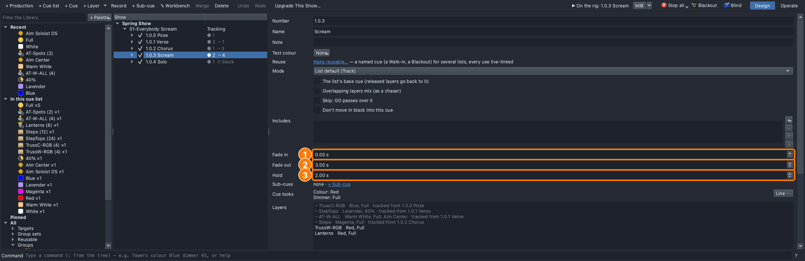

# Lesson 1.4 — Timing: fades and holds

**Student handout**

## Today you will

- choose the timing of each cue from the music;
- set fade and hold times on the cue's page;
- play the sequence with GO and watch the timing happen.

## Words for today

| Word | Means |
|---|---|
| **Snap** | A change with no fade (0 seconds), for a hit or a surprise. |
| **Fade** | A change that happens over time, like a breath. |
| **Fade in** | How long a cue takes to arrive. |
| **Fade out** | How long a cue's lights take to go out when the next cue takes over. |
| **Hold** | How long a cue waits before the next cue plays **on its own**. **∞** means it waits for GO. |
| **Follow** | A cue that plays on its own after the previous cue's hold. The Run tab shows it as *follow 2s*. |

## Part 1 — Design it (on paper, everyone)

Listen to the song. For each cue, decide between a **snap** and a
**fade** (and how many seconds), and give your reason.

| Cue | When | Time | Why |
|---|---|---|---|
| 1.0.0 Pose | Before the first note | **Fade in 3 s** | |
| 1.0.1 Verse | First words | **Fade in 2 s** | |
| 1.0.2 Chorus | First chorus, on the hit | **Snap** (0 s) | |
| 1.0.3 Scream | The scream | **Snap**, **hold 2 s**, **fade out 3 s** | |
| 1.0.4 Solo | After the scream | **Fade in 3 s** | |

## Part 2 — Build it (at the laptop)

Roles: **Driver** (mouse), **Navigator** (reads each step aloud and checks
*You should see*), **Designer** (holds this sheet and calls the times).

**On Windows or Linux:** where it says ⌘, press **Ctrl**.

### Get ready

1. Open qlcconsole, choose **File → Open** and open
   `lesson-1-4-start.qlcc` (where Lesson 1.3 finished).
2. Click the **Show Tree** tab (⇧⌘4) and open **View → Rig Overview**
   (⇧⌘R) beside it.

### Type the times

To enter a time, click in the box, select what's there (⌘A), type the
number and press **Return**. Tab, or clicking the next cue, keeps it too;
**Esc** puts the old time back.

3. Click **1.0.0 Pose**, then in **Fade in** type **3** and press
   **Return**.
   - *You should see:* **Fade in 3.00 s**.
4. Click **1.0.1 Verse** and set **Fade in** to **2** (press Return).
5. Leave **1.0.2 Chorus** at **0.00 s**, so it snaps.
6. Click **1.0.3 Scream** and set **Hold** to **2** and **Fade out** to
   **3**, pressing Return after each.
   - *You should see:* **Fade in 0.00 s**, **Fade out 3.00 s** and **Hold
     2.00 s**, where Hold read *∞ — waits for GO* before.

   **(1)** Fade in, **(2)** Fade out and **(3)** Hold.

7. Click **1.0.4 Solo** and set **Fade in** to **3** (press Return).

Clicking a cue in the tree shows it on stage **instantly**; the fades
only play when you run the cues with **GO**.

### Play it

8. Click **Spring Show** in the tree, so no cue is being previewed, then
   click the **Run** tab (⇧⌘7). Keep the Rig Overview in view.
   - *You should see:* a **Timing** column reading *fade 3s*, *fade 2s*,
     nothing for the chorus (a snap), *follow 2s* and *fade 3s*.
9. Press **GO** and watch the cyc.
   - *You should see:* the cyc fades up to blue over three seconds, while
     the line above NEXT shows the fade's progress, such as *▶ 1.0.0 Pose
     42%*.

   **(1)** the cue that's playing and how far through its fade it is, and
   **(2)** the Timing column.

10. Press **GO** again and the verse fades in over two seconds; press it
    once more and the chorus **snaps** in.
11. Press **GO** for the Scream, then take your hands off.
    - *You should see:* the stage snaps to red, and two seconds later the
      **Solo follows on its own**: the red fades away over three seconds
      while the spots fade up on the soloist.
12. Press **Stop**, then save with **File → Save As** →
    `Lesson1-4-yourname.qlcc` in **Documents → qlcconsole**.

## Stuck?

| Problem | Try |
|---|---|
| The box went back to its old time | **Esc** puts the old time back. Type it again, then press **Return** or click the next cue. |
| Nothing fades when you click cues | That's expected: fades only play with **GO** in the Run tab. |
| GO starts in the middle | Press **Stop**; the next **GO** starts from 1.0.0. |
| The Solo never follows on its own | Check that the Scream's **Hold** is 2.00 s, not ∞. |

## Done early? (Extension)

1. Give the **chorus** a 1-second fade instead of a snap and play it.
   Which works better with the music? Keep that one.
2. Play the song and press **GO** on each moment, adjusting the times
   until the lighting moves with the music.
3. What would happen if the **Pose** had a 5-second hold?
