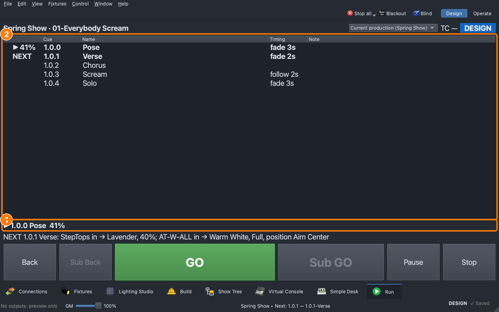

# Lesson 1.4 — Timing: fades and holds

A snap is a hit; a slow fade is a breath. Students give each cue a timing
that follows the music: a slow fade up for the pose, a snap for the
chorus, and a scream that holds for two seconds and melts into the solo
by itself.

| For | File |
|---|---|
| Teacher | [Teacher guide](https://github.com/sandinak/qlcconsole/blob/main/docs/course/level-1/lesson-04/teacher-guide.md) · [Slides outline](https://github.com/sandinak/qlcconsole/blob/main/docs/course/level-1/lesson-04/slides.md) |
| Students | [Handout](handout.md) · [Exit ticket](exit-ticket.md) · [At home](at-home.md) |
| Show files | [`lesson-1-4-start.qlcc`](../../shows/lesson-1-4-start.qlcc) · [`lesson-1-4-finish.qlcc`](../../shows/lesson-1-4-finish.qlcc) |

