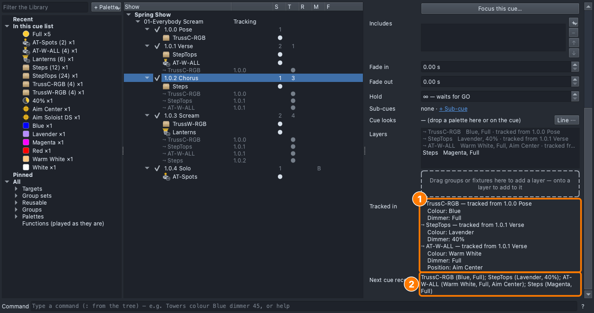
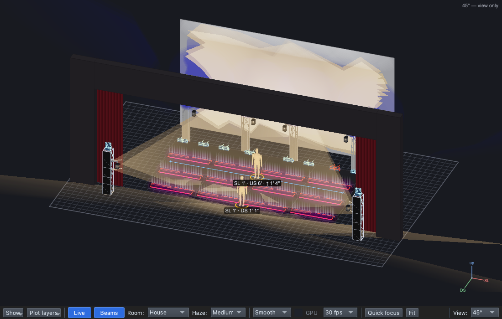

# Lesson 2.1 — Tracking and Block

**Student handout**

## Why this matters

A cue is a change the audience feels
([Lesson 0.1](../../level-0/lesson-01/handout.md)), and a cue list only
writes the changes: whatever a cue doesn't change stays on. That is how
designers think about a song, but what stays on has to be what you
meant. A colour that belongs to the verse and bleeds into the chorus
blurs the contrast between sections
([Lesson 0.5](../../level-0/lesson-05/handout.md)); a stab of light on an
accent has to be gone on the next beat
([Lesson 0.6](../../level-0/lesson-06/handout.md)); a solo needs a clean
start. Today you decide, cue by cue, what carries on.

## Today you will

- read what tracks into a cue, and from where;
- let a layer go when its cue ends (**Release**);
- add a one-beat flash that doesn't carry on (**Cue-only**), and see why
  the Solo is a **Block** cue.

## Words for today

| Word | Means |
|---|---|
| **Tracking** | A light keeps its state into the following cues until a cue changes it. A tracked layer shows grey (⤳) with the cue it came from. |
| **S / T / R / M** | The tree's columns on a cue: **S** the layers it sets, **T** the layers tracking in, **R** the layers it releases; **M** its mode (**B** Block, **C** Cue-only, blank for Track). |
| **Tracked in** | On a cue's page: each layer tracking in, where from, and its values. |
| **Next cue receives** | On a cue's page: what the next cue starts from. |
| **Release** | Ticked on a layer: the layer leaves when its cue is left, back to the base cue, else dark. |
| **Cue-only** | A cue mode: the cue starts from the one before, but its changes don't pass on. For a moment that's there and gone. |
| **Block** | A cue mode: the cue starts from nothing, only its own layers. A **hard start**. |
| **Base cue** | The cue a released layer goes back to (extension). |

## Part 1 — Design it (on paper, everyone)

The director watched a run of the song and gave two notes:

1. *"In the chorus, the lavender step tops muddy the magenta. Lavender is
   the verse's colour."*
2. *"On the last word of the chorus, flash the riser tops white for one
   beat, then the scream."*

| Cue | When | Why (feel) | Lights |
|---|---|---|---|
| 1.0.1 Verse *(change)* | First words | | **StepTops** released when the verse ends |
| 1.0.2.5 Flash *(new)* | Last word of the chorus | | **Cue-only**. **StepTops**: White, Full |

What should the scream look like: with the white flash still on, or
without it? Why? ______________________

## Part 2 — Build it (at the laptop)

Roles: **Driver** (mouse), **Navigator** (reads each step aloud and checks
*You should see*), **Designer** (holds this sheet, watches the stage).
Switch roles after each part.

**On Windows or Linux:** where it says ⌘, press **Ctrl**.

### Get ready

1. Open qlcconsole, choose **File → Open** and open
   `lesson-2-1-start.qlcc` (where Level 1 finished).
2. Click the **Show Tree** tab (⇧⌘5) and open **View → Rig Overview**
   (⇧⌘R) beside it.

### Read the chorus

3. Click **1.0.2 Chorus**.
   - *You should see:* under it, the Steps (its own layer) and three grey
     ⤳ rows: TrussC-RGB from **1.0.0**, StepTops and AT-W-ALL from
     **1.0.1**. On its row, **1** under **S** and **3** under **T**: the
     chorus sets one layer, three track in. The step tops are still
     lavender on stage.

   **(1)** the chorus sets 1 layer, 3 track in, and **(2)** the grey
   rows on its page.

4. Scroll down the chorus's page.
   - *You should see:* **Tracked in**, each grey layer with where it came
     from and its values, and **Next cue receives**: all four layers.

5. Look at **1.0.4 Solo**'s row.
   - *You should see:* **B** under **M**, and nothing under **T**: a
     **Block** cue starts from nothing, so nothing tracks into it. It's a
     hard start (you made it in Lesson 1.3).

### Note 1: let the lavender go

6. Click **1.0.1 Verse**, then its **StepTops** row (the white one, not
   grey).
7. Tick **Release when the cue is left (back to the base cue, else
   dark)**.
   - *You should see:* the top bar reads **Changed: 1.0.2 Chorus, 1.0.3
     Scream**, and the verse's row reads **1** under **S**, **T** and
     **R**: it sets AT-W-ALL, the cyc tracks in, and it releases the step
     tops.

   **(1)** Release and **(2)** the verse's S, T, R.

8. Click **1.0.2 Chorus**.
   - *You should see:* no grey StepTops row, **2** under **T**, and the
     step tops dark on stage: the magenta steps stand alone.

### Note 2: a flash for one beat

9. With **1.0.2 Chorus** selected, click **+ Cue**, type `Flash` and
   press **Return**.
   - *You should see:* **1.0.2.5 Flash** between the chorus and the
     scream (a point cue, Lesson 1.5).
10. Drag **StepTops** (Groups → Steps) onto the dashed box, then drag
    **White** and **Full** onto its row.
    - *You should see:* the riser tops white.
11. On the Flash's page, set **Mode** to **Cue-only**.
    - *You should see:* **C** under **M**, and the top bar reads
      **Changed: 1.0.3 Scream**. **Next cue receives** begins *what this
      cue started from (it is cue-only)*, with no StepTops in it.

   **(1)** Mode: Cue-only and **(2)** C in the tree's M column.

12. Click **1.0.3 Scream**.
    - *You should see:* no grey StepTops row (**3** under **T**), and the
      step tops dark in the scream: the flash was there for its cue only.

### Save

13. Save with **File → Save As** → `Lesson2-1-yourname.qlcc` in
    **Documents → qlcconsole**.

## Stuck?

| Problem | Try |
|---|---|
| There's no Release box | You clicked a grey row in the chorus. Click **1.0.1 Verse**, then its own StepTops row. |
| The new cue is 1.0.3.5 | You had the Scream selected. Undo (⌘Z), click **1.0.2 Chorus**, then **+ Cue**. |
| The scream still has white step tops | Set the Flash's **Mode** to **Cue-only**. |
| The step tops are dark in the flash too | Drop **White** and **Full** on the Flash's StepTops row, not on the dashed box. |
| Something else went wrong | Undo (⌘Z) one step at a time. |

## Done early? (Extension)

**A base cue.** Released layers go back to the **base cue**, or dark if
it doesn't light them.

1. Click **1.0.0 Pose**. Drag **StepTops** onto its dashed box, then
   **Blue** and **10%** onto its row.
2. On the Pose's page, tick **The list's base cue (released layers go
   back to it)**. The Pose's row shows **base** under **F**.
3. Click **1.0.1 Verse** and read **Next cue receives**: *StepTops (Blue,
   10%) — back to the base*. Click **1.0.2 Chorus**: the step tops glow a
   dim blue instead of going dark.
4. Which do you prefer under the magenta chorus: dark, or a dim blue
   glow? Why?
