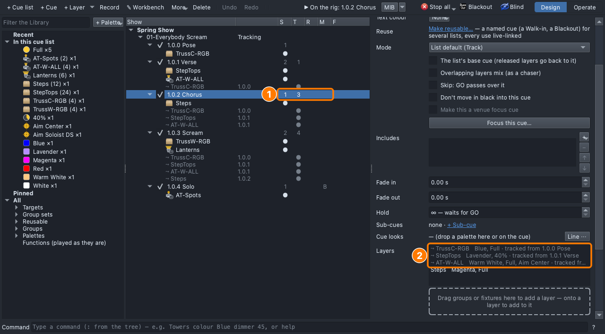
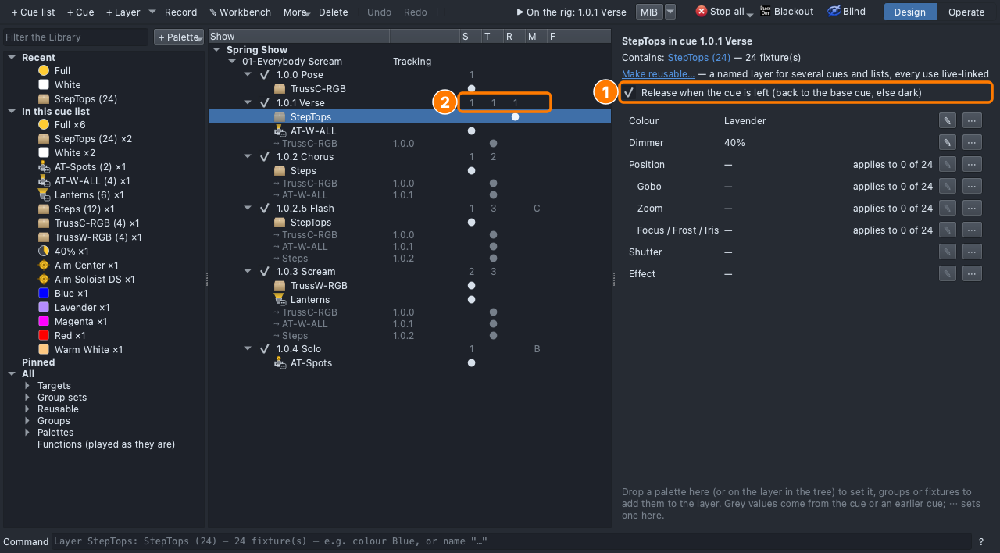
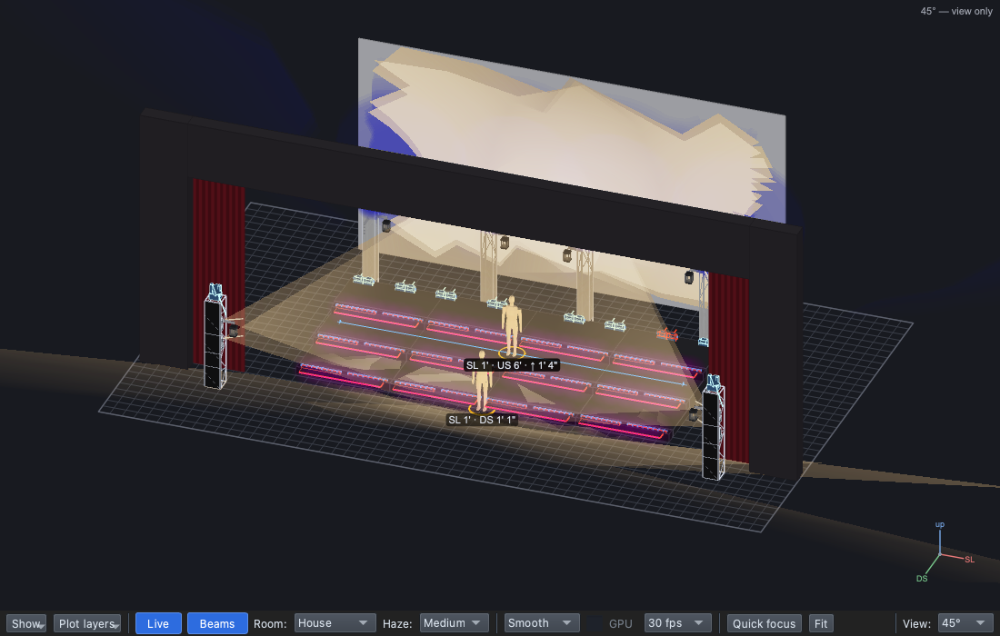
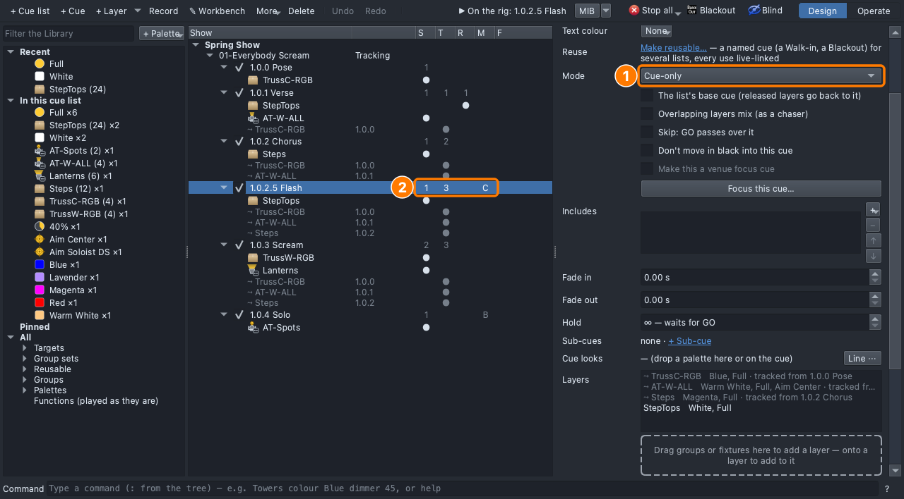

## Why

A cue list only writes changes: whatever a cue doesn't change stays on.
What stays on has to be what you meant. The verse's colour shouldn't blur
the chorus ([Lesson 0.5](../0-5/)), a sting is gone on the next beat
([Lesson 0.6](../0-6/)), and a solo starts clean.

## The plan

| Cue | When | Why | Lights |
|---|---|---|---|
| 1.0.1 Verse *(change)* | First words | | **StepTops** released when the verse ends |
| 1.0.2.5 Flash *(new)* | Last word of the chorus | | **Cue-only**. **StepTops**: White, Full |

Should the scream still have the white flash? Why?

## Steps

1. **File ▸ Open** → `lesson-2-1-start.qlcc`.
2. Click the **Show Tree** tab (⇧⌘5); open **View ▸ Rig Overview** (⇧⌘R)
   beside it.
3. Click **1.0.2 Chorus**. Three grey ⤳ rows track in; its row reads
   **1** under **S**, **3** under **T**.

   

4. Scroll down its page: **Tracked in** and **Next cue receives**.
5. Look at **1.0.4 Solo**: **B** under **M**, nothing under **T**. Block:
   a hard start.
6. Click **1.0.1 Verse**, then its **StepTops** row.
7. Tick **Release when the cue is left**. The verse reads **1** under
   **S**, **T** and **R**.

   

8. Click **1.0.2 Chorus**: **2** under **T**, and the step tops are dark.

   

9. With the chorus selected, click **+ Cue**, type `Flash`, press
   **Return**: **1.0.2.5 Flash**.
10. Drag **StepTops** onto the dashed box, then **White** and **Full**
    onto its row.
11. Set **Mode** to **Cue-only**: **C** under **M**.

    

12. Click **1.0.3 Scream**: no grey StepTops row, and the step tops are
    dark.
13. **File ▸ Save As** → `Lesson2-1-yourname.qlcc`.

**Stuck?** No Release box: click the verse's own StepTops row, not a grey
one. The new cue is 1.0.3.5: undo, select the chorus, **+ Cue** again.
White step tops in the scream: set the Flash to **Cue-only**.
Both are on the right-click menu too: a layer's **Release (leaving this
cue)**, a cue's **Mode ▸**. They work on a ▣ scene layer the same way.

## Exit ticket

1. In a tracking cue list, what does a cue play besides the layers it
   sets itself?
2. After the release, the chorus reads **S 1, T 2**. What do the numbers
   count, and which layers are they?
3. What did **Release** on the verse's StepTops change in the chorus, and
   why did the director want it?
4. **Block** or **Cue-only**, and why: (a) a soloist alone in a spot;
   (b) a one-beat white flash on a stomp.

## At home

Do one:

- **App:** download [`lesson-2-1-finish.qlcc`](../../shows/lesson-2-1-finish.qlcc).
  Add **1.0.5 Final Chorus** after the Solo. It starts from the Solo:
  only the spots. Make it a **Block** cue and light the chorus again:
  **Steps** Magenta, Full; **TrussC-RGB** Blue, Full; **AT-W-ALL** Warm
  White, Full, aimed at **Center**; plus one thing to make it bigger.
  Bring in `Lesson2-1-Home-yourname.qlcc`.
- **Paper:** for this cue sheet, list what's on in each cue, and say
  which cue should be Block, which Cue-only, and where Release goes.
  1 Intro: cyc blue · 2 Verse: step tops lavender 40%, front warm ·
  3 Chorus: steps magenta · 4 Stomp: step tops white (one beat) ·
  5 Solo: one spot white.
