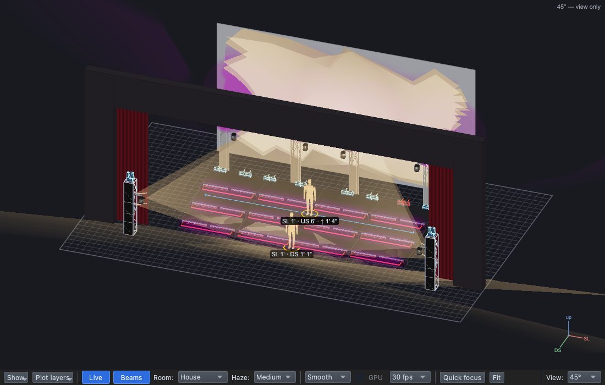
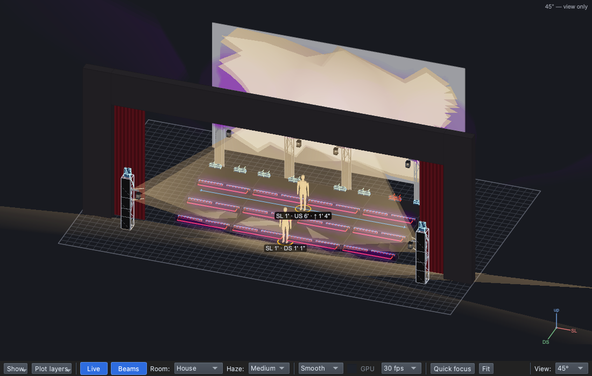

# Lesson 2.2 — Palettes: change once, change everywhere

**Student handout**

## Why this matters

Colour tells the audience the mood
([Lesson 0.4](../../level-0/lesson-04/handout.md)), and a designer picks a
song's colours as a set, one idea per section
([Lesson 0.5](../../level-0/lesson-05/handout.md)). Then the notes come,
often late: *"less pink"*, an hour before the show. If the pink is typed
into every cue, that note means hunting through the show and missing one.
If every cue uses one palette, it's one change, and every cue follows.

## Today you will

- find where a palette is used;
- make a palette of the song's own, named for its job and filed in a
  folder for the song;
- take a director's note by changing the palette once.

## Words for today

| Word | Means |
|---|---|
| **Palette** | A saved, named value (a colour, a level, a position). Every cue that uses it shows its value; change it and they all change. |
| **Used by** | Right-click a palette in the Library: every cue and layer that uses it. |
| **Duplicate** | A copy of a palette, to change without touching the original. |
| **Look Editor** | Opens under the page (**✎** on a layer's row, or **Edit** in the Library) to change a palette's value and name. |
| **Palette folder** | A folder in the Library's Palettes. A folder per song keeps its colours, levels and positions together. |

## Part 1 — Design it (on paper, everyone)

Our chorus is magenta: the show's **Magenta** palette, on the steps. The
designer wants the cyc in the same colour in the chorus, and knows the
director will want to adjust it.

| Cue | When | Why (feel) | Lights |
|---|---|---|---|
| 1.0.2 Chorus *(change)* | The hook | | **Steps** and **TrussC-RGB** (the cyc): **Chorus Colour**, the song's own palette |

Then the note: *"Less pink."* Which cues will change when you change
Chorus Colour? ______________________

## Part 2 — Build it (at the laptop)

Roles: **Driver** (mouse), **Navigator** (reads each step aloud and checks
*You should see*), **Designer** (holds this sheet, watches the stage).
Switch roles after each part.

**On Windows or Linux:** where it says ⌘, press **Ctrl**; for a
right-click on a Mac trackpad, click with two fingers.

### Get ready

1. Open qlcconsole, choose **File → Open** and open
   `lesson-2-2-start.qlcc` (where Lesson 2.1 finished).
2. Click the **Show Tree** tab (⇧⌘5) and open **View → Rig Overview**
   (⇧⌘R) beside it.

### Who uses Magenta?

3. In the Library, open **All → Palettes → Colour**. Right-click
   **Magenta** → **Used by**.
   - *You should see:* one use, *Cue 1.0.2 Chorus in 01-Everybody Scream
     — Steps*. Click it: the tree goes to the chorus's Steps.

### The song's own colour

4. Right-click **Magenta** → **Duplicate**.
   - *You should see:* **Magenta (copy)** in the Library, open in the
     **Look Editor** under the page, with *Used by: nothing yet*.

   **(1)** its Name and **(2)** Used by.

5. In the Look Editor's **Name** box, type `Chorus Colour` and press
   **Return**. Name a palette for its job, not its colour: the colour may
   change, the job won't.
6. Right-click **Chorus Colour** → **Move to folder** → **New folder…**,
   type `01-Everybody Scream` and click **OK**.
   - *You should see:* **Palettes → Colour → 01-Everybody Scream →
     Chorus Colour**.

### Use it in the chorus

7. Click **1.0.2 Chorus**. Drag **Chorus Colour** onto the **Steps** row.
   The top bar reads *"Chorus Colour → layer Steps in 1.0.2 Chorus"*.
8. Drag **Chorus Colour** onto the grey **⤳ TrussC-RGB** row. The top bar
   reads *"… → layer TrussC-RGB in 1.0.2 Chorus (sets it in this cue)"*.
   - *You should see:* TrussC-RGB is now a white row, the chorus's own,
     and the steps and the cyc are both magenta on stage.

### The note: "less pink"

9. Click the **Steps** row; on its **Colour** row, click **✎**.
   - *You should see:* Chorus Colour in the Look Editor, *A shared
     palette: changing it changes every cue and scene that uses it*, and
     *Used by: 1 cue(s)*.
10. Under **Basic colors**, click the violet: the **third row, second
    column**.
    - *You should see:* the top bar reads **Changed: 1.0.2 Chorus, 1.0.2.5
      Flash, 1.0.3 Scream**, and the steps and the cyc turn violet
      together. Magenta itself hasn't changed.

   **(1)** Used by, **(2)** the colour, and **(3)** every cue it changed.

11. Click **1.0.3 Scream**.
    - *You should see:* the cyc is violet there too: it tracks from the
      chorus.
12. Click **↩ Back** at the top of the Look Editor (or press **Esc**) to
    close it.

### Save

13. Save with **File → Save As** → `Lesson2-2-yourname.qlcc` in
    **Documents → qlcconsole**.

## Stuck?

| Problem | Try |
|---|---|
| No **Used by** or **Duplicate** in the menu | Right-click the palette under **All → Palettes → Colour**, not in Recent. |
| The cyc didn't change in step 8 | Drop it on the grey **⤳ TrussC-RGB** row itself; the top bar says where it lands before you let go. |
| Magenta changed too | You opened Magenta, not the copy. Undo (⌘Z) and click **✎** on the chorus's Steps row. |
| Something else went wrong | Undo (⌘Z) one step at a time. |

## Done early? (Extension)

1. **The song's folder first.** Right-click **Palettes** (under All) and
   untick **Group by type**. Now **01-Everybody Scream** is right under
   Palettes, with Chorus Colour in it: a song's colours, levels and
   positions can all live there. Tick it again to go back.
2. Which other values in our song would you make the song's own, and
   what would you name them?
