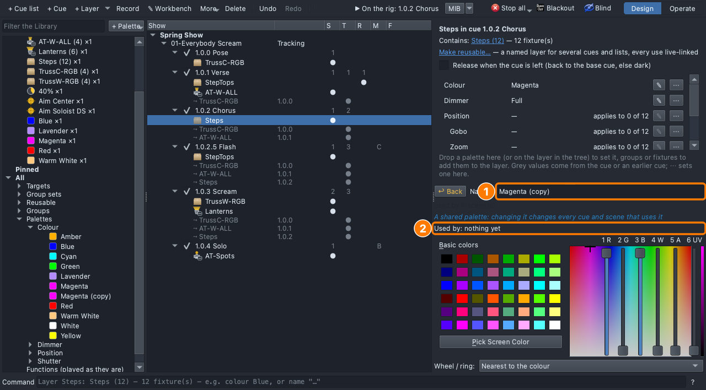
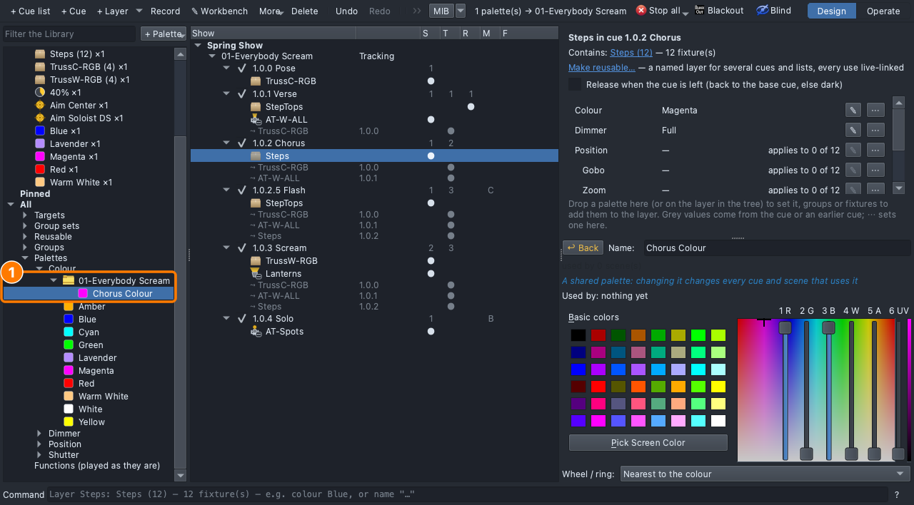
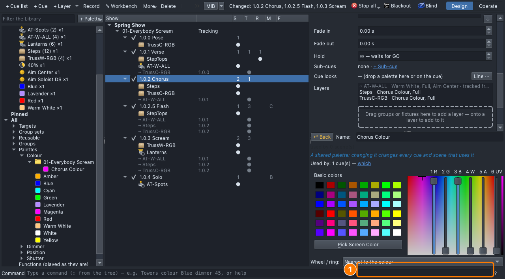
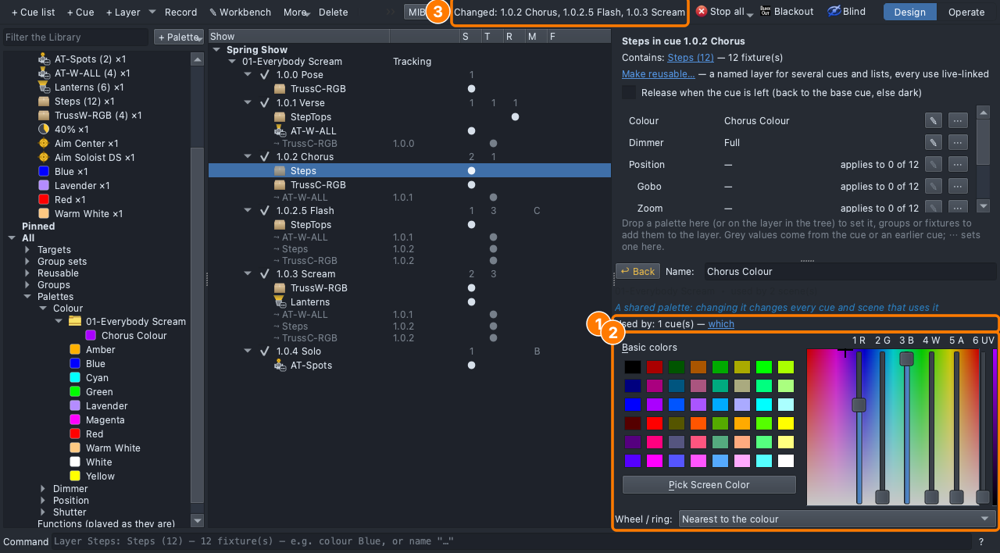

## Why

Colour tells the mood ([Lesson 0.4](../0-4/)), and a song's colours are a
set ([Lesson 0.5](../0-5/)). Notes come late: *"less pink"*, an hour
before the show. If every cue uses one palette, the note is one change.

## The plan

| Cue | When | Why | Lights |
|---|---|---|---|
| 1.0.2 Chorus *(change)* | The hook | | **Steps** and **TrussC-RGB**: **Chorus Colour**, the song's own palette |

Which cues change when Chorus Colour changes?

## Steps

1. **File ▸ Open** → `lesson-2-2-start.qlcc`.
2. Click the **Show Tree** tab (⇧⌘5); open **View ▸ Rig Overview** (⇧⌘R)
   beside it.
3. Library → **All → Palettes → Colour**: right-click **Magenta** →
   **Used by**. One use: the chorus's Steps.

   
4. Right-click **Magenta** → **Duplicate**. The copy opens in the Look
   Editor under the page.

   

5. In its **Name** box type `Chorus Colour`, press **Return**.
6. Right-click **Chorus Colour** → **Move to folder** → **New folder…**,
   type `01-Everybody Scream`, **OK**.

   

7. Click **1.0.2 Chorus**. Drag **Chorus Colour** onto the **Steps** row.
8. Drag **Chorus Colour** onto the grey **⤳ TrussC-RGB** row: it becomes
   the chorus's own.

   

9. Click the **Steps** row, then **✎** on its **Colour** row.
10. Under **Basic colors**, click the violet (third row, second column).
    The top bar: **Changed: 1.0.2 Chorus, 1.0.2.5 Flash, 1.0.3 Scream**.

    

11. Click **1.0.3 Scream**: its cyc is violet too.
12. Click **↩ Back** to close the Look Editor.
13. **File ▸ Save As** → `Lesson2-2-yourname.qlcc`.

**Stuck?** No Used by or Duplicate: right-click the palette under **All →
Palettes**, not in Recent. Magenta changed: undo, and click **✎** on the
chorus's Steps row. Only the steps changed: drop Chorus Colour on the
grey TrussC-RGB row too.

## Exit ticket

1. "Less pink", an hour before the show. How many changes do you make,
   and where?
2. Why copy Magenta into the song's own palette instead of changing
   Magenta?
3. Why **Chorus Colour** and not **Chorus Pink**?
4. What does **Used by** tell you, and when do you check it?

## At home

Do one:

- **App:** download [`lesson-2-2-finish.qlcc`](../../shows/lesson-2-2-finish.qlcc).
  Duplicate **Lavender**, name it `Verse Colour`, move it to
  **01-Everybody Scream**, drop it on the verse's **StepTops**, then pick
  a verse colour you like better. Bring in `Lesson2-2-Home-yourname.qlcc`.
- **Paper:** plan four to six palettes for a song, named by job (*Verse
  Colour*, *Cyc Colour*, *Solo Level*…), each with its value and the cues
  that use it. Then a note, "the verse is too cold": what do you change?
