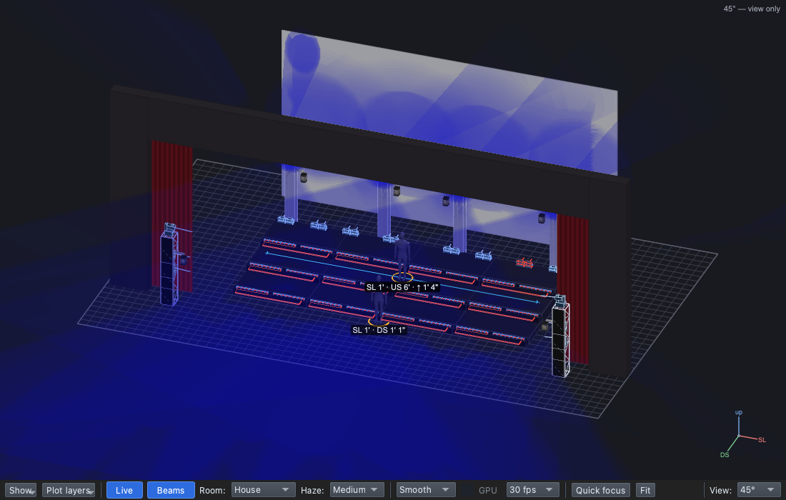
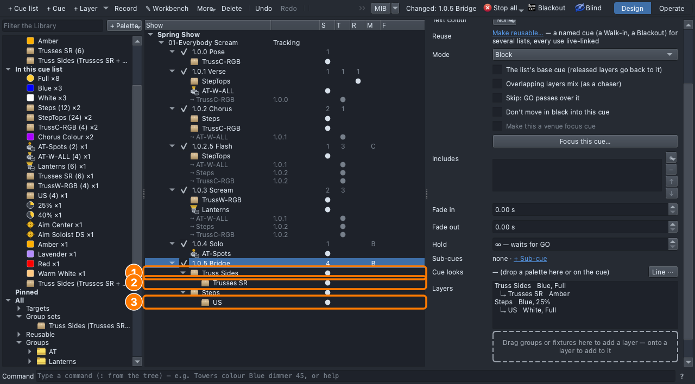

# Lesson 2.3 — Parts of a group

**Student handout**

## Why this matters

The audience looks where the light tells it to: at contrast, at the
brightest place ([Lesson 0.4](../../level-0/lesson-04/handout.md)). In a
call and response, the light follows who is singing, so it has to light
part of the choir and not the rest
([Lesson 0.5](../../level-0/lesson-05/handout.md): light the staging).
And balance matters: both sides the same reads as calm and formal;
breaking the symmetry sends the eye to the difference. Today you light
parts of a group without taking the look apart
([Lesson 0.3](../../level-0/lesson-03/handout.md): a look is layers, each
with one job).

## Today you will

- make a **group set** of the two truss sides and light them as one;
- give one side its own colour with a **child layer**;
- pick out the top row of singers with a child layer on the Steps.

## Words for today

| Word | Means |
|---|---|
| **Symmetry** | Both sides of the stage lit the same. Balanced; breaking it draws the eye. |
| **Call and response** | One part of the choir sings a line, another answers. |
| **Group set** | One name for several groups, used as one: **Truss Sides** = Trusses SR + Trusses SL. A layer on a set is one layer. |
| **Child layer** | A layer on part of its parent (one member of its set, or a group inside it). It sets only what it sets; the parent lights the rest. Shown **↳** under its parent. |

## Part 1 — Design it (on paper, everyone)

After the Solo comes the bridge. The SR half of the choir sings the call,
SL answers, and the top row (US) takes the last line.

| Cue | When | Why (feel) | Lights |
|---|---|---|---|
| 1.0.5 Bridge *(new)* | After the solo | | **Block**. **Truss Sides**: Blue, Full, with **↳ Trusses SR**: Amber. **Steps**: Blue, 25%, with **↳ US**: White, Full |

Where will the audience look first? ______________________

## Part 2 — Build it (at the laptop)

Roles: **Driver** (mouse), **Navigator** (reads each step aloud and checks
*You should see*), **Designer** (holds this sheet, watches the stage).
Switch roles after each part.

**On Windows or Linux:** where it says ⌘, press **Ctrl**; ⇧ is
**Shift** everywhere.

### Get ready

1. Open qlcconsole, choose **File → Open** and open
   `lesson-2-3-start.qlcc` (where Lesson 2.2 finished).
2. Click the **Show Tree** tab (⇧⌘5) and open **View → Rig Overview**
   (⇧⌘R) beside it.

### The bridge

3. Click **1.0.4 Solo**, then **+ Cue**, type `Bridge` and press
   **Return**. Set its **Mode** to **Block**: a hard start (Lesson 2.1).
   - *You should see:* **1.0.5 Bridge**, **B** under **M**, a dark stage.

### Both sides as one: a group set

4. In the Library, open **All → Groups → Trusses**. Click **Trusses SR**,
   then **⌘-click** **Trusses SL**. Right-click one of them → **Make
   set…**, type `Truss Sides` and click **OK**.
   - *You should see:* **All → Group sets → Truss Sides (Trusses SR +
     Trusses SL)**.

5. Drag **Truss Sides** onto the Bridge's dashed box. The top bar reads
   *"one layer on Truss Sides in 1.0.5 Bridge"*.
6. Drag **Blue**, then **Full**, onto the **Truss Sides** row.
   - *You should see:* both sides of the trusses blue: symmetric.

### The call: one side apart

7. In the tree, right-click the **Truss Sides** layer under 1.0.5 →
   **Add child layer** → **Trusses SR**.
   - *You should see:* **↳ Trusses SR** under Truss Sides, in the tree
     and on the cue's page. (A set stays one layer, so **Split** is grey
     on it: you change part of it with a child.)
8. Drag **Amber** onto the **↳ Trusses SR** row.
   - *You should see:* the SR side amber, the SL side still blue: the
     call has its own colour, and the eye goes to it.

### The top row takes the line

9. Drag **Steps** onto the dashed box, then **Blue** and **25%** onto its
   row.
10. Hold **⇧** and drag **US** (Groups → Steps) onto the **Steps** row. The
    top bar reads *"a child layer on US under Steps in 1.0.5 Bridge: it
    sets only what it sets"*.
11. Drag **White**, then **Full**, onto the **↳ US** row.
    - *You should see:* the top row of steps white and bright, the other
      two rows dim blue.

   **(1)** the set's layer, **(2)** its child, and **(3)** the Steps'
   child.

### Save

12. Save with **File → Save As** → `Lesson2-3-yourname.qlcc` in
    **Documents → qlcconsole**.

## Stuck?

| Problem | Try |
|---|---|
| **Make set…** made a set of one group | ⌘-click the second group before you right-click, so both are selected. |
| US became a layer of its own, not a child | Undo (⌘Z), and hold **⇧** all the way through the drop. |
| The whole truss turned amber | You dropped Amber on Truss Sides. Undo and drop it on the **↳ Trusses SR** row. |
| No **Add child layer** in the menu | Right-click the layer's row in the tree (under 1.0.5), not the cue. |
| Something else went wrong | Undo (⌘Z) one step at a time. |

## Done early? (Extension)

**Split and merge.** Two groups dropped together are one layer.

1. In the Library, click **CS**, ⌘-click **DS**, and drag them together
   onto the Bridge's dashed box: one layer, **CS + DS**. Drop **Red** on
   its row. It's lower in the cue than Steps, so where they overlap it
   wins: the CS and DS rows turn red.
2. Right-click **CS + DS** in the tree → **Split layer (one per group)**:
   a layer each, CS and DS, both still red. Nothing on stage changes.
3. Click **CS**, ⌘-click **DS** in the tree, then **More ▾ → Merge**: one
   layer again.
4. Undo (⌘Z) back to your bridge. When would you want two layers, and
   when one?
