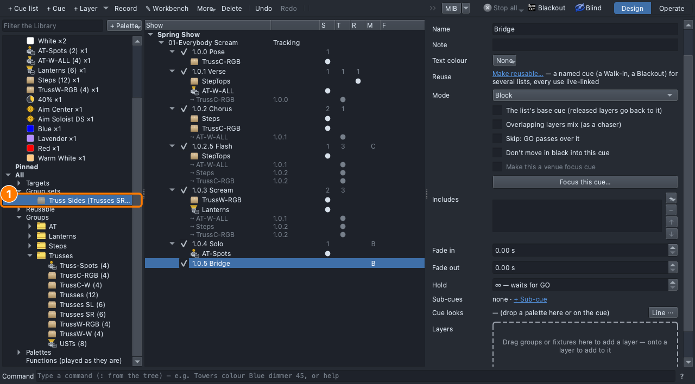
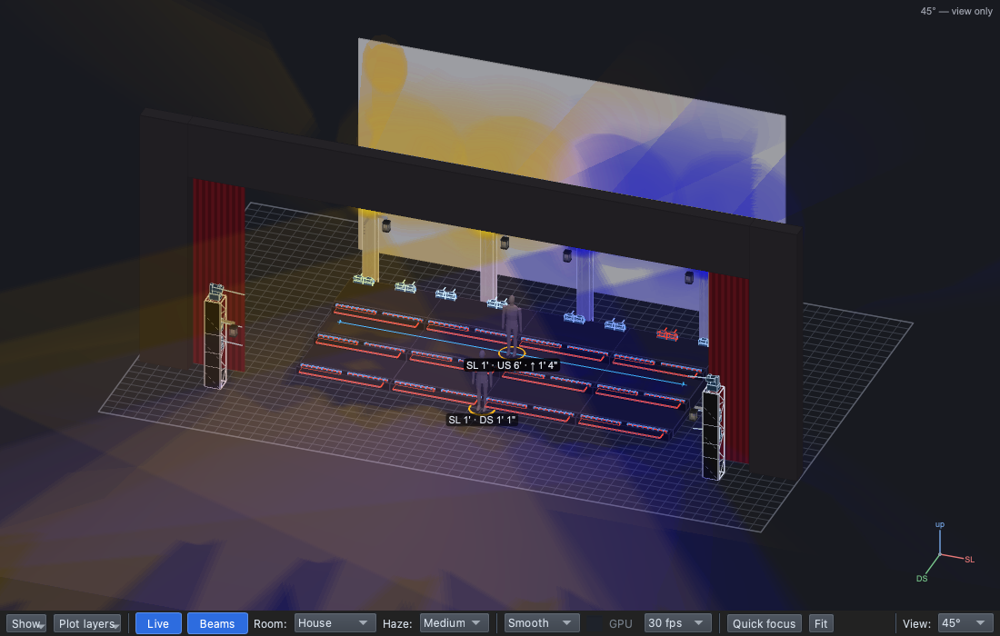
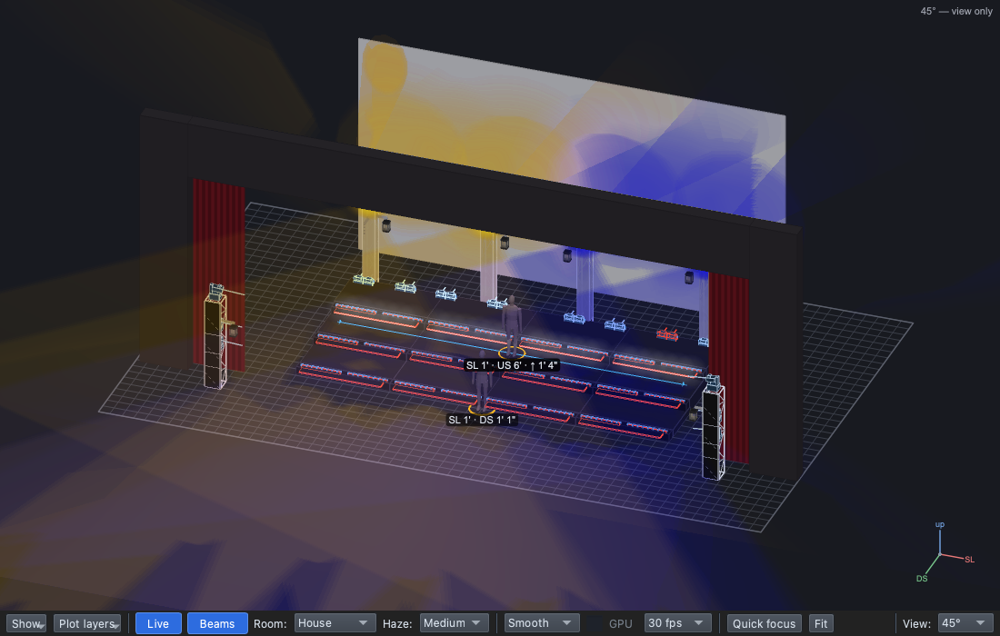

## Why

The audience looks at contrast and at the brightest place
([Lesson 0.4](../0-4/)). In a call and response the light follows who's
singing ([Lesson 0.5](../0-5/)), so you light part of the choir and hold
the rest back, without taking the look apart ([Lesson 0.3](../0-3/)).

## The plan

| Cue | When | Why | Lights |
|---|---|---|---|
| 1.0.5 Bridge *(new)* | After the solo | | **Block**. **Truss Sides**: Blue, Full; **↳ Trusses SR**: Amber. **Steps**: Blue, 25%; **↳ US**: White, Full |

Where will the audience look first?

## Steps

1. **File → Open** → `lesson-2-3-start.qlcc`.
2. Click the **Show Tree** tab (⇧⌘5); open **View → Rig Overview** (⇧⌘R)
   beside it.
3. Click **1.0.4 Solo**, **+ Cue**, type `Bridge`, **Return**. Set
   **Mode** to **Block**.
4. Library → **All → Groups → Trusses**: click **Trusses SR**, ⌘-click
   **Trusses SL**, right-click → **Make set…**, type `Truss Sides`, **OK**.

   

5. Drag **Truss Sides** (All → Group sets) onto the dashed box.
6. Drag **Blue** and **Full** onto its row: both sides blue.
7. In the tree, right-click the **Truss Sides** layer → **Add child
   layer** → **Trusses SR**.
8. Drag **Amber** onto the **↳ Trusses SR** row: SR amber, SL blue.

   

9. Drag **Steps** onto the dashed box, then **Blue** and **25%** onto its
   row.
10. Hold **⇧** and drag **US** onto the **Steps** row: a child layer.
11. Drag **White** and **Full** onto the **↳ US** row.

    

12. **File → Save As** → `Lesson2-3-yourname.qlcc`.

**Stuck?** The set has one group: ⌘-click the second before you
right-click. US isn't under Steps: undo, hold ⇧ all through the drop.
The whole truss is amber: undo, drop it on **↳ Trusses SR**.

## Exit ticket

1. What is a **child layer**, and what does it set?
2. What does one layer on the set **Truss Sides** give you that two
   layers on the sides wouldn't?
3. Both sides blue, then SR amber: what does each say to the audience?
4. In the bridge, where does the audience look first, and why?

## At home

Do one:

- **App:** download [`lesson-2-3-finish.qlcc`](../../shows/lesson-2-3-finish.qlcc).
  Add **1.0.6 Response** after the Bridge, **Block**: **Truss Sides** Blue,
  Full with a child **Trusses SL** in Amber; **Steps** Blue, 25% with a
  child **DS** (⇧-drop) in White, Full. Bring in
  `Lesson2-3-Home-yourname.qlcc`.
- **Paper:** draw the stage from above. Light a four-line bridge: SR
  sings, SL answers, the top row, all together. Which lines are
  symmetric? What does breaking it do?
