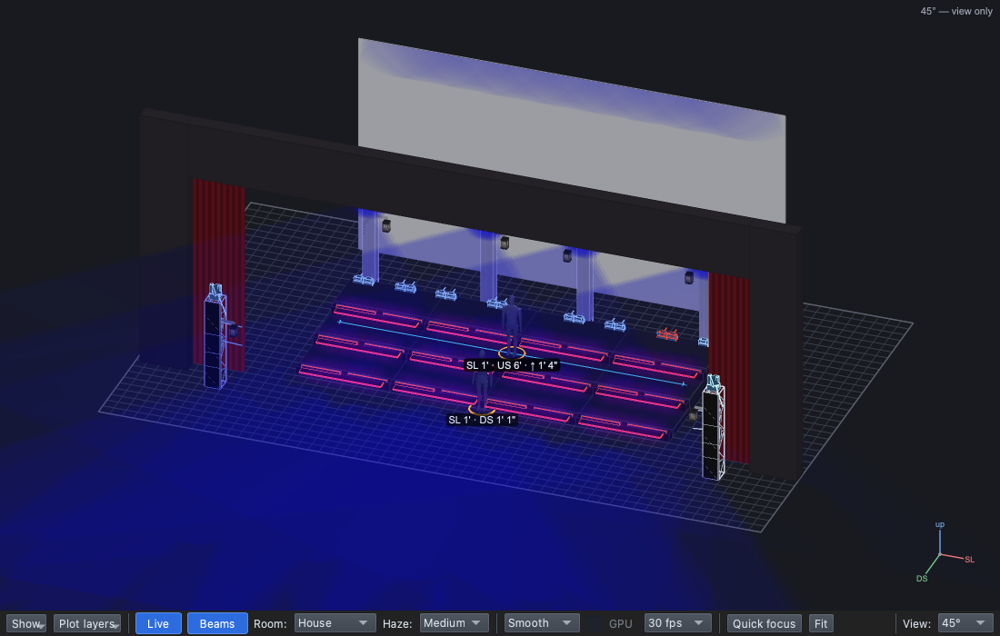
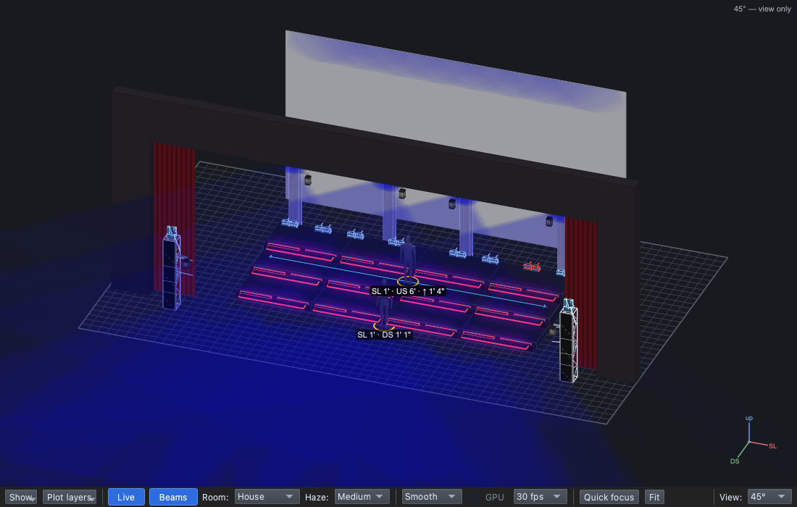

# Lesson 2.4 — Effects: sparkle and wave

**Student handout**

## Why this matters

Movement is one of the four things light can do
([Lesson 0.2](../../level-0/lesson-02/handout.md)), and moving light pulls
the eye ([Lesson 0.4](../../level-0/lesson-04/handout.md)). In a dance
break the music is at its most energetic: light that sparkles and
travels matches it and builds to the peak
([Lesson 0.6](../../level-0/lesson-06/handout.md)). The same effect in a
verse would pull focus from the story. And effects are eye candy: they
go on the scenery, never at the cost of light on the singers.

## Today you will

- light the dance break: steps, step tops and truss boxes;
- make two **effect palettes** of the song's own;
- put a **sparkle** on the steps with **its own colour**, and a **wave**
  on the truss boxes.

## Words for today

| Word | Means |
|---|---|
| **Effect** | A pattern that moves through the lights: a sparkle, a wave, a chase. In the Show Tree, an effect palette dropped on a layer. |
| **Effect palette** | A palette that plays an effect. Made with **+ Palette → Effect**; the effect is picked in the **effect picker**. |
| **Sparkle** | Pixels flash and fade at random, like glitter. |
| **Wave** | Brightness that travels across the lights (here, *Rainbow* with one colour: it sweeps that colour across them). |
| **Its own colour** | A colour that belongs to the effect only: the sparkle glints white while the steps stay in the chorus colour. |
| **Eye candy** | Light that looks good on its own (moving scenery, sparkle) but doesn't light the people. |

## Part 1 — Design it (on paper, everyone)

After the bridge, the band kicks in and the choir dances.

| Cue | When | Why (feel) | Lights |
|---|---|---|---|
| 1.0.6 Dance Break *(new)* | The band kicks in | | **Block**. **Steps**: Chorus Colour, Full, **Step Sparkle** in White. **StepTops**: Blue, 25% (still). **TrussW-RGB**: Blue, Full, **Truss Wave** |

Which lights move, and which stay still? Why? ______________________

## Part 2 — Build it (at the laptop)

Roles: **Driver** (mouse), **Navigator** (reads each step aloud and checks
*You should see*), **Designer** (holds this sheet, watches the stage).
Switch roles after each part.

**On Windows or Linux:** where it says ⌘, press **Ctrl**.

### Get ready

1. Open qlcconsole, choose **File → Open** and open
   `lesson-2-4-start.qlcc` (where Lesson 2.3 finished).
2. Click the **Show Tree** tab (⇧⌘5) and open **View → Rig Overview**
   (⇧⌘R) beside it.

### The dance break, still

3. Click **1.0.5 Bridge**, then **+ Cue**, type `Dance Break` and press
   **Return**. Set its **Mode** to **Block**.
4. Drag **Steps** onto the dashed box, then **Chorus Colour** and **Full**
   onto its row.
5. Drag **StepTops** onto the dashed box, then **Blue** and **25%**.
6. Drag **TrussW-RGB** onto the dashed box, then **Blue** and **Full**.
   - *You should see:* the steps violet, the step tops dim blue, the
     truss boxes blue. Nothing moves yet.

### A sparkle on the steps

7. In the Library, click the folder **Palettes → Colour → 01-Everybody
   Scream**, so the new palette goes in the song's folder. Then click
   **+ Palette → Effect**.
   - *You should see:* **New Effect** in the Look Editor under the page.
8. If the effect picker isn't open, click **Change effect…**. In the
   picker's search box type `Sparkle`, click **Sparkle · Dimmer**, then
   **Done**.

   **(1)** search, **(2)** the effect, **(3)** Done.

9. In the Look Editor's **Name** box, type `Step Sparkle` and press
   **Return**.
10. Click **1.0.6 Dance Break**, then drag **Step Sparkle** onto the
    **Steps** row.
    - *You should see:* the steps twinkle, pixel by pixel.
11. Click **↩ Back** to close the Look Editor, then click the **Steps**
    row. On its **Dimmer effect** row, click **⋯ → Its own colour /
    dimmer → White**.
    - *You should see:* the row reads **Step Sparkle in White**: white
      glints over the violet steps.

   **(1)** the effect row and **(2)** its ⋯.

### A wave on the trusses

12. Click the **01-Everybody Scream** folder in the Library again, then
    **+ Palette → Effect**.
13. If the picker isn't open, click **Change effect…**. Search `Rainbow`,
    click **Rainbow**, then **Done**.
    Name it `Truss Wave` and press **Return**.
14. Click **1.0.6 Dance Break** and drag **Truss Wave** onto the
    **TrussW-RGB** row.
    - *You should see:* a wave of blue travels across the truss boxes.
      With one colour in the look, Rainbow sweeps that colour instead of
      the rainbow. The step tops stay still.

15. Click **↩ Back** to close the Look Editor.

### Save

16. Save with **File → Save As** → `Lesson2-4-yourname.qlcc` in
    **Documents → qlcconsole**.

## Stuck?

| Problem | Try |
|---|---|
| The picker shows nothing for your search | Clear the search box first: it keeps what you typed last time. |
| The new palette isn't in the song's folder | Click the folder in the Library before **+ Palette**. Or right-click it → **Move to folder**. |
| No **Its own colour / dimmer** in the menu | Use the ⋯ on the **Dimmer effect** row, not the Colour row. |
| The steps don't twinkle | Drop Step Sparkle on the **Steps** row, not on the dashed box. |
| Something else went wrong | Undo (⌘Z) one step at a time. |

## Done early? (Extension)

**On the beat: a speed master.** An effect can run on a **speed
master**, so one tap moves everything on it together.

1. In the Library, right-click **Truss Wave** → **Edit**.
2. In the Look Editor, set **Speed** to **Main Speed**.
3. Look at the footer: a **Main Speed 120** button appears, beside the
   Grand Master. The wave now counts in beats of that master.
4. Which effects in a show would you put on the same master, and why?
