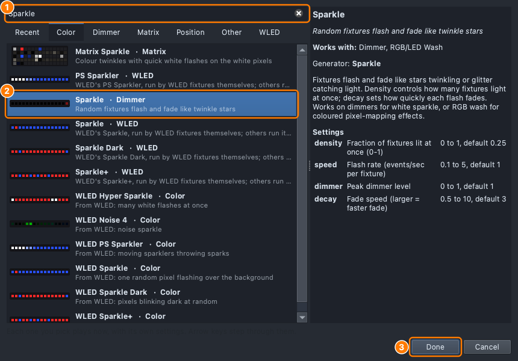
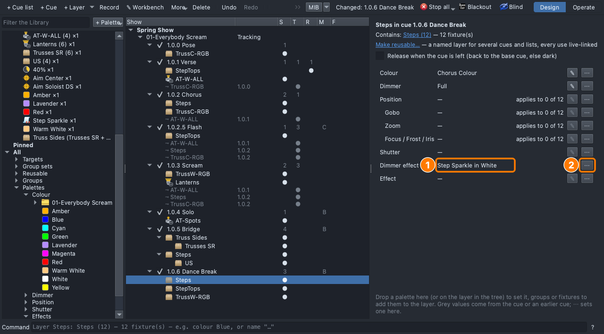
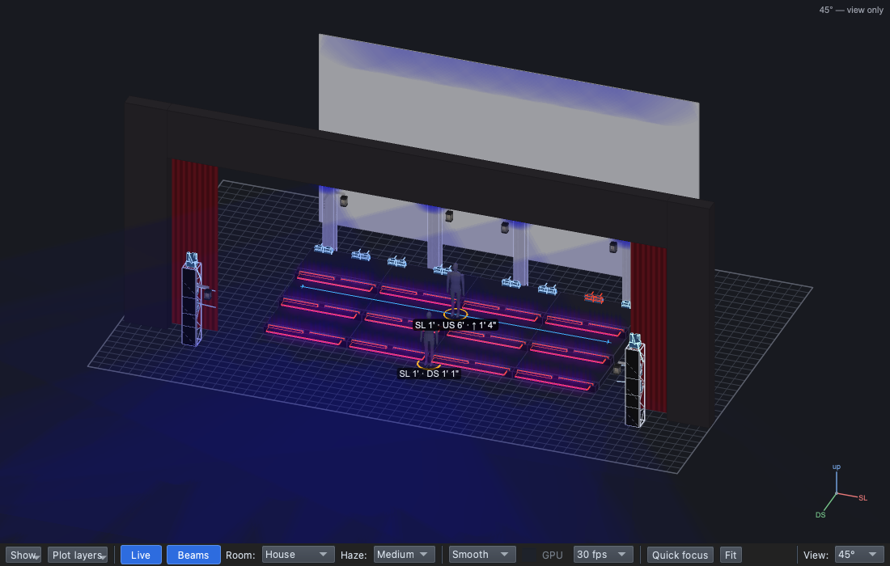

## Why

Movement is one of the four qualities of light ([Lesson 0.2](../0-2/))
and it pulls the eye ([Lesson 0.4](../0-4/)). The dance break is the
energy peak ([Lesson 0.6](../0-6/)): light that moves matches it. Effects
go on the scenery, never at the cost of light on the singers.

## The plan

| Cue | When | Why | Lights |
|---|---|---|---|
| 1.0.6 Dance Break *(new)* | The band kicks in | | **Block**. **Steps**: Chorus Colour, Full, **Step Sparkle** in White. **StepTops**: Blue, 25%. **TrussW-RGB**: Blue, Full, **Truss Wave** |

Which lights move, and which stay still?

## Steps

1. **File ▸ Open** → `lesson-2-4-start.qlcc`.
2. Click the **Show Tree** tab (⇧⌘5); open **View ▸ Rig Overview** (⇧⌘R)
   beside it.
3. Click **1.0.5 Bridge**, **+ Cue**, type `Dance Break`, **Return**.
   **Mode**: **Block**.
4. Drop **Steps** (Chorus Colour, Full), **StepTops** (Blue, 25%) and
   **TrussW-RGB** (Blue, Full) as layers.
5. In the Library click **Palettes → Colour → 01-Everybody Scream**, then
   **+ Palette → Effect**.
6. If the browser isn't open, click **Change effect…**. Search `Sparkle`,
   click **Sparkle · Dimmer**, **Done**.

   

   The browser lists every effect. **Built-in · Mine · This show** narrow it by where an effect came from.

7. In the Look Editor's **Name**, type `Step Sparkle`, **Return**.
8. Click **1.0.6 Dance Break**; drag **Step Sparkle** onto the **Steps**
   row. The steps twinkle.
9. Click **↩ Back**, then the **Steps** row. On **Dimmer effect**: **⋯ →
   Its own colour / dimmer → White**.

   

10. Click the song folder again, **+ Palette → Effect**; pick **Rainbow**
    (Change effect… if needed), **Done**; name it `Truss Wave`.
11. Click **1.0.6 Dance Break**; drag **Truss Wave** onto the
    **TrussW-RGB** row: a wave of blue across the boxes.

    

12. Click **↩ Back**. **File ▸ Save As** → `Lesson2-4-yourname.qlcc`.

The sparkle runs as long as the cue plays (**Runs: Loop** in the Look Editor). Once and N times stop it after that many runs.

**Stuck?** The search finds nothing: clear the box first. No *Its own
colour*: use the ⋯ on the **Dimmer effect** row. Not twinkling: drop it
on the **Steps** row, not the dashed box.

## Exit ticket

1. Why does the dance break get effects, and the verse doesn't?
2. Which lights in our dance break are eye candy, and what must never be
   given up for it?
3. What does **its own colour** do on the Step Sparkle?
4. Why make effect palettes in the song's folder, named for their job?

## At home

Do one:

- **App:** download [`lesson-2-4-finish.qlcc`](../../shows/lesson-2-4-finish.qlcc).
  On the dance break's Steps, set the sparkle's own colour to **Amber**,
  then **None of its own**. Which suits it best, and why? Bring in
  `Lesson2-4-Home-yourname.qlcc` set that way.
- **Paper:** list our stage's lights; for each write still or moves (and
  how), keep the lights on the dancers still, and say how fast each
  effect goes against the music.
