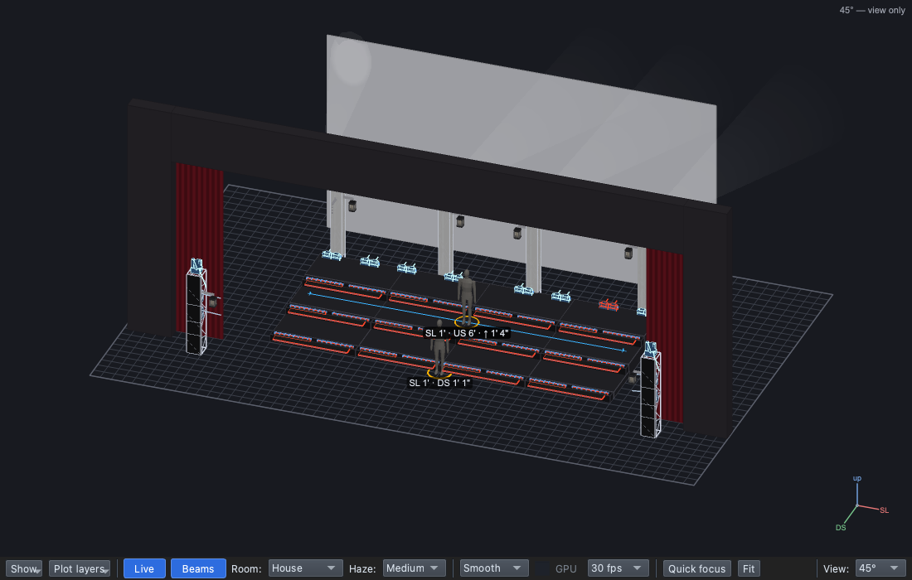

# Lesson 2.5 — Moving lights and lines

**Student handout**

## Why this matters

In haze, a beam is a shape in the air: scenery made of light
([Lesson 0.3](../../level-0/lesson-03/handout.md)), and when it moves the
eye follows it ([Lesson 0.2](../../level-0/lesson-02/handout.md),
[0.4](../../level-0/lesson-04/handout.md)). The end of a song is where
that pays off. The **button** tells the audience the number is over and
it's time to applaud ([Lesson 0.6](../../level-0/lesson-06/handout.md)):
beams that fan across the choir and then snap into a cross on the last
note make an ending nobody misses.

## Today you will

- aim moving lights at a **line**, so they fan out along it;
- cross them for the button with **Spread −5**, in red;
- give the button a one-second fade so the beams sweep.

## Words for today

| Word | Means |
|---|---|
| **Line target** | A stage target that is a line, not a point: each light aimed at it gets its own point along it. Ours is **Riser Line**, across the CS row. |
| **Spread** | How the lights share the line: **+5** end to end, **0** all on the centre, **below 0** crossed (−5 fully crossed). |
| **Fan / cross** | Beams spread out from their lights / beams that cross over each other. |
| **Order strip / plan view** | Under the Position row: where each light lands on the line, numbered, and the same from above. |
| **Colour wheel / colour ring** | A spot's colour comes from named slots (a wheel of filters, a ring of LEDs round the lens). A colour picks the nearest slot. |

## Part 1 — Design it (on paper, everyone)

The last chorus ends; the choir hits its final pose.

| Cue | When | Why (feel) | Lights |
|---|---|---|---|
| 1.0.7 Fan *(new)* | The last line | | **Block**. **Truss-Spots**: White, Full, aimed at **Riser Line** (spread end to end) |
| 1.0.8 Button *(new)* | The last note | | The same beams, **Spread −5** (crossed), **Red**, fade in 1 s |

Why might the button be a quick sweep, not a snap? ______________________

## Part 2 — Build it (at the laptop)

Roles: **Driver** (mouse), **Navigator** (reads each step aloud and checks
*You should see*), **Designer** (holds this sheet, watches the stage).
Switch roles after each part.

**On Windows or Linux:** where it says ⌘, press **Ctrl**.

### Get ready

1. Open qlcconsole, choose **File ▸ Open** and open
   `lesson-2-5-start.qlcc` (where Lesson 2.4 finished).
2. Click the **Show Tree** tab (⇧⌘5) and open **View ▸ Rig Overview**
   (⇧⌘R) beside it.

### The fan

3. Click **1.0.6 Dance Break**, then **+ Cue**, type `Fan` and press
   **Return**. Set its **Mode** to **Block**.
4. Drag **Truss-Spots** (Groups → Trusses) onto the dashed box, then
   **White** and **Full** onto its row.
   - *You should see:* the four truss spots on, pointing wherever they
     rest: no position yet (Lesson 1.3).

5. Drag **Riser Line** (All → Targets) onto the **Truss-Spots** row. The
   top bar reads *"Aim at Riser Line → layer Truss-Spots in 1.0.7 Fan"*.
   - *You should see:* the four beams land one after another along the
     line across the CS row: a fan.

6. Click the **Truss-Spots** row.
   - *You should see:* **Position: Aim Riser Line**, the order strip and
     the plan view under it, and **Spread: +5 — the Aim look's**.

   **(1)** the aim, **(2)** Spread, **(3)** the order strip, **(4)** the
   plan view.

### The button

7. Click **1.0.7 Fan**, then **+ Cue**, type `Button` and press
   **Return**.
   - *You should see:* **1.0.8 Button**, with a grey **⤳ Truss-Spots**
     row: the fan tracks in.
8. Click the grey **Truss-Spots** row. On its **Spread** row, click **⋯ →
   −5**.
   - *You should see:* **Spread: −5**, the layer is the Button's own now,
     and the top bar reads **Changed: 1.0.8 Button**. The beams cross.
9. Click **1.0.8 Button** and drag **Red** onto the **Truss-Spots** row.
   - *You should see:* red beams. The spots have no colour mixing: their
     colour wheel and their colour ring each turn to the slot nearest
     red.
10. Type `1` in **Fade in** and press **Return**: on GO, the beams sweep
    from the fan into the cross over one second.

### Save

11. Save with **File ▸ Save As** → `Lesson2-5-yourname.qlcc` in
    **Documents → qlcconsole**.
12. Optional: play it. In the **Run** tab, click **1.0.7 Fan** to load it,
    press **GO**, then **GO** again for the button.

## Stuck?

| Problem | Try |
|---|---|
| The beams don't move onto the line | Drop **Riser Line** on the **Truss-Spots** row, not the dashed box. |
| The fan crossed too | You set −5 in the Fan. Undo (⌘Z), click **1.0.8 Button**, and set it there. |
| No **Spread** row | It shows only under a Position that aims at a line. Check the row says **Aim Riser Line**. |
| The spots are hard to see | In the Rig Overview, set **Room** to **Dim**. |
| Something else went wrong | Undo (⌘Z) one step at a time. |

## Done early? (Extension)

1. In **1.0.7 Fan**, click the **Truss-Spots** row and set **Spread ⋯ →
   0**: every beam on the middle of the line, a single hot spot.
2. Set **Grouping ⋯ → Pairs** and watch the order strip: the lights move
   in pairs.
3. Undo (⌘Z) back to your fan. Which looks best on the last line, and
   why?
4. Fan the upstage beams too. In **1.0.7 Fan**, drag **USTs**
   (Groups) onto the dashed box, **White** and **Full** onto its row, and
   **Riser Line** onto the row. The eight beams aim at the singers on the
   line, one each, evenly spaced. Why would the USTs and the truss spots
   make a stronger fan together than either alone?
