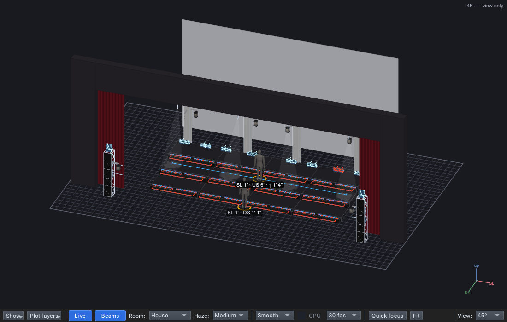
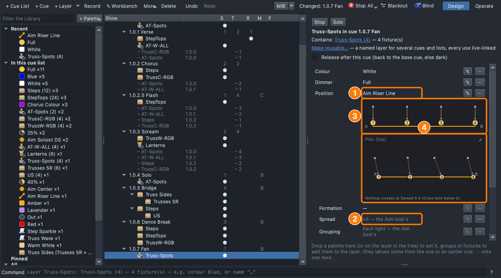
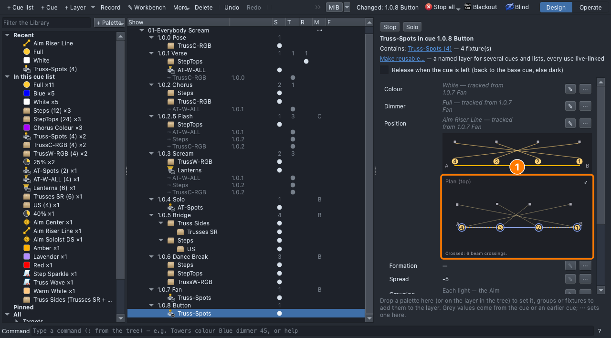
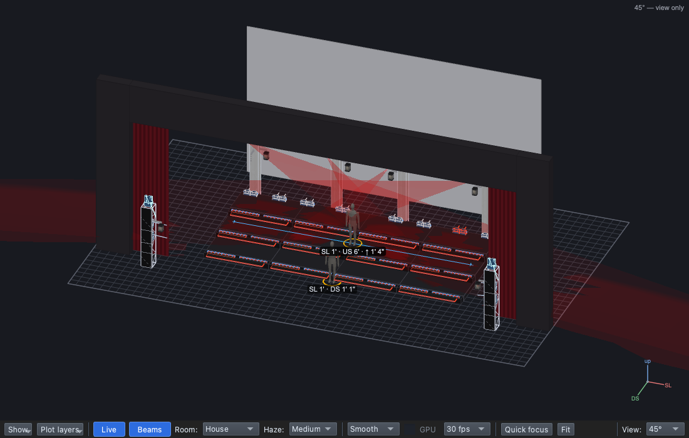

## Why

In haze a beam is scenery ([Lesson 0.3](../0-3/)), and moving light
pulls the eye ([Lesson 0.2](../0-2/)). The button ends the song and asks
for applause ([Lesson 0.6](../0-6/)): beams that fan, then sweep into a
cross on the last note, make an ending nobody misses.

## The plan

| Cue | When | Why | Lights |
|---|---|---|---|
| 1.0.7 Fan *(new)* | The last line | | **Block**. **Truss-Spots**: White, Full, aimed at **Riser Line** |
| 1.0.8 Button *(new)* | The last note | | The same, **Spread −5**, **Red**, fade in 1 s |

A snap or a quick sweep for the button? Why?

## Steps

1. **File ▸ Open** → `lesson-2-5-start.qlcc`.
2. Click the **Show Tree** tab (⇧⌘5); open **View ▸ Rig Overview** (⇧⌘R)
   beside it.
3. Click **1.0.6 Dance Break**, **+ Cue**, type `Fan`, **Return**.
   **Mode**: **Block**.
4. Drag **Truss-Spots** onto the dashed box; **White** and **Full** onto
   its row.
5. Drag **Riser Line** (All → Targets) onto the **Truss-Spots** row: a
   fan along the CS row.

   

6. Click the **Truss-Spots** row: the aim, the order strip, the plan view
   and **Spread +5**.

   

7. The Fan is a Block cue, so the spots would swing onto the line lit.
   Mark them in the cue before it: click **1.0.6 Dance Break**, drag
   **Truss-Spots** onto the dashed box, then **Out** and **Riser Line**
   onto the **Truss-Spots** row.
8. Click **1.0.7 Fan**, **+ Cue**, type `Button`, **Return**.
9. Click the grey **Truss-Spots** row; **Spread ⋯ → −5**: the beams cross.
   In the plan view (from above, downstage at the bottom) each beam is a
   line from where its light hangs to its point on the line, so a cross
   shows as lines that cross. Read the caption under it. With Grouping set,
   lights that move together share a colour, and it counts the crossings
   (*Groups swap sides: 24 beam crossings*). **Cross** does something only
   with Spread below 0; at +5 or 0 the plan says so.

   
10. Click **1.0.8 Button**; drag **Red** onto the **Truss-Spots** row.
11. Type `1` in **Fade in**, **Return**.

    

11. **File ▸ Save As** → `Lesson2-5-yourname.qlcc`.

**Stuck?** The beams didn't move: drop Riser Line on the **row**, not the
dashed box. The fan crossed: undo, set −5 in the **Button**. No Spread
row: the Position must say **Aim Riser Line**.

## Keep a shape: Formation

A Spread and Grouping you like will be wanted again on another line, and
copying the numbers by hand lets them drift apart. **Save as Formation…**
keeps them as one palette.

1. Click the **Truss-Spots** row of **1.0.8 Button**: Spread is −5.
   Set **Grouping** to Pairs.
2. On the **Spread** row, **⋯ → Save as Formation…**, name it
   `Pairs Crossed`, **OK**. The layer now uses the palette and clears its
   own rows; it is one undo step.
3. Change the Formation and every cue that uses it follows. It is in the
   Library under **Formation**.

## Blocking: the same look, wherever the people stand

Theatre marks where a performer stands for a number with spike tape. If
the soloist stands downstage in one song and upstage in the next, you
don't want a second look for the same light; you want the target to move.
**Blocking** is that: a named set of stage target places, and a cue picks
one.

1. Open the Lighting Studio (⇧⌘3) and its **Blocking ▾** button: it says
   which blocking the plot shows. **Default** is where the targets stand
   when nothing says otherwise.
2. Click a cue, then its **Blocking** row on the cue page: **Default**, or
   a set. **Save Positions as Blocking…** makes a set from where the
   targets stand now and uses it from this cue on.
3. Pick the new set in **Blocking ▾**: a blue banner reads *Moving targets
   in …*, and a drag moves the selected targets in that blocking only. A
   dashed ring shows where Default puts each one.
4. Every look aimed at a target follows: the Aim looks, the line spreads,
   the follow spot. A cue keeps its blocking for the cues after it, until
   one sets its own.

Why it matters on the real rig: the focus you did in Lesson 3.6 is for
Default, and a blocking is an offset from it, so a venue's correction
carries into every set.

## Exit ticket

1. What does a **line target** do that a point target doesn't?
2. What do Spread **+5**, **0** and **−5** look like?
3. Why does the Button have a one-second fade in?
4. What did the spots' colour wheel and ring do with Red, and why not an
   exact red?

## At home

Do one:

- **App:** download [`lesson-2-5-finish.qlcc`](../../shows/lesson-2-5-finish.qlcc).
  In **1.0.7 Fan**, try **Spread ⋯ → 0**, then **+2.5**, then **Grouping
  ⋯ → Pairs**. Keep the one you like for the last line; bring in
  `Lesson2-5-Home-yourname.qlcc` and a sentence on why.
- **Paper:** draw the stage from above with four spots and the line.
  Draw Spread +5, 0 and −5, lights numbered 1–4 from SR. Which ends a
  song best?
- **Reuse it:** save Spread −5 and Grouping Pairs as a Formation (see
  *Keep a shape*), check it in its preview, then change it and watch every
  cue that uses it follow.
