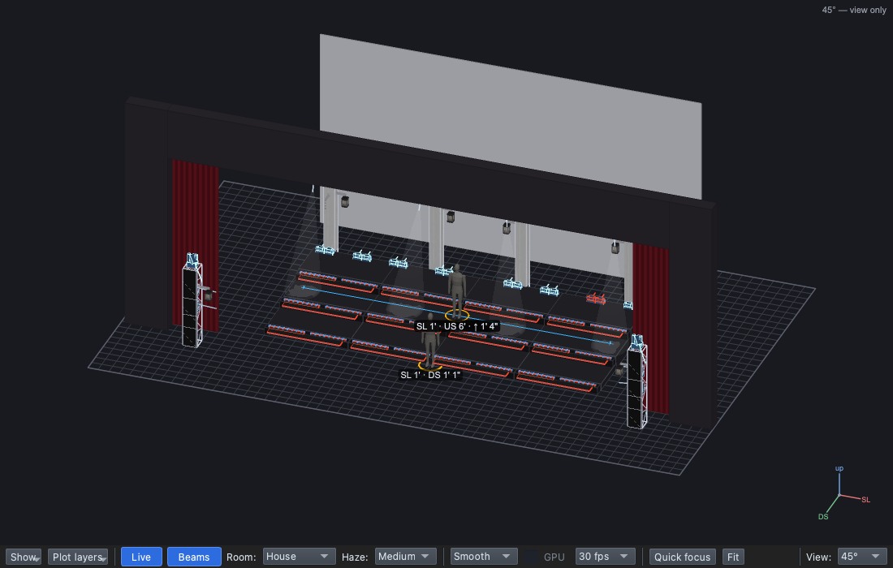
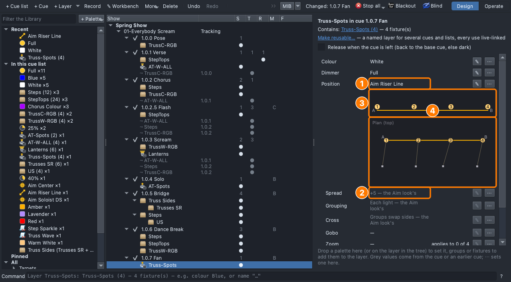
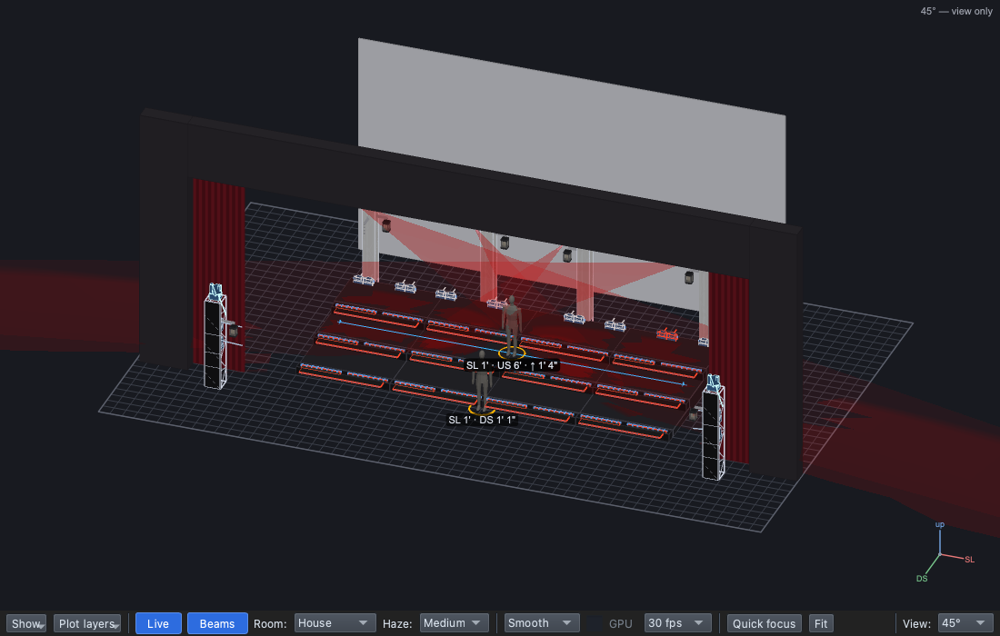

## Why

In haze a beam is scenery ([Lesson 0.3](../0-3/)), and moving light
pulls the eye ([Lesson 0.2](../0-2/)). The button ends the song and asks
for applause ([Lesson 0.6](../0-6/)): beams that fan, then sweep into a
cross on the last note, make an ending nobody misses.

## The plan

| Cue | When | Why | Lights |
|---|---|---|---|
| 1.0.7 Fan *(new)* | The last line | | **Block**. **Truss-Spots**: White, Full, aimed at **Riser Line** |
| 1.0.8 Button *(new)* | The last note | | The same, **Spread −5**, **Red**, fade in 1 s |

A snap or a quick sweep for the button? Why?

## Steps

1. **File → Open** → `lesson-2-5-start.qlcc`.
2. Click the **Show Tree** tab (⇧⌘5); open **View → Rig Overview** (⇧⌘R)
   beside it.
3. Click **1.0.6 Dance Break**, **+ Cue**, type `Fan`, **Return**.
   **Mode**: **Block**.
4. Drag **Truss-Spots** onto the dashed box; **White** and **Full** onto
   its row.
5. Drag **Riser Line** (All → Targets) onto the **Truss-Spots** row: a
   fan along the CS row.

   

6. Click the **Truss-Spots** row: the aim, the order strip, the plan view
   and **Spread +5**.

   

7. Click **1.0.7 Fan**, **+ Cue**, type `Button`, **Return**.
8. Click the grey **Truss-Spots** row; **Spread ⋯ → −5**: the beams cross.
9. Click **1.0.8 Button**; drag **Red** onto the **Truss-Spots** row.
10. Type `1` in **Fade in**, **Return**.

    

11. **File → Save As** → `Lesson2-5-yourname.qlcc`.

**Stuck?** The beams didn't move: drop Riser Line on the **row**, not the
dashed box. The fan crossed: undo, set −5 in the **Button**. No Spread
row: the Position must say **Aim Riser Line**.

## Exit ticket

1. What does a **line target** do that a point target doesn't?
2. What do Spread **+5**, **0** and **−5** look like?
3. Why does the Button have a one-second fade in?
4. What did the spots' colour wheel and ring do with Red, and why not an
   exact red?

## At home

Do one:

- **App:** download [`lesson-2-5-finish.qlcc`](../../shows/lesson-2-5-finish.qlcc).
  In **1.0.7 Fan**, try **Spread ⋯ → 0**, then **+2.5**, then **Grouping
  ⋯ → Pairs**. Keep the one you like for the last line; bring in
  `Lesson2-5-Home-yourname.qlcc` and a sentence on why.
- **Paper:** draw the stage from above with four spots and the line.
  Draw Spread +5, 0 and −5, lights numbered 1–4 from SR. Which ends a
  song best?
