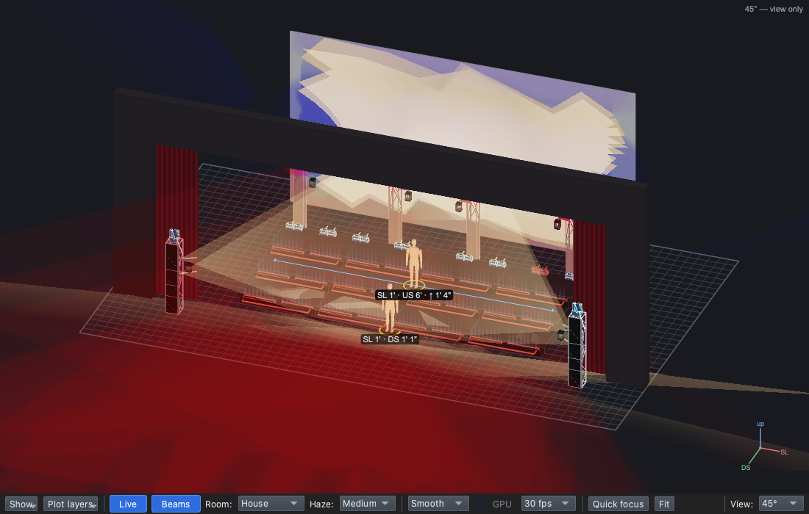

# Lesson 2.6 — Busking with Hits

**Student handout**

## Why this matters

A cue list is the plan, and a live show doesn't always follow it: the
band vamps until the choir is ready, a soloist holds a note longer, the
audience calls for an encore, something goes wrong on stage. Then the
board op **busks**: fires looks by feel, on the music
([Lesson 0.7](../../level-0/lesson-07/handout.md)). A sharp stab on a
drum hit is a sting ([Lesson 0.6](../../level-0/lesson-06/handout.md)),
and it only works if it's ready before the moment comes. Hits are those
looks, built ahead and one button away.

## Today you will

- build three **hits** for the song;
- put them on a **Virtual Console** page, a button each;
- fire one live over the running cue list, and let it go.

## Words for today

| Word | Means |
|---|---|
| **Busking** | Running lights live by feel, firing looks on the music instead of a fixed list. |
| **Hit** | A look kept ready to fire by hand, over whatever the cue list is playing. Built like a cue; it never tracks. Hits live in the production's **Hits** section. |
| **Virtual Console (VC)** | qlcconsole's on-screen control desk: buttons, faders, frames. Its tab is ⇧⌘6. |
| **Toggle button** | Click: on. Click again: off. |

## Part 1 — Design it (on paper, everyone)

During the verse the band might vamp, and the director wants three looks
ready:

| Hit | What it's for | Lights |
|---|---|---|
| **Red Stab** | A sting on a drum hit | **TrussW-RGB**: Red, Full |
| **Glow** | A warm hold while the choir resets | **Lanterns**: Amber, Full |
| **Faces** | Every face lit, whatever is on stage | **AT-W-ALL**: White, Full, aimed at **Center** |

When would you fire each one? ______________________

## Part 2 — Build it (at the laptop)

Roles: **Driver** (mouse), **Navigator** (reads each step aloud and checks
*You should see*), **Designer** (holds this sheet, watches the stage).
Switch roles after each part.

**On Windows or Linux:** where it says ⌘, press **Ctrl**.

### Get ready

1. Open qlcconsole, choose **File → Open** and open
   `lesson-2-6-start.qlcc` (where Lesson 2.5 finished).
2. Click the **Show Tree** tab (⇧⌘5) and open **View → Rig Overview**
   (⇧⌘R) beside it.

### Three hits

3. In the tree, right-click **Spring Show** → **+ Hit**.
   - *You should see:* a **Hits** section under the production, with a
     new hit selected and its page open.
4. In its **Name** box type `Red Stab` and press **Return**.
5. Drag **TrussW-RGB** onto the dashed box, then **Red** and **Full**
   onto its row.
6. Right-click **Spring Show** → **+ Hit** again. Name it `Glow`; drag
   **Lanterns** onto the dashed box, then **Amber** and **Full**.
7. Once more: `Faces`, with **AT-W-ALL**, **White** and **Full**, then
   drag **Center** (All → Targets) onto its row.

### A button each

8. Right-click **Hits** → **Make VC page**.
   - *You should see:* the top bar reads **VC page "Hits — Spring
     Show": 3 button(s), one per hit**; each hit shows **VC ×1** in the
     tree, and Red Stab's page says **Fired by: VC button "Red Stab"**.

   **(1)** the Hits section, **(2)** a hit, **(3)** the button that
   fires it.

9. Save with **File → Save As** → `Lesson2-6-yourname.qlcc` in
   **Documents → qlcconsole**.

### Busk it

10. Click **Operate** (top right). In the **Run** tab (⇧⌘8), press **GO**
    for the Pose and, when it has faded in, **GO** for the Verse.
11. Click the **Virtual Console** tab (⇧⌘6) and click **Red Stab**.
    - *You should see:* the truss boxes flash red over the verse, and
      the verse's own lights stay on under it.

12. Click **Red Stab** again: the stab goes, and the verse is as it was.
13. Back in the **Run** tab, press **Stop**, then click **Design**.

## Stuck?

| Problem | Try |
|---|---|
| No **+ Hit** in the menu | Right-click a row in the tree (the production is easiest), not the empty space below it. |
| The button does nothing | Click **Operate** first: in Design, VC buttons don't fire. |
| The hit's colour is wrong | Click the hit in the tree and check its row, as you would a cue's. |
| **Save** is greyed out | You're in Operate. Click **Design**, then save. |
| Something else went wrong | Undo (⌘Z) one step at a time. |

## Done early? (Extension)

1. In Operate, load **1.0.4 Solo** in the Run tab (click it) and press
   **GO**, then fire **Faces** from the Virtual Console. What does it do
   to the solo? When would you want that, and when not?
2. Let it go, press **Stop**, and go back to **Design**.
