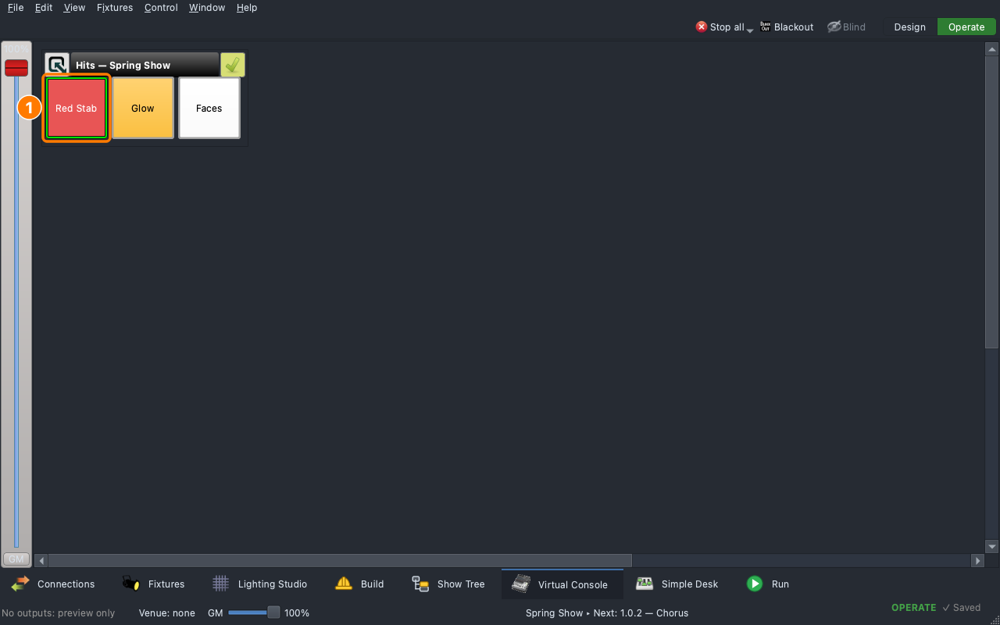

# Lesson 2.6 — Busking with Hits

The band vamps; the soloist goes long; something nobody planned happens.
Students build three **hits** ready for the moment (a red stab, a glow,
faces up), put them on a **Virtual Console** page with one button each,
and fire one live over the running cue list.

| For | File |
|---|---|
| Teacher | [Teacher guide](https://github.com/sandinak/qlcconsole/blob/main/docs/course/level-2/lesson-06/teacher-guide.md) · [Slides outline](https://github.com/sandinak/qlcconsole/blob/main/docs/course/level-2/lesson-06/slides.md) |
| Students | [Handout](handout.md) · [Exit ticket](exit-ticket.md) · [At home](at-home.md) |
| Show files | [`lesson-2-6-start.qlcc`](../../shows/lesson-2-6-start.qlcc) · [`lesson-2-6-finish.qlcc`](../../shows/lesson-2-6-finish.qlcc) |

