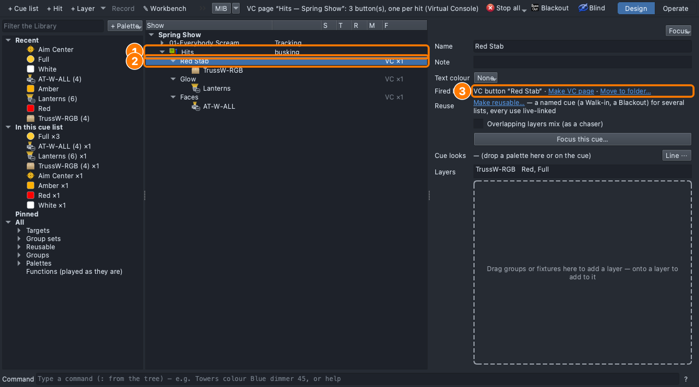

## Why

A live show doesn't always follow the plan: the band vamps, a soloist
goes long, an encore. The op busks ([Lesson 0.7](../0-7/)), and a sting
on a drum hit ([Lesson 0.6](../0-6/)) only works if it's ready before
the moment. Hits are those looks, one button away.

## The plan

| Hit | For | Lights |
|---|---|---|
| **Red Stab** | A sting on a drum hit | **TrussW-RGB**: Red, Full |
| **Glow** | A warm hold while the choir resets | **Lanterns**: Amber, Full |
| **Faces** | Every face lit | **AT-W-ALL**: White, Full, aimed at **Center** |

When would you fire each one?

## Steps

1. **File → Open** → `lesson-2-6-start.qlcc`.
2. Click the **Show Tree** tab (⇧⌘5); open **View → Rig Overview** (⇧⌘R)
   beside it.
3. Right-click **Spring Show** → **+ Hit**. Name it `Red Stab`,
   **Return**.
4. Drag **TrussW-RGB** onto the dashed box; **Red** and **Full** onto its
   row.
5. **+ Hit** again: `Glow`, **Lanterns**, **Amber**, **Full**.
6. Again: `Faces`, **AT-W-ALL**, **White**, **Full**, then **Center** on
   its row.
7. Right-click **Hits** → **Make VC page**: a button per hit.

   

8. **File → Save As** → `Lesson2-6-yourname.qlcc`.
9. Click **Operate**. In the **Run** tab (⇧⌘8): **GO**, then **GO** for
   the Verse.
10. **Virtual Console** tab (⇧⌘6): click **Red Stab**. The truss boxes go
    red over the verse.

    

11. Click **Red Stab** again: the verse is back as it was.
12. **Run** tab: **Stop**, then **Design**.

**Stuck?** The button does nothing: click **Operate** first. Can't save:
go back to **Design**. No **+ Hit**: right-click a row in the tree.

## Exit ticket

1. Name two moments when you'd busk instead of pressing GO.
2. How is a **hit** different from a cue?
3. You fired Red Stab in the verse. What happened to the verse's lights,
   and when you let it go?
4. Why a button per hit, named for what it does?

## At home

Do one:

- **App:** download [`lesson-2-6-finish.qlcc`](../../shows/lesson-2-6-finish.qlcc).
  Right-click **Hits** → **+ Hit** for an encore look, then **Make VC
  page** again: a new button, the others stay. Fire your hits over the
  song in Operate. Bring in `Lesson2-6-Home-yourname.qlcc` (save in
  Design).
- **Paper:** four hit cards for a vamp (a name for what it does, the
  lights, the moment). A partner sings a vamp; you hold them up on the
  beat. Swap.
