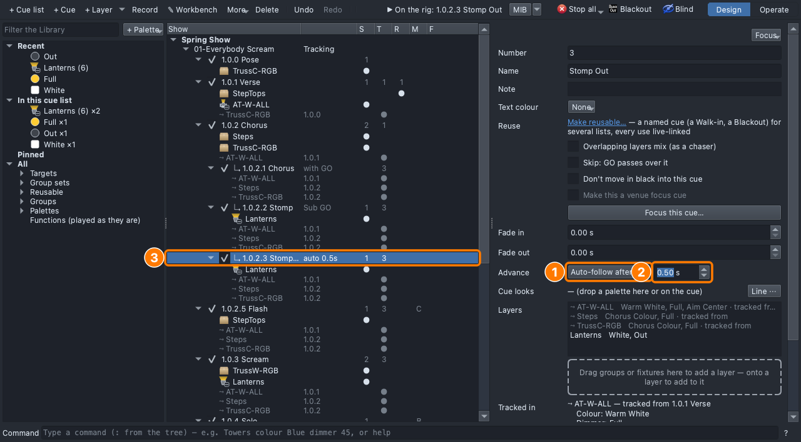
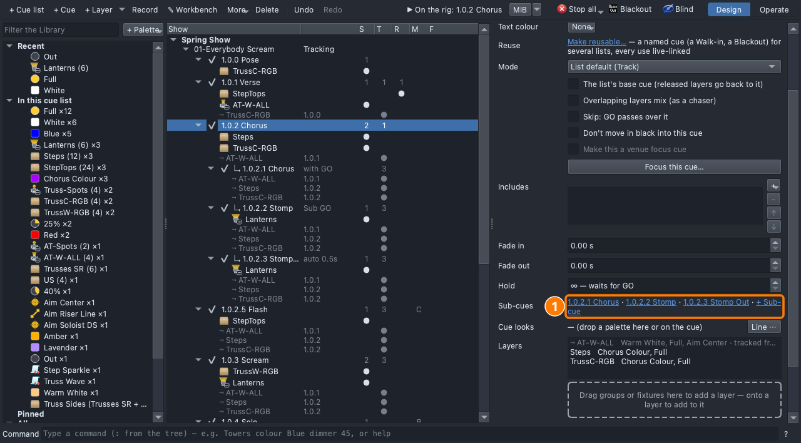
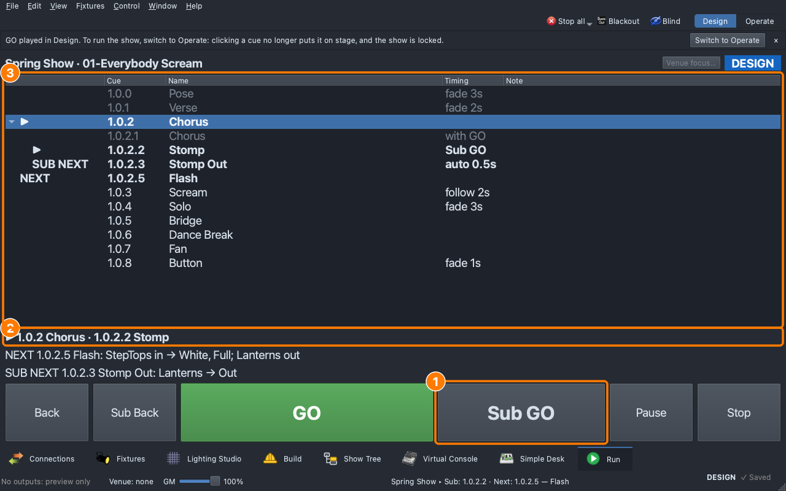

# Lesson 2.7 — Sub-cues: stomps inside a cue

**Student handout**

## Why this matters

A chorus isn't one flat moment: the choir stomps, claps, hits an accent,
and the light can land on each one, a **sting**
([Lesson 0.6](../../level-0/lesson-06/handout.md)). But the chorus
itself goes on, and what comes after it shouldn't inherit the stomp. A
separate cue for each stomp clutters the list and tracks into the next
cue; a **sub-cue** sits inside the chorus, fires on the beat, and what
it changes doesn't pass on (the cue-only idea from Lesson 2.1).

## Today you will

- give the chorus **sub-cues**: 1.0.2.1, 1.0.2.2, 1.0.2.3;
- set how each one goes on: **Sub GO**, or **auto-follow** after a wait;
- play them in the Run tab with **GO** and **Sub GO**.

## Words for today

| Word | Means |
|---|---|
| **Sub-cue** | A cue inside a cue (1.0.2.1, 1.0.2.2…), for hits within a section. What it changes doesn't pass on to the next cue. |
| **Sub GO** | Steps to the next sub-cue of the cue playing (⌥⌘↩, or the Run tab's button). **GO** still goes on to the next main cue. |
| **Auto-follow** | A sub-cue that goes on by itself, a set time after the one before it has faded in. |
| **Advance** | On a sub-cue's page: **Sub GO** or **Auto-follow after** a wait. |

## Part 1 — Design it (on paper, everyone)

On the chorus's last line the choir stomps once. The lanterns hit white
on the stomp and are gone half a second later.

| Sub-cue | When | Advance | Lights |
|---|---|---|---|
| 1.0.2.1 Chorus | The chorus starts (plays with GO) | — | nothing new: the chorus as it is |
| 1.0.2.2 Stomp | The stomp | **Sub GO** | **Lanterns**: White, Full |
| 1.0.2.3 Stomp Out | Half a second later | **Auto-follow after 0.5 s** | **Lanterns**: Out |

Why is the stomp a Sub GO, and its end automatic? ______________________

## Part 2 — Build it (at the laptop)

Roles: **Driver** (mouse), **Navigator** (reads each step aloud and checks
*You should see*), **Designer** (holds this sheet, watches the stage).
Switch roles after each part.

**On Windows or Linux:** where it says ⌘, press **Ctrl**; ⌥ is **Alt**.

### Get ready

1. Open qlcconsole, choose **File → Open** and open
   `lesson-2-7-start.qlcc` (where Lesson 2.6 finished).
2. Click the **Show Tree** tab (⇧⌘5) and open **View → Rig Overview**
   (⇧⌘R) beside it.

### The sub-cues

3. Click **1.0.2 Chorus**. On its page, in the **Sub-cues** row, click
   **+ Sub-cue**.
   - *You should see:* **1.0.2.1** under the chorus in the tree, its page
     open. Name it `Chorus` and press **Return**.
4. Click **More ▾ → + Sub-cue** in the header. Name it `Stomp`.
5. Drag **Lanterns** onto the dashed box, then **White** and **Full**
   onto its row. Its **Advance** reads **Sub GO**.
6. **More ▾ → + Sub-cue** again. Name it `Stomp Out`, drag **Out**
   (Palettes → Dimmer) onto its **Lanterns** row.
7. Set its **Advance** to **Auto-follow after**, type `0.5` in the box
   beside it and press **Return**.
   - *You should see:* **auto 0.5s** beside 1.0.2.3 in the tree.

   **(1)** Advance, **(2)** the wait, **(3)** the sub-cue in the tree.

8. Click **1.0.2 Chorus**: its **Sub-cues** row lists all three.

9. Save with **File → Save As** → `Lesson2-7-yourname.qlcc` in
   **Documents → qlcconsole**.

### Play it

10. In the **Run** tab (⇧⌘8), click **1.0.2 Chorus** to load it, then
    press **GO**.
    - *You should see:* the chorus, and **1.0.2.1 Chorus** with it: the
      first sub-cue plays with GO. The lanterns are dark.
11. Press **Sub GO** on the stomp.
    - *You should see:* the lanterns flash white, then go out by
      themselves half a second later (**1.0.2.3 Stomp Out**).

   **(1)** Sub GO, **(2)** what's playing, **(3)** the list with the
   sub-cues.

12. Press **GO**: **1.0.2.5 Flash**. The lanterns stay dark: what the
    sub-cues changed doesn't pass on.
13. Press **Stop**.

## Stuck?

| Problem | Try |
|---|---|
| The new sub-cue went under the wrong cue | It goes under the selected cue. Undo (⌘Z), click 1.0.2 Chorus or one of its sub-cues, try again. |
| No **Advance** row | You're on the chorus's page. Click the sub-cue in the tree. |
| Sub GO does nothing | Load and GO the chorus first: Sub GO steps the cue that's playing. |
| The lanterns stay on | Check Stomp Out: **Out** on its Lanterns row, **Auto-follow after 0.5**. |
| Something else went wrong | Undo (⌘Z) one step at a time. |

## Done early? (Extension)

1. A second stomp: click **1.0.2.3 Stomp Out**, then **More ▾ → +
   Sub-cue**. It's **1.0.2.4**; name it `Stomp 2` and drop **Red** and
   **Full** on its grey Lanterns row. It waits for **Sub GO**. Play the
   chorus again with two stomps.
2. Start your [Level 2 check](level-check.md) cue sheet.
