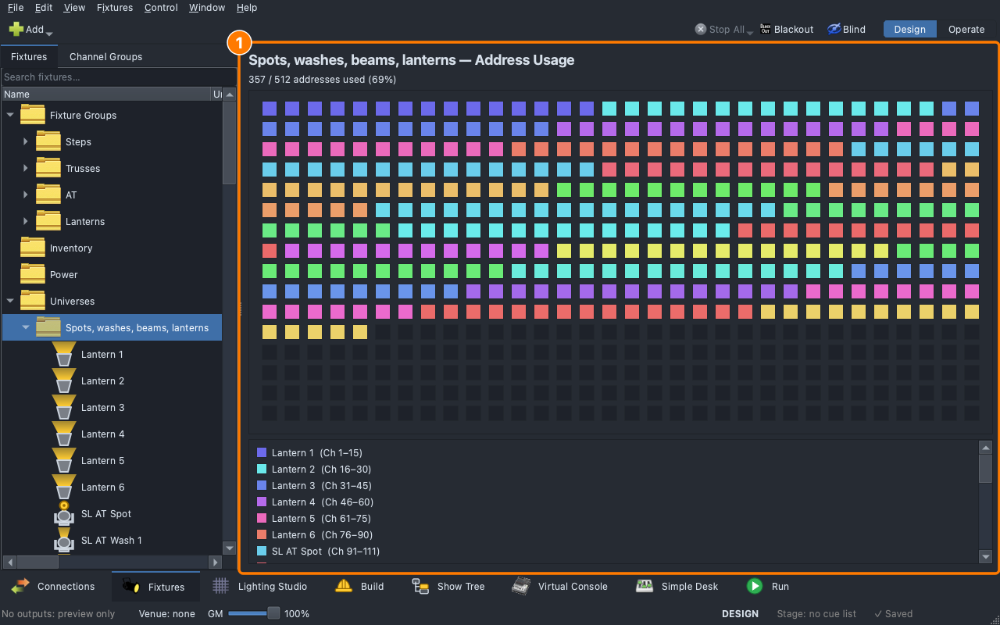
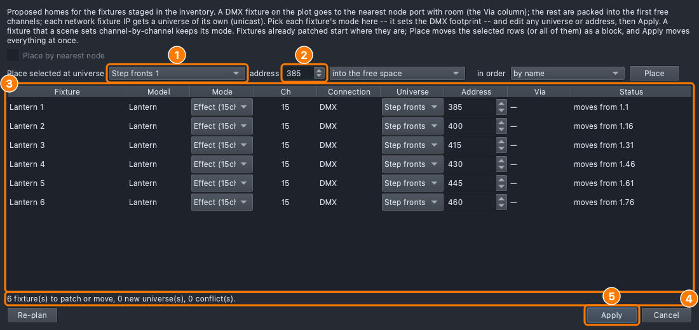
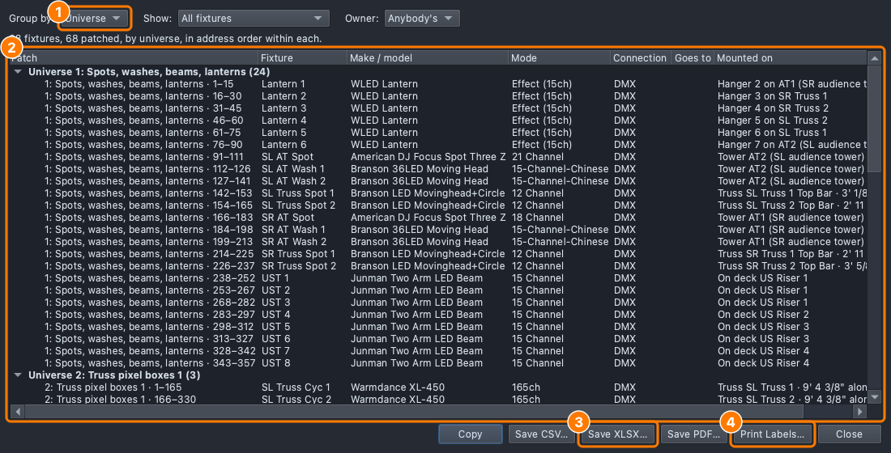

# Lesson 3.1 — DMX, universes and patching

**Student handout**

## Why this matters

The board op calls GO and the cue plays ([Lesson 0.7](../../level-0/lesson-07/handout.md)),
but only if the console and the light agree on one number: the **address**.
A light patched one channel off does the wrong thing, or nothing. The
patch is also the paper the crew works from on load-in: which light is
which, and where its cable goes.

## Today you will

- work out where lights fit in a **universe**, and why two lights can't share channels;
- read the classroom show's patch: a light's universe, address and channels;
- add a light, see an address clash, and move a block of lights with the **Patch** dialog;
- make the **patch list** and the labels the crew hangs the rig from.

## Words for today

| Word | Means |
|---|---|
| **DMX** | The signal that tells real lights what to do: 512 **channels**, each set from 0 to 255 (Out to Full). |
| **Channel** | One thing a light can be told: its intensity, its red, its pan. |
| **Universe** | One DMX line of 512 channels. A big rig has many; ours has 13. |
| **Address** | The channel where a light's channels start in its universe. |
| **Footprint** | How many channels a light takes in the mode it is set to. A light at address 214 with 12 channels uses 214 to 225. |
| **Patch** | The list of which light is at which universe and address. |
| **DIP switches** | Small switches on many lights that set the address in binary. The app shows the pattern to set. |
| **Art-Net / sACN** | DMX sent over a network cable instead of a DMX cable: one stream per universe. |
| **Node** | A box that turns network universes into DMX cable ports (port 1, port 2 …). |
| **Patch list** | The paperwork: every light, its patch, where it hangs and where its universe goes. |

## Part 1 — Fit them in (on paper, everyone)

One universe has channels 1 to 512. Patch these in order, starting at
channel 1, each light right after the one before it. Fill in the start and
end of each.

| Light | Channels it takes | Starts at | Ends at |
|---|---|---|---|
| Dimmer (house lights) | 1 | | |
| RGB par A | 3 | | |
| RGB par B | 3 | | |
| Moving head A | 12 | | |
| Moving head B | 12 | | |

Then answer:

- Moving head B is patched to start at the same channel as RGB par B.
  What do both do, and why is that a problem?
- How many 12-channel moving heads fit in one universe?
- A light takes 165 channels and 160 are free in the universe. Where does it go?

## Part 2 — Patch it (at the laptop)

Roles: **Driver** (mouse), **Navigator** (reads each step aloud and checks
*You should see*), **Designer** (holds this sheet, answers the questions).
Switch roles after each part.

**On Windows or Linux:** where it says ⌘, press **Ctrl**.

### Get ready

1. Open qlcconsole. **File → Open** → `ShowChoir-Classroom.qlcc`.
2. Click the **Fixtures** tab (⇧⌘2).

### Read the patch

3. In the tree, open **Universes** and click the first one, **Spots, washes,
   beams, lanterns**. A universe is named for what is on it; this is
   Universe 1.
   - *You should see:* the heading **Spots, washes, beams, lanterns —
     Address Usage**, a grid of 512 cells, one colour per light, and a line
     under it: **357 / 512 addresses used (69%)**. The pale cells are free:
     358 to 512.

   

4. Open that universe and click **SR Truss Spot 1**.
   - *You should see:* its **Mode** (12 Channel), **Universe** 1,
     **Address Range** 214 - 225, **Channels** 12, and its **Binary Address
     (DIP)**: the switch pattern that sets 214 on the light itself.
5. Click **SR Truss Spot 2**. *Which address does it start at, and why
   there?* (It starts right after Spot 1 ends: 226.)
6. Click the second universe, **Truss pixel boxes 1**, and read its usage: 495 of 512. Three XL-450 pixel
   boxes at 165 channels each fill it. *Why isn't a fourth there?*

### Add a light and meet a clash

7. Click **Add ▾ → Add fixture…**. In **Fixture Model**, open **WLED** and
   pick **Lantern**; set **Mode** to **Effect (15ch)** and the **Name** to
   `Lantern 7`.
   - *You should see:* the app has chosen the first universe, **Spots,
     washes, beams, lanterns**, and **Address** 358: the first free channel
     after the last light. Click **OK**.
8. Open **Add ▾ → Add fixture…** again, the same Lantern and mode, and
   type **Address** `365`.
   - *You should see:* a red **ERROR: Address already used!** Lantern 7
     has 358 to 372, and a second light can't start inside it. Click
     **Cancel**.

   An address clash isn't an error the console can fix for you: two
   lights on the same channels both follow every cue meant for one.

### Move a block with the Patch dialog

9. Open the first universe again. Click **Lantern 1**, then ⇧-click **Lantern
   6**. Right-click → **Patch 6 Fixtures…**.
   - *You should see:* the **Patch / Re-address** dialog: a row for each
     lantern with its **Universe** and **Address**, and a summary line
     ending in *0 conflict(s)*.
10. Set **Place selected at universe** to **Step fronts 1** (Universe 5),
    **address** `385`, and click **Place**.
    - *You should see:* the six lanterns at addresses 385, 400 … 460, each
      **Status** *moves from 1.1*, *moves from 1.16* and so on (universe,
      then address). **Step fronts 1** already holds 384 channels; the six
      lanterns take 90 more. The summary reads *6 fixture(s) to patch or
      move, 0 new universe(s), 0 conflict(s)*.

    

11. Click **Apply**. In the tree, **Step fronts 1** now holds the lanterns.
    Then press **Undo** (⌘Z) on the Fixtures tab.
    - *You should see:* the lanterns back on Universe 1, at 1 to 90.

### Make the paperwork

12. Click **Fixtures → Patch List…** in the menu bar.
    - *You should see:* every light, grouped by **Location**: what it hangs
      on. The **Patch** column reads universe and channels.
13. Change **Group by** to **Universe**, then to **Type**.
    - *You should see:* the same rows under headings like **Universe 1:
      Spots, washes, beams, lanterns**, then under kinds of light (Moving Head, LED Bar (Pixels) …).
14. Click **Save XLSX…** and save it in **Documents → qlcconsole**. Open it in a
    spreadsheet.
    - *You should see:* a row for each light, with its first and last
      channel.
15. Back in the Patch List, click **Print Labels…**. Leave **Label says**
    as it is and read the preview.
    - *You should see:* a label for each light: its name, then **D** and
      its address (universe first, as the rig has several: "D1.214").
      Click **Save PDF…** to print them later; this is what goes on the
      cable end and on the light.

    

### Save

16. **File → Save As** → `Lesson3-1-yourname.qlcc` in **Documents →
    qlcconsole**.

## Part 3 — On the real rig (with Branson)

The classroom show has no outputs: nothing leaves this computer. On the
rig, Branson walks the class through where a universe goes.

1. **Connections ▸ Devices**: the network nodes the console hears, each
   with its ports. A universe is sent to one port; **Edit connection…** on a
   universe sets protocol (Art-Net or sACN), the node and its port.
2. At a light: set its DIP switches from the pattern in the Fixtures tab's
   **Binary Address (DIP)**, then check it answers the console.
3. Read a label off the patch list and find the light it names.

## Stuck?

| Problem | Try |
|---|---|
| **Add ▾** is greyed out | You're in Operate. Click **Design** at the top right. |
| The red error stays | The address overlaps a light. Pick the next free one, or read the grid in the universe. |
| **Apply** is greyed out | The dialog still shows a conflict: read its summary line and the **Status** column. |
| The Patch List is empty | Open the show first. |

## Done early? (Extension)

1. In the Patch dialog, **Place selected at universe** with **one universe
   each, counting up**: what does it do to the six lanterns? When would
   a rig want that?
2. Work out how many boxes the 135-channel mode of the XL-450 fits in one
   universe, and how many the 30-channel white mode (Lesson 3.2 shows where
   those modes are).
