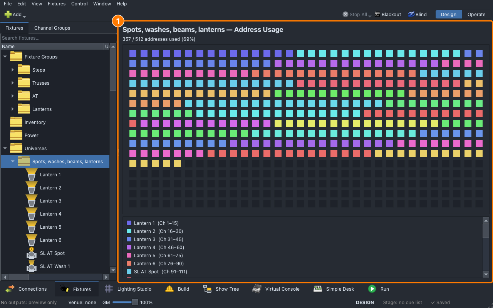

# Lesson 3.1 — DMX, universes and patching

A cue only reaches a light if the console knows which DMX channels that
light listens to. Students work out where lights fit in a universe, read
the classroom show's patch, add a light and move a block of lights with
the Patch dialog, then print the paperwork the crew hangs and labels the
rig from. The real network (which interface a universe goes out of) is
taught on the real rig, with Branson.

| For | File |
|---|---|
| Teacher | [Teacher guide](https://github.com/sandinak/qlcconsole/blob/main/docs/course/level-3/lesson-01/teacher-guide.md) · [Slides outline](https://github.com/sandinak/qlcconsole/blob/main/docs/course/level-3/lesson-01/slides.md) |
| Students | [Handout](handout.md) · [Exit ticket](exit-ticket.md) · [At home](at-home.md) |
| Show files | [`ShowChoir-Classroom.qlcc`](../../shows/ShowChoir-Classroom.qlcc) (students save their own copy) |

<!-- PICTURE (real hardware, ask Branson): a light's back panel with its DIP switches (or its address display), and a network node with its numbered ports, taken on the rig for Part 3 -->
