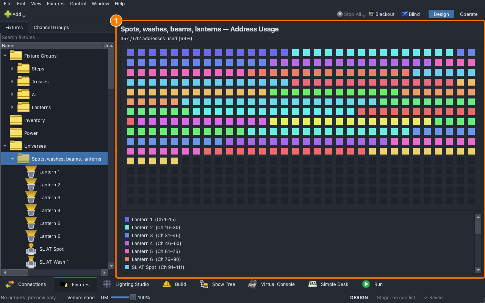
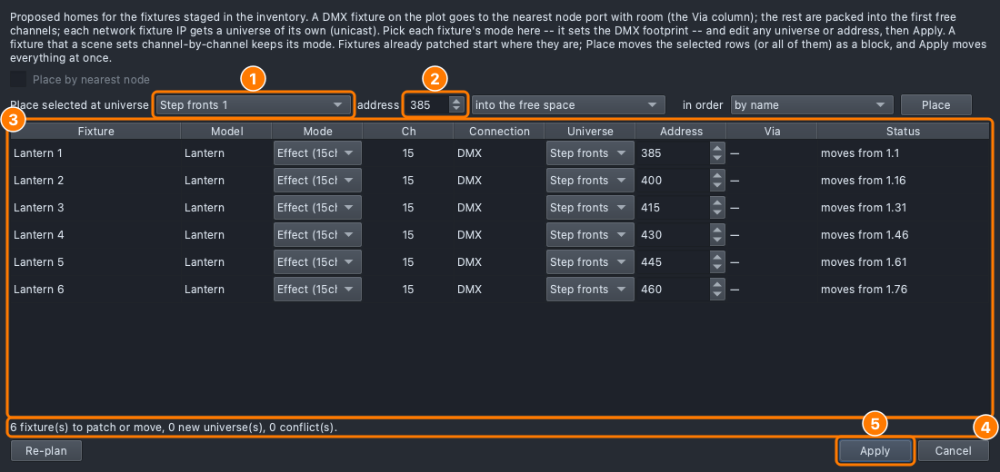
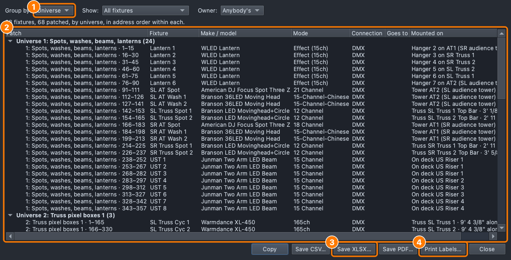

## Why

The board op calls GO and the cue plays
([Lesson 0.7](../0-7/)), but only if the console and the light agree on
one number: the address. A light patched one channel off does the wrong
thing, or nothing.

## On paper

Patch in order from channel 1: a dimmer (1 channel), two RGB pars (3 each),
two moving heads (12 each). Write each start and end. What happens if two
lights share an address? How many 12-channel heads fit in one universe?

Roles: Driver, Navigator, Designer. Switch after each part.

## Steps

1. **File → Open** → `ShowChoir-Classroom.qlcc`.
2. Click the **Fixtures** tab (⇧⌘2). Open **Universes** and click the
   first one, **Spots, washes, beams, lanterns** (Universe 1): the grid and
   **357 / 512 addresses used (69%)**.

   

3. Click **SR Truss Spot 1**: **Address Range** 214 - 225, **Channels** 12,
   **Binary Address (DIP)**. Click **SR Truss Spot 2**: why does it start at 226?
4. Click **Truss pixel boxes 1** (Universe 2): 495 of 512. Why isn't a fourth XL-450 in it?
5. **Add ▾ → Add Fixture…**: **WLED → Lantern**, **Mode** **Effect (15ch)**,
   **Name** `Lantern 7`. The app picks Universe 1, address 358. **OK**.
6. **Add ▾ → Add Fixture…** again, the same Lantern, **Address** `365`:
   the red **ERROR: Address already used!** **Cancel**.
7. Click **Lantern 1**, ⇧-click **Lantern 6**, right-click → **Patch 6
   Fixtures…**. Set **Place selected at universe** to **Step fronts 1**
   (Universe 5), **address** 385, click **Place**: each **Status** reads *moves from 1.n*. Click **Apply**.

   

8. Press ⌘Z on the Fixtures tab: the lanterns are back on Universe 1.
9. **Fixtures → Patch List…**: grouped by **Location**; change **Group by**
   to **Universe** and **Type**.
10. **Save XLSX…** into **Documents → qlcconsole** and open it.
11. **Print Labels…**: read the preview (names and "U1.214"), **Save PDF…**.

   

12. **File → Save As** → `Lesson3-1-yourname.qlcc`.

**Stuck?** **Add ▾** greyed out: click **Design**. Red error stays: pick the
next free address. **Apply** greyed: read the summary line.

## Seeing the channels: the DMX map

The patch list says where a light *should* be. On site, before you trust
it, you want to see what the console is actually sending, and to move one
channel by hand to find out which light answers. The Connections tab does
both.

1. Click the **Connections** tab, then **Spots, washes, beams, lanterns**
   (Universe 1). To the right of its settings is the **DMX map**: all 512
   channels as blocks, each patched fixture's channels shaded together.
2. Point at a block in the **SR Truss Spot 1** run (214 to 225). The line
   above the map names the address, the fixture, its range and the
   channel, and the value it sends.
3. Read the colours. Red, green, blue, amber, white and UV blocks are a dull
   shade at 0 and bright at 255; a dimmer is a grey ramp; a **pan** block
   carries a left-right arrow and a **tilt** block an up-down one, placed
   by the value. A channel with nothing patched to it stays plain. The
   legend under the map explains the rest.
4. Click **Test**, then click or drag in a block to set that channel. The
   top of the block is 255, the bottom 0; double-click to type a value,
   right-click to let that channel go. The banner and the footer read
   **Testing channels: N held**.
5. Click **Test** again: every held channel goes back to what the show
   gives it.

Test works in Design and is refused in Operate, so you can't disturb a
running show. The values sit on top of the show and are never saved; the
emergency stop turns Test off too. A light set to Show only (a house light,
say) keeps its output rules while you test it.

**Stuck?** **Test** won't stay on: you are in Operate; click **Design**.

## Exit ticket

1. What is a universe, and what is an address?
2. A new light takes 12 channels and the last light ends at 357. Where
   does it start and end?
3. What does **Add Fixture…** say if two lights overlap, and what goes wrong on
   stage if it is ignored?
4. Who uses the patch list and labels, and for what?

## At home

Do one:

- **App:** add four WLED Lanterns with **Quantity** 4 and an **Address gap**
  of 5; save the patch list as `Lesson3-1-Home-yourname.xlsx`.
- **Paper:** patch six 7-channel pars, two 16-channel movers and a
  4-channel dimmer pack on a 512 grid; write the label for the second
  mover's cable end.
