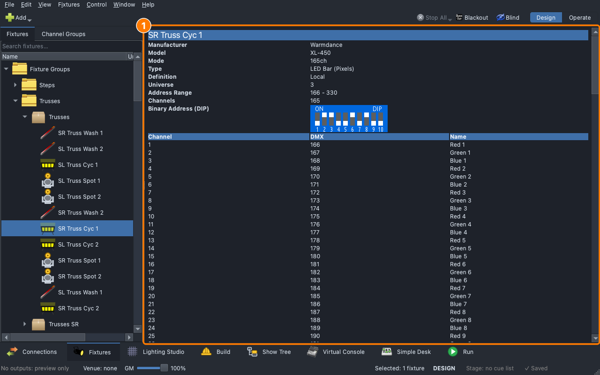
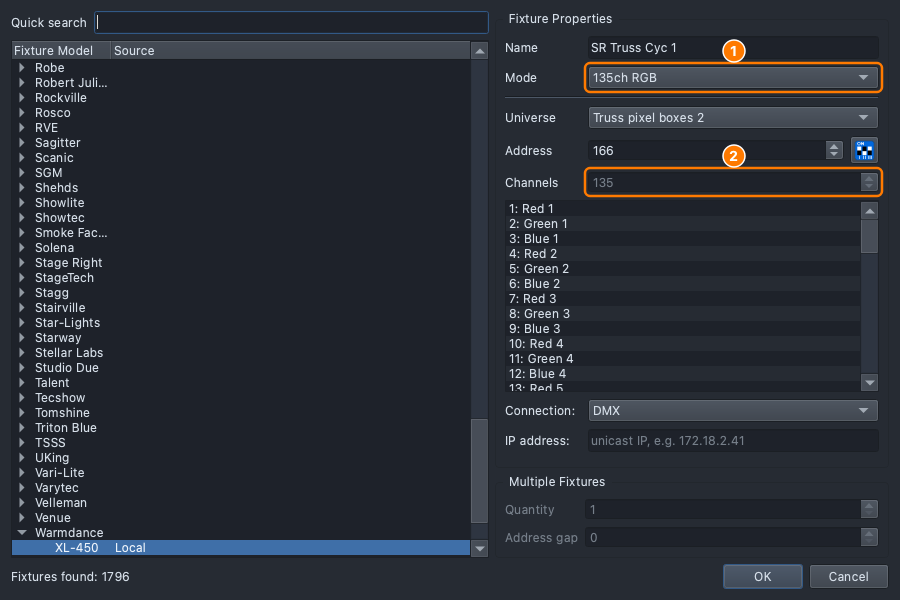
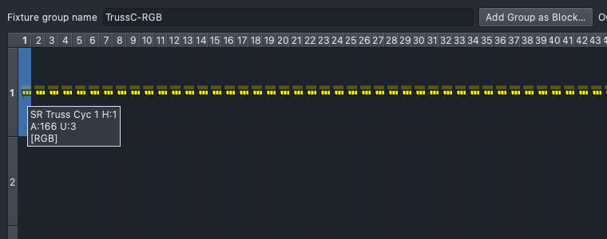

# Lesson 3.2 — Fixtures and definitions

**Student handout**

## Why this matters

A look is built from colour, intensity and position
([Lesson 0.2](../../level-0/lesson-02/handout.md)), and the console can only
set them if it knows which channel is which. A light's **definition** says
so. Pick the wrong mode, or the wrong definition, and Blue comes out
green, or the light sits dark waiting for a dimmer channel nobody sends.

## Today you will

- read what a definition tells the console: its channels, modes and heads;
- compare the three modes of the XL-450 pixel box and say what each costs in channels;
- find the colour and white heads that the truss groups are made of;
- open the Fixture Editor on one definition, and find the definitions the show carries.

## Words for today

| Word | Means |
|---|---|
| **Fixture definition** | The file that tells the app what each channel of a light does. |
| **Mode** | One way a light can be set up: a list of its channels in order. The mode on the console has to be the mode set on the light. |
| **Head** | One lit part of a fixture: a pixel box has many; a mover has one. A head can have its own colour channels. |
| **Included / Local** | Where a definition file comes from: **Included** with the app, or **Local**, one the app doesn't ship (yours, or the show's); a third source is Downloadable. |
| **Fixture Editor** | The tool for reading and writing definitions. |

## Part 1 — Pick the mode (on paper, everyone)

A par comes with three modes. Its manual's DMX chart:

| Mode | Channels, in order |
|---|---|
| **3ch** | 1 Red, 2 Green, 3 Blue |
| **5ch** | 1 Red, 2 Green, 3 Blue, 4 Dimmer, 5 Strobe |
| **8ch** | 1 Dimmer, 2 Red, 3 Green, 4 Blue, 5 White, 6 Strobe, 7 Macro, 8 Speed |

Answer:

- Which modes can make a level of 50% dim the whole colour from the light itself?
- How many lights of each mode fit in one universe, patched end to end?
- The light's own menu is set to **5ch** but the console is patched as **3ch**.
  Which channel does the light wait on for its dimmer, and what does the
  console send it?

## Part 2 — Read it (at the laptop)

Roles: **Driver** (mouse), **Navigator** (reads each step aloud and checks
*You should see*), **Designer** (holds this sheet, answers the questions).
Switch roles after each part.

**On Windows or Linux:** where it says ⌘, press **Ctrl**.

### Get ready

1. Open qlcconsole. **File → Open** → `ShowChoir-Classroom.qlcc`.
2. Click the **Fixtures** tab (⇧⌘2).

### Read a definition

3. Open **Fixture Groups ▸ Trusses** and click **SR Truss Cyc 1**.
   - *You should see:* its **Manufacturer** (Warmdance), **Model** (XL-450),
     **Mode** (165ch), **Type** (LED Bar (Pixels)), **Definition** (Local),
     **Channels** 165 and the table of channels: Red 1, Green 1, Blue 1 …

   

   **Local** means the file isn't one the app ships with. The show carries
   its own copy, so it opens complete on any computer.
4. Click **SR Truss Spot 1**.
   - *You should see:* a **Moving Head** with **12 Channel**: Pan, Pan fine,
     Tilt, Tilt fine, Color wheel, Gobo wheel, Strobe, Dimmer …
   - Which channel dims it, and which does the cyc box not have? (The spot's
     Dimmer. The box has no dimmer channel: its levels dim the colour.)

### Compare the modes

5. Right-click **SR Truss Cyc 1** → **Definition & Mode…**. Open the **Mode**
   list and pick each mode in turn, reading **Channels**.
   - *You should see:* **165ch** with 165 channels, **135ch RGB** with 135 and
     **30ch White** with 30.

   

   Click **Cancel**. Changing the mode here changes how many channels the
   console gives the light, and what it sends on each. It does not change the
   light: on a real rig you also set the same mode on the light's own menu,
   or the two disagree.
6. Work out how many boxes fit in one universe in each mode, and fill in the
   table:

   | Mode | Channels | Boxes in 512 |
   |---|---|---|
   | 165ch | 165 | |
   | 135ch RGB | 135 | |
   | 30ch White | 30 | |

### Find the heads

7. Open **Fixture Groups ▸ Trusses** and click **TrussC-RGB**.
   - *You should see:* the group's grid, a row of small cells for each box,
     one cell per head. Point at a cell: its tooltip reads the box's name,
     **H:** the head number, **A:** its address, **U:** its universe, and a
     tag, **[RGB]**.
8. Click **TrussC-W**.
   - *You should see:* the same four boxes, but a cell's tooltip carries the
     tag **[W]**.
     The box has 45 colour pixels and 30 white pixels: the colour pixels are
     in **TrussC-RGB**, the white ones in **TrussC-W**. A colour on
     TrussC-RGB doesn't light the white pixels.

   

### Open the definition

9. Right-click **SR Truss Cyc 1** → **Edit Fixture Definition…**.
   - *You should see:* the Fixture Editor, with tabs **General**, **Physical**,
     **Channels**, **Modes** and **Aliases**.
10. Click **Modes**.
    - *You should see:* three rows, each with **Name**, **Channels** and
      **Heads**: 165ch, 165 channels, 75 heads; 135ch RGB, 135 and 45; 30ch
      White, 30 and 30. 75 heads are the 45 colour pixels and the 30 white
      ones of the first mode.
11. Close the Fixture Editor **without saving**.
12. Back in qlcconsole, open **File → Show Definitions…**.
    - *You should see:* the five definitions this show carries, each with
      how it compares with this computer's. Close it.

### Save

13. **File → Save As** → `Lesson3-2-yourname.qlcc` in **Documents →
    qlcconsole**.

## Part 3 — On the real rig (with Branson)

The classroom show sends nothing. At the rig, with the Fixtures tab open
beside a real light:

1. Find the light's model on its label and the same model in the Fixtures
   tab. Read its **Mode**.
2. On the light's own menu, read its mode: it has to be the console's mode,
   channel for channel. Change nothing unless Branson says to.

## Stuck?

| Problem | Try |
|---|---|
| **Definition & Mode…** isn't in the menu | Right-click one light, not a group. |
| **Edit Fixture Definition…** isn't there | You have lights with different definitions selected. Right-click one light. |
| The Fixture Editor didn't open | It starts as its own window and may be behind this one. |
| You pressed **OK** in Definition & Mode… | **Undo** (⌘Z) on the Fixtures tab, or leave it: it's your copy. |

## Done early? (Extension)

1. Find the mode of **SR AT Spot** and **SL AT Spot**. They are the same
   model: why do their channel counts differ (18 and 21)?
2. Which definition does a **UST** use, and how many heads does each of its
   modes have? (Look at its **Modes** tab in the Fixture Editor.)
