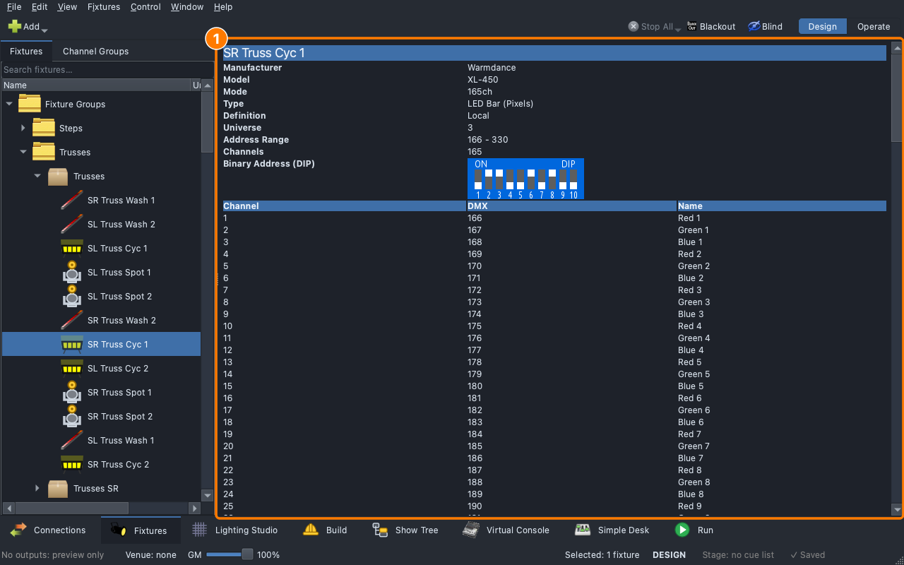

# Lesson 3.2 — Fixtures and definitions

The console knows what a light's channels do from its **definition**: a
file that lists the channels, the modes a light can be set to, and the
heads it is made of. Students read the definitions behind the classroom
rig, compare a pixel box's three modes, see how the groups are made of
heads, and open the Fixture Editor to look at one definition.

| For | File |
|---|---|
| Teacher | [Teacher guide](https://github.com/sandinak/qlcconsole/blob/main/docs/course/level-3/lesson-02/teacher-guide.md) · [Slides outline](https://github.com/sandinak/qlcconsole/blob/main/docs/course/level-3/lesson-02/slides.md) |
| Students | [Handout](handout.md) · [Exit ticket](exit-ticket.md) · [At home](at-home.md) |
| Show files | [`ShowChoir-Classroom.qlcc`](../../shows/ShowChoir-Classroom.qlcc) (students save their own copy) |

<!-- PICTURE (real hardware, ask Branson): a pixel box and its menu showing the mode it is set to; the back-panel label that names its model -->
