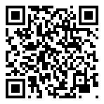

# Lesson 3.3 — Reading the plot: symbols

**Teacher guide** · Level 3, lesson 3 · 50 minutes

**Give students:** <https://sandinak.github.io/qlcconsole/class/3-3/> (the show file, the steps, the exit ticket and the at-home task; nothing else)

**Builds on:** Lesson [0.3](../../level-0/lesson-03/teacher-guide.md). Open with the handout's *Why this matters* before any clicks.

## Objectives

Students can:

1. name the kind of each light on our rig from its symbol on a plot;
2. set a fixture's **plot symbol** in qlcconsole, and mark a **practical**;
3. say why a plot symbol changes only the picture, not what the light does.

## Before class

- [ ] qlcconsole on the projector computer and the class laptops.
- [ ] `ShowChoir-Classroom.qlcc` on each laptop (from `docs/course/shows/`).
- [ ] On the projector: the show open, the **Lighting Studio** tab (⇧⌘3).
- [ ] A printed lighting plot from any real show (a USITT-style plot with
  a symbol key is ideal), and the [handout](handout.md) and
  [exit ticket](exit-ticket.md).

## Vocabulary (introduce in this order)

**plot**, **symbol key**, **plot symbol**, **practical**. Each is in the
handout's word table and the [Glossary](../../GLOSSARY.md).

## Timing

| Min | Part | What happens |
|---|---|---|
| 0–10 | **Design idea** (no computers) | Read a real plot: what is each symbol? |
| 10–20 | **Teacher demo** (projector) | The plot; Show ▸ Auto as closest symbol; one correction |
| 20–40 | **Hands-on** (pairs/triads, roles) | Handout Part 2 |
| 40–45 | **Check / share** | Two groups explain one correction they made |
| 45–50 | **Exit ticket** | On paper |

## 1. Design idea (10 min)

Hand out the printed plot. Ask the class to find a PAR, an ellipsoidal, a
moving light and a practical using the symbol key. Then: "The electrician
hanging this plot has never seen the show. What does the plot have to tell
them?" (*what each light is, where it hangs, what it points at, its
circuit or address*).

**Key idea to land:** a plot is read by people who weren't in the design
meetings, so each symbol has to say what the light *is*.

## 2. Teacher demo (10 min)

1. **Lighting Studio** tab: the plot is the stage from above. Point out
   the trusses, the towers and the risers. Every light is drawn by its
   type; the lanterns look like any other LED fixture.
2. The plot's **Show** button → **Show Auto fixtures as their closest
   plot symbol**. Each light is now drawn as the symbol the app guesses from
   its definition: the spots with a yoke, the step lights as bars.
3. "Which guesses are wrong?" Lead them to the **AT-W-ALL** washes (drawn
   as spots) and the **Lanterns** (drawn as LED PARs).
4. **Fixtures** tab, right-click the **AT-W-ALL** group → **Plot Symbol ▸**.
   The first item, **Auto (Moving head spot)**, is the guess. Pick
   **Moving head round wash**, then show the plot again.

## 3. Hands-on (20 min)

- Roles: **Driver / Navigator / Designer**, switching every correction.
- Students without a laptop: the **design station**: mark the symbol of
  each of our rig's lights on a paper plan of the stage.

### What to watch for

| You see | Likely cause | Say |
|---|---|---|
| Nothing changed on the plot | They set the symbol in the Fixtures tab but are still looking at it | "Click the **Lighting Studio** tab." |
| Only one lantern changed | One fixture right-clicked, not the group | "Right-click the **Lanterns** group." |
| "Did that change the light?" | | "No: a symbol is the picture. The DMX is the same." |
| A symbol went on the wrong group | | "⌘Z takes it back, in the Fixtures tab or the Lighting Studio." |

## 4. Check for understanding (while circulating)

- "Why is a lantern a practical?" (*it's part of the set, and the audience
  sees it as a light*)
- "Why did the app call the washes spots?" (*it guesses from the
  definition: a moving head without a zoom it recognises reads as a spot*)
- "Does changing the symbol change what the light does?" (*no*)

## 5. Share (5 min)

Two groups say which guess they corrected and how they knew.

## 6. Exit ticket (5 min)

[Exit ticket](exit-ticket.md) — answers below.

## Extension (fast groups)

Set a symbol for the **TrussC-RGB** boxes that says they light the cyc
(**Cyc / strip light**), and explain the choice.

## At home

[At home](at-home.md): draw a plot of a room at home with symbols and a key.

## Answer key

- **Exit ticket:** 1 — a light that is part of the set and seen by the
  audience as a light (a lantern, a table lamp). 2 — no: the symbol is only
  the picture on the plot and in the studio; the light does exactly what
  it did. 3 — Auto: the app draws it as the symbol closest to its
  definition's type. 4 — anyone who reads the plot without having been in
  the design meetings: the electricians, the board op, next year's crew.

## How this lesson was checked

The course test (`ui/test/courseshow`, `lessonStageLooks`) runs it
offscreen on the real app: the Show menu's item by its name, the Plot
Symbol menu's six sections, **Auto (Moving head spot)** on AT-W-ALL and
**Moving head round wash**, and **Lantern** under Practicals on the
Lanterns group. It does not take pictures for this lesson yet.
