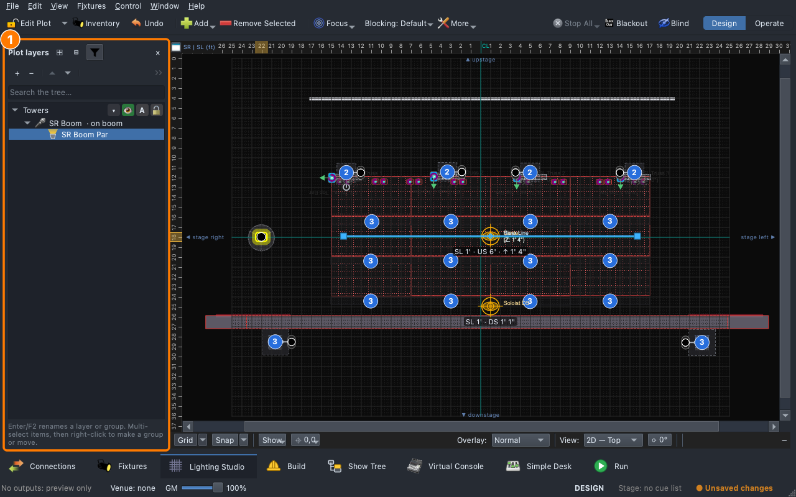
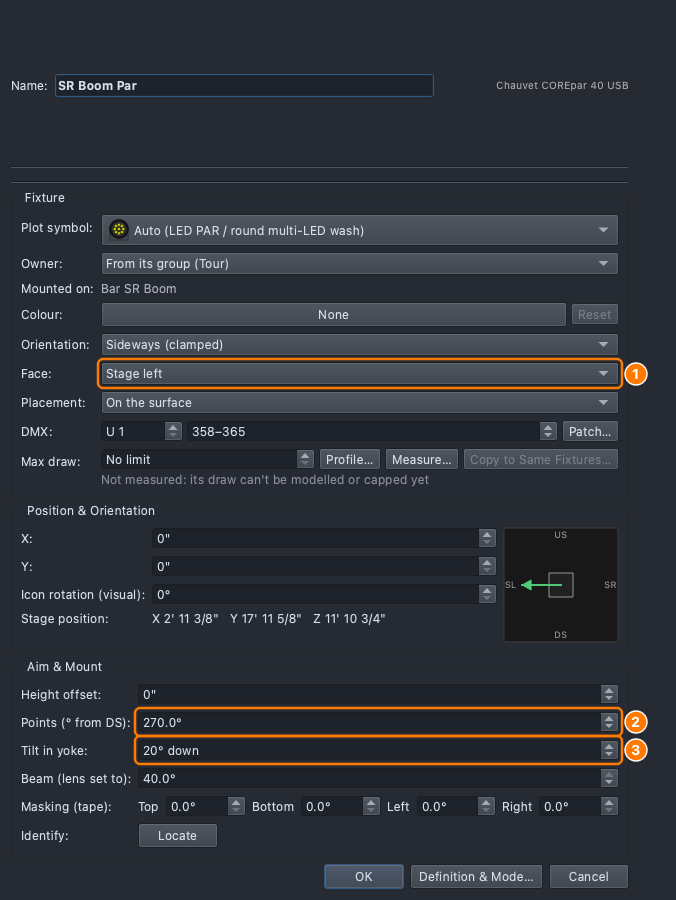

# Lesson 3.4 — Building the rig

**Student handout**

## Why this matters

Front light shows faces and side light sculpts
([Lesson 0.3](../../level-0/lesson-03/handout.md)), and which one a light
gives depends on where it hangs and which way it faces. The console aims a
moving light by angles it works out from the plot, so a plot that doesn't
match the room aims every light a little wrong. In the stage words of
[Lesson 0.8](../../level-0/lesson-08/handout.md): the plot is the room, as
the console has it.

## Today you will

- add structures to the plot: a **boom** and a **wall with a door**;
- mount a light on the boom and point it with **Face**, **Points** and **Tilt in yoke**;
- read **Plot layers**: what hangs on what, and lock what is finished;
- work out why the plot has to match the room.

## Words for today

| Word | Means |
|---|---|
| **Boom** | A vertical pipe that lights are mounted up. On a stand, or hung from a truss. |
| **Mount** | What a light hangs or stands on: a truss, boom, tower, riser or the floor. |
| **Face** | Which side of its mount a light is on, and so which way it throws: Top, Bottom, Front (downstage), Back (upstage), Stage left, Stage right. |
| **Points** | Which way a fixed light points, seen from above, in degrees from downstage: 0 downstage, 90 stage right, 180 upstage, 270 stage left. |
| **Tilt in yoke** | How far a fixed light is tipped up or down from level in its yoke. |
| **Plot layer** | A group of things on the plot you can hide or lock together. |

## Part 1 — Does it match? (on paper, everyone)

The plot says a spot hangs **18'** above the stage and is aimed at a
mark **12'** downstage of it on the floor. The console works out the tilt:
the angle whose tangent is 18 ÷ 12 = 1.5, which is about 56° down.

| | The plot says | The real truss is |
|---|---|---|
| Height | 18' | 16' |
| Tilt the console sends | 56° down | 56° down |
| Where the beam lands (how far downstage of the light) | 12' | |

Answer:

- How far short of the mark does the beam land? (Floor distance = height ÷ 1.5.)
- Which two numbers from the room would you measure first, and with what?

## Part 2 — Build it (at the laptop)

Roles: **Driver** (mouse), **Navigator** (reads each step aloud and checks
*You should see*), **Designer** (holds this sheet, compares the plot with
the room). Switch roles after each part.

**On Windows or Linux:** where it says ⌘, press **Ctrl**.

### Get ready

1. Open qlcconsole. **File → Open** → `ShowChoir-Classroom.qlcc`.
2. Click the **Lighting Studio** tab (⇧⌘3). Click **Plot Layers** on the plot's bar.
   - *You should see:* the plot and, beside it, the **Plot layers** list. The
     first three layers, **House**, **Stage** and **Stage Lights**, have
     padlocks: the show ships with them locked so a stray drag can't move the rig.

### Add structures

3. Right-click an empty part of the plot off the stage-right edge of the stage
   (the left of the plot, with the audience at the bottom), in the wing, and
   choose **Add Here ▸ Boom**.
   - *You should see:* a box, **Place on which layer?**, because the active
     layer, House, is locked. Open the list, pick **Towers**, and click **Place
     on this layer**.
4. In the boom's editor, type the **Name** `SR Boom` and set **Pipe height**
   to `14'`. Click **OK**.
   - *You should see:* the boom on the plot, and **SR Boom** in Plot layers
     under **Towers**.
5. Click **Add ▸ Add Scenery ▸ Wall** on the plot's bar and place it on the
   layer **Towers** again. In its editor set **Name** `Door Wall`, **Width**
   `12'`, **Height** `9'`, **Door width** `3'` and **Door height** `7'`. Click
   **OK**.
   - *You should see:* a wall with a gap in it. Light passes through the door
     and is blocked by the rest.

### Mount and point a light

6. Right-click the plot beside the boom → **Add Here ▸ Fixture…**. In
   **Fixture Model**, open **Chauvet**, pick **COREpar 40 USB**, **Mode**
   **8-Channel**, **Name** `SR Boom Par`, **OK**. (The app picks a free
   address, as in Lesson 3.1.)
7. Right-click **SR Boom Par** on the plot → **Mount on ▸ Boom ▸ SR Boom**.
   - *You should see:* in **Plot layers**, **SR Boom Par** under **SR Boom**,
     marked as hung on a boom. Click the funnel (**Selected only**) to list
     just what is selected and what holds it.

   

8. Double-click **SR Boom Par** to open its **Fixture Properties**. In **Face**,
   pick **Stage left**: the par throws across the stage, away from the wing.
   - *You should see:* in **Aim & Mount**, **Points (° from DS)** reads 270
     and **Tilt in yoke** reads level.
9. In **Tilt in yoke**, type `20 down`. Click **OK**.
   - *You should see:* the beam tipped down toward the stage on the plot.

   

### Layers and locks

10. In Plot layers, find **SR Boom** under **Towers**. Right-click the boom
    on the plot → **Lock Layer “Towers”**, then try to drag it.
    - *You should see:* it doesn't move, and the plot's status line says
      **Layer locked — unlock it in Layers to move**. The par on the boom
      is held too.
11. In Plot layers, click the padlock on the **Towers** row to unlock it.
    Right-click the boom → **Lock Position**: only this object is held now,
    and its row shows a padlock.

### Save

12. **File → Save As** → `Lesson3-4-yourname.qlcc` in **Documents →
    qlcconsole**.

## Part 3 — On the real rig (with Branson)

Measure the room and correct the plot.

1. With a tape or a laser measure: the height of each truss, how far the
   boom stands from the stage edge, the width and depth of the stage.
2. Write them against the plot's numbers. Where they differ, double-click
   the structure on the plot and type the real value.
3. Fire a **Soloist DS** aim and see if the beam lands on the mark.

## Stuck?

| Problem | Try |
|---|---|
| Nothing happens on **Add Here** | The plot is locked: click **Edit Plot** on the bar, then right-click again. |
| **Mount on ▸ Boom** is greyed out | There's no boom yet: do step 3. |
| **Stage left** is not in **Face** | Click the par itself, not the boom. |
| The par is on the floor | It wasn't mounted: do step 7. |
| Something moved that shouldn't | **Undo** (⌘Z) on the Lighting Studio takes back the last edit. |

## Done early? (Extension)

1. Copy the boom: right-click it → **Copy Selected**, then right-click the
   plot in the other wing → **Paste Here**. Name it `SL Boom`.
<!-- PLOT-HANDLES: depends on branch feat/043-plot-handles; drop this item if it has not landed -->
2. Hold **⌥** (Alt on Windows and Linux) and drag the end of the **Door Wall**
   to swing it about its other end; hold **Shift** to step by 15°. It
   catches the end of another wall or truss so corners close.
<!-- /PLOT-HANDLES -->
3. Right-click **SR Boom Par** → **Show Light Footprint**. Set **Tilt in yoke**
   to `45 down`, then to `10 down`. How does the pool of light move, and which
   is the better front light for a face?
