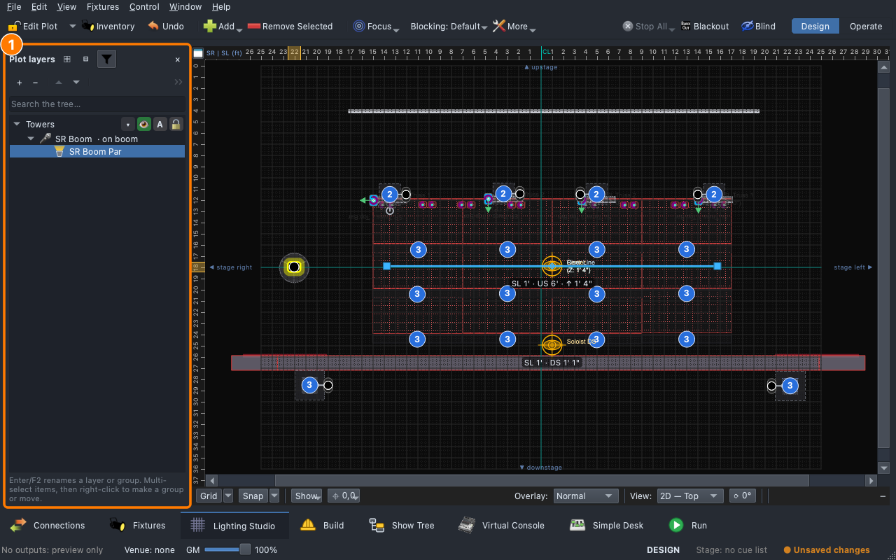

# Lesson 3.4 — Building the rig

A show's aims are worked out from the plot: how high a light hangs, what it
hangs on, which way it faces. Students add a boom and a wall with a door
to the classroom plot, hang a par on the boom and face it across the
stage, read what hangs on what in Plot layers, and lock what is done. The
last part is the measuring tape: the plot has to match the room.

| For | File |
|---|---|
| Teacher | [Teacher guide](https://github.com/sandinak/qlcconsole/blob/main/docs/course/level-3/lesson-04/teacher-guide.md) · [Slides outline](https://github.com/sandinak/qlcconsole/blob/main/docs/course/level-3/lesson-04/slides.md) |
| Students | [Handout](handout.md) · [Exit ticket](exit-ticket.md) · [At home](at-home.md) |
| Show files | [`ShowChoir-Classroom.qlcc`](../../shows/ShowChoir-Classroom.qlcc) (students save their own copy) |

<!-- PICTURE (real hardware, ask Branson): the real boom or truss with a tape measure on it, and the plot beside it, taken on the rig for Part 3 -->
