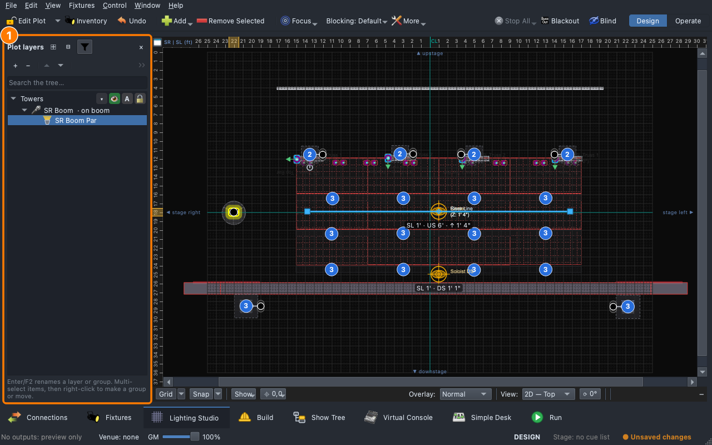
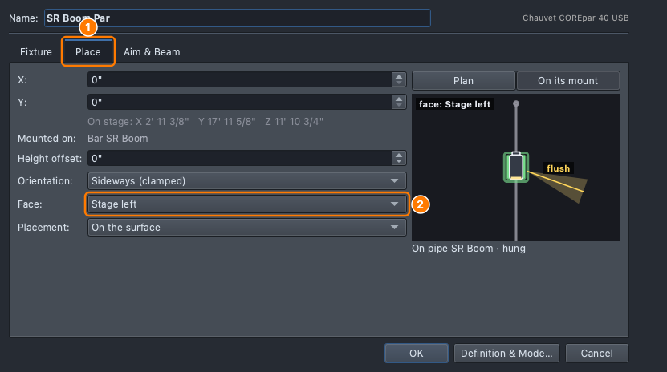
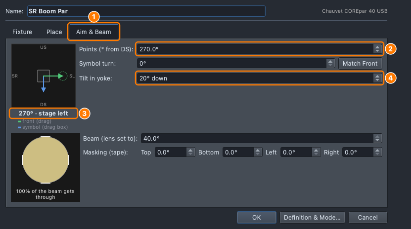

## Why

Which light is front light and which is side light
([Lesson 0.3](../0-3/)) depends on where it hangs and which way it faces.
The console aims by angles it works out from the plot, so a plot that
doesn't match the room aims every light a little wrong.

## On paper

A spot hangs 18' up and is aimed at a mark 12' away on the floor: about 56°
down (tangent 1.5). The real truss is 16'. The console still sends 56°
down: where does the beam land (16 ÷ 1.5)?

Roles: Driver, Navigator, Designer. Switch after each part.

## Steps

1. **File → Open** → `ShowChoir-Classroom.qlcc`. Click the **Lighting
   Studio** tab (⇧⌘3), then **Plot Layers**. **House**, **Stage** and **Stage
   Lights** are locked.
2. Right-click the wing off the stage-right edge → **Add Here ▸ Boom**. At
   **Place on which layer?** pick **Towers** and **Place on this layer**.
3. In the editor: **Name** `SR Boom`, **Pipe height** `14'`, **OK**.
4. **Add ▸ Add Scenery ▸ Wall**, layer **Towers**: **Name** `Door Wall`,
   **Width** `12'`, **Height** `9'`, **Door width** `3'`, **Door height** `7'`,
   **OK**.
5. Right-click beside the boom → **Add Here ▸ Fixture…**: **Chauvet**,
   **COREpar 40 USB**, **Mode** **8-Channel**, **Name** `SR Boom Par`, **OK**.
6. Right-click **SR Boom Par** → **Mounting & Masking ▸ Mount on ▸ Boom ▸ SR Boom**. In Plot
   layers it hangs under **SR Boom**.

   

7. Double-click **SR Boom Par**. On the **Place** tab, **Face** → **Stage
   left**.

   

   On the **Aim & Beam** tab, **Points (° from DS)** reads 270, and the line
   under the diagram beside it says *270° · stage left*. In **Tilt in yoke**
   type `20 down`. **OK**.

   

8. Right-click the boom → **Lock Layer “Towers”** and drag it: **Layer
   locked — unlock it in Layers to move**. Click the **Towers** padlock in
   Plot layers to unlock, then right-click the boom → **Lock Position**.
9. **File → Save As** → `Lesson3-4-yourname.qlcc`.

**Stuck?** Nothing on **Add Here**: click **Edit Plot** to unlock the plot.
**Mounting & Masking ▸ Mount on ▸ Boom** greyed: there is no boom yet. Something moved:
**Undo** (⌘Z).

## Look while you edit

**Fixture Properties** stays open beside the rig. With it open on **SR Boom
Par**, zoom and swing the plot or the Rig Overview (**⇧⌘R**) and the view
stays where you put it: you can check the par's **Points** and **Tilt in
yoke** against the beam while you type, instead of closing the editor to
look. Click another fixture in either view and the editor switches to it,
keeping what you changed so far as its own undo step. Nothing in the view
can be dragged, deleted or added until the editor closes, so **Cancel**
still puts back exactly what that editor did.

## A head that turns more than once: the pan turn

A moving head with more than a full turn of pan (540°, say) can reach most
places two ways: at one pan, or a turn further along the channel. Somewhere
around the head is a **seam**, the one bearing where its answer jumps a
whole turn. A follow spot walked across the seam, or a fade between two
looks either side of it, swings round the long way: the head spins a full
turn and the audience sees the beam sweep the whole stage. Which turn the
head works in is its **pan turn**, kept with the head in the show.

The default puts the seam straight behind the head, which is right for a
head over the stage or facing it. A head hung out front with its pan zero
facing away from the stage has the seam in the middle of the stage.

In Fixture Properties, the **Aim & Beam** tab's **Pan works around** shows
the turn and how clear of the stage the seam is. **Centre on Stage**
picks the turn that keeps the seam off the stage with the most room;
**Earlier Turn** and **Later Turn** move the seam a turn either way. Each
is live, and **OK** keeps it as one undo step. If the head is live its beam
moves now, so the app asks first.

Show Review (Lesson 3.9) names a head whose stage sits on or near its seam
and offers the same fix.

## Group it, and find the loose light

A boom and its par move together, and you will move them again. Select
the boom on the plot (the par goes with it) and press **⌘G** (Ctrl+G):
they are one group at once, named "Group" and a number, with the name open
to type over in **Plot Layers**. **⇧⌘G** ungroups it. Right-click ▸ **Group**
also adds a selection to a group already on that layer.

A fixture you just added is in no group, a **loose fixture**, so nothing in the
show can reach it by name yet. In the Show Tree, the Library's **All ▸ Ungrouped** lists
the patched lights that are in no group: **SR Boom Par** is there. Drag
one onto a cue for a layer on just that light, or give it a group and it
leaves the list.

## Exit ticket

1. A spot hangs 2' lower than the plot says. Why do its beams land in the
   wrong place when the console is working correctly?
2. A par's **Points** reads 270 and its **Tilt in yoke** reads 20 down.
   Which way does it throw, and how steeply?
3. What is the difference between a layer's lock and an object's own lock?
4. Name the three settings that point a fixed light.

## At home

Do one:

- **App:** add a second par on **SR Boom** and point it at the soloist's mark
  with **Face**, **Points** and **Tilt in yoke**; save it as
  `Lesson3-4-Home-yourname.qlcc`.
- **Paper:** measure a room you know, draw it as a plot with a boom and a
  door, and write the Face, Points and Tilt in yoke of a light on the boom.
