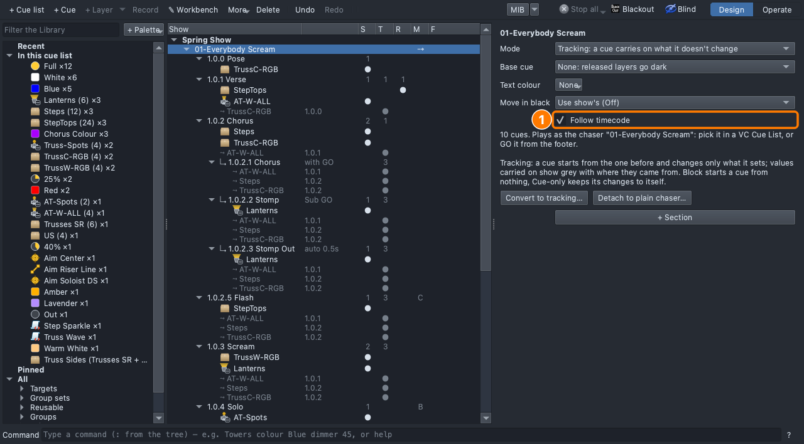
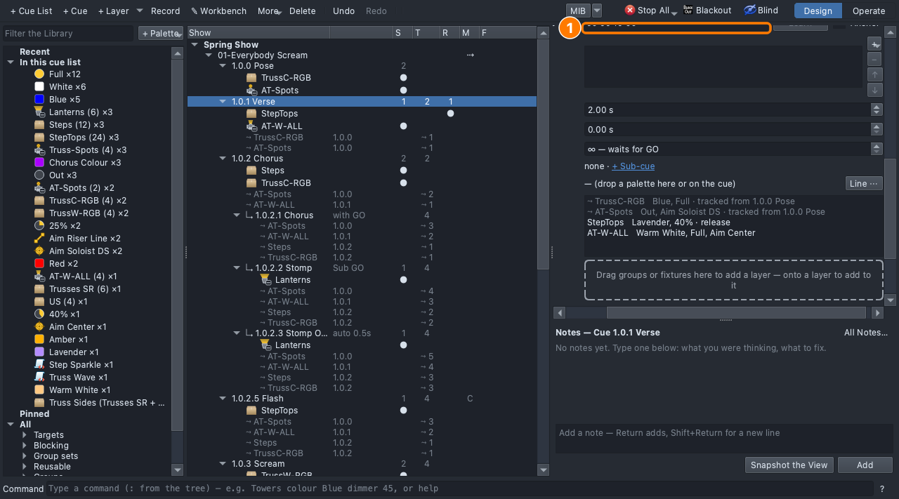
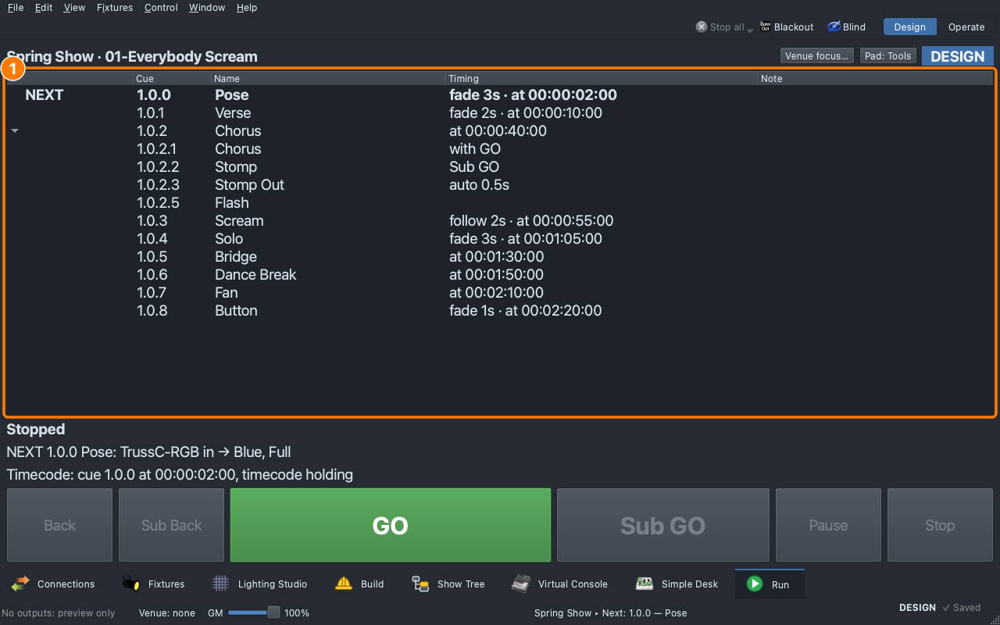

# Lesson 3.5 — Show control and timecode

**Student handout**

## Why this matters

A song with the music running from QLab can be lit two ways. QLab calls the cue ("GO 1.0.2") and the cue goes when the sound op's cue goes. Or both computers follow one clock, and each cue goes at its time with nobody pressing anything. A person can change their mind; a clock repeats exactly, every night. A show usually wants both: the clock for the song, a hand on GO for what isn't on the music ([Lesson 0.7](../0-7/)).

## Today you will

- set a cue list to follow timecode, with a time on each cue that belongs on the clock;
- say why a stab stays off the clock, and what QLab's cue numbers promise the sound op;
- name the routes a GO can take to the stage, and which one has its own switch.

## Words for today

| Word | Means |
|---|---|
| **Show control** | Another computer fires your cues by number. QLab, the sound and video program, does it over OSC or MIDI Show Control (MSC). |
| **Timecode** | A clock that counts hh:mm:ss:ff along with the music. Every cue carries a time; when the clock reaches it, the cue goes. |
| **Follow timecode** | A cue list's setting: its cues with a time go on by themselves when the incoming timecode reaches it. |
| **Pad Run** | The game controller as a GO button: hold **LB**, press **A**. |
| **Phone Run page** | A web page on a phone with GO, Back and Stop. Off in every show until someone turns it on. |

## Part 1 — Plan it (on paper, everyone)

The song map from [Lesson 0.5](../0-5/): write the time of each section change and the cue that belongs there. Which of them must land on the beat, and which are a few seconds either side?

## Part 2 — Build it (at the laptop)

Roles: **Driver** (mouse), **Navigator** (reads each step aloud and checks *You should see*), **Designer** (holds the song map). Switch every few steps.

**On Windows or Linux:** where it says ⌘, press **Ctrl**.

1. **File ▸ Open** → `lesson-3-5-start.qlcc` (the song as Lesson 2.7
   left it). Open the **Show Tree** tab (⇧⌘5).
2. **Connections ▸ Devices**: scroll to **Show control & sync**. Click
   its three rows in turn: **OSC in**, **MIDI Show Control in**, **MIDI
   timecode**. Each says what it is listening to, and what it last heard.
   Change nothing: today the clock is the show's.
3. Back in the Show Tree, click the list **01-Everybody Scream** and tick
   **Follow timecode**.

   
4. Click **1.0.0 Pose**. In **At timecode**, type `00:00:02:00` and press
   **Return**. Do the same for each cue in the table below.

   

   | Cue | At timecode |
   |---|---|
   | 1.0.0 Pose | 00:00:02:00 |
   | 1.0.1 Verse | 00:00:10:00 |
   | 1.0.2 Chorus | 00:00:40:00 |
   | 1.0.3 Scream | 00:00:55:00 |
   | 1.0.4 Solo | 00:01:05:00 |
   | 1.0.5 Bridge | 00:01:30:00 |
   | 1.0.6 Dance Break | 00:01:50:00 |
   | 1.0.7 Fan | 00:02:10:00 |
   | 1.0.8 Button | 00:02:20:00 |

   Leave **1.0.2.5 Flash** empty. A stab that lands on a drum hit is
   fired by hand, not by the clock.
5. Open the **Run** tab (⇧⌘8).
   - *You should see:* **at 00:00:10:00** on the Verse's row, and the
     other times down the list. The Flash has none.

     
6. Click **Operate**, then **GO** and **GO** again. A GO by hand still
   plays, whatever the clock says. Click **Stop**, then **Design**.
7. **File ▸ Show Settings…**: find **Allow GO from the phone Run page**.
   Leave it off. Read its tooltip.
8. **File ▸ Save As** → `Lesson3-5-yourname.qlcc`.

**Stuck?** No **At timecode** box: click a cue, not the list. A red box
around the time: write all four parts, `hh:mm:ss:ff`. No times on the
Run tab: tick **Follow timecode** on the list first.

## One GO

Whichever way a GO arrives, it is the same GO: the key, the Run tab's
button, a pad, the phone page, QLab (OSC or MSC), a cue on the clock. It
holds the Design previews first, and in Design it offers Operate. A
rule on one door holds on all of them; the phone page is the door that
has its own switch, and its own PIN.

- **QLab fires by number.** QLab's cue says "GO cue 1.0.2" and the lights
  go to 1.0.2. Renumber the cues the night before and QLab fires the wrong
  ones, so a number is a promise to the sound op.
- **The pad.** Hold **LB** (L1), press **A** (Cross): GO. Nothing moves
  unless LB is held, so a pad knocked off a stool does nothing.
- **The phone page.** It shows the cues and GO, Back and Stop. Stop takes
  two taps.

## Done early? (Extension)

Press **Learn** instead of typing: with a timecode source running, the box stamps the time coming in now onto the cue. Ask: "When would you rather learn a time than type it?" (*while the sound op plays the song once and the SM calls the cues*). Then a button on a MIDI controller: right-click the cue list, or a hit, in the Show Tree → **Learn Trigger…**, and press the control. Ask why a dedicated button beats a mouse in the dark.
