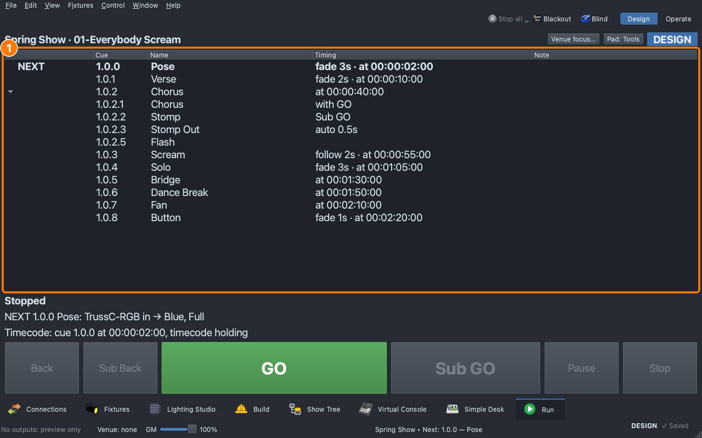

# Lesson 3.5 — Show control and timecode

The sound op runs the music from QLab; the lights have to land with it. Students set the song's cues to follow the clock, and learn the other ways a GO arrives: QLab's cue number, a pad, a phone.

| For | File |
|---|---|
| Teacher | [Teacher guide](https://github.com/sandinak/qlcconsole/blob/main/docs/course/level-3/lesson-05/teacher-guide.md) · [Slides outline](https://github.com/sandinak/qlcconsole/blob/main/docs/course/level-3/lesson-05/slides.md) |
| Students | [Handout](handout.md) · [Exit ticket](exit-ticket.md) · [At home](at-home.md) |
| Show files | [`lesson-3-5-start.qlcc`](../../shows/lesson-3-5-start.qlcc) · [`lesson-3-5-finish.qlcc`](../../shows/lesson-3-5-finish.qlcc) |

