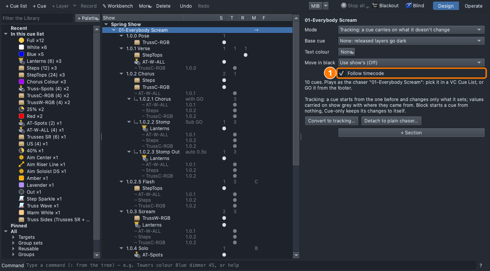
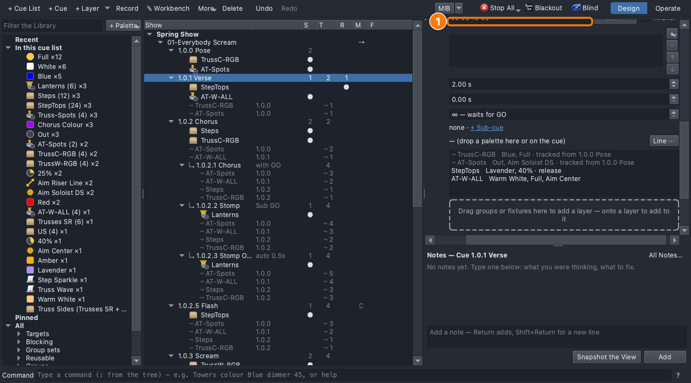
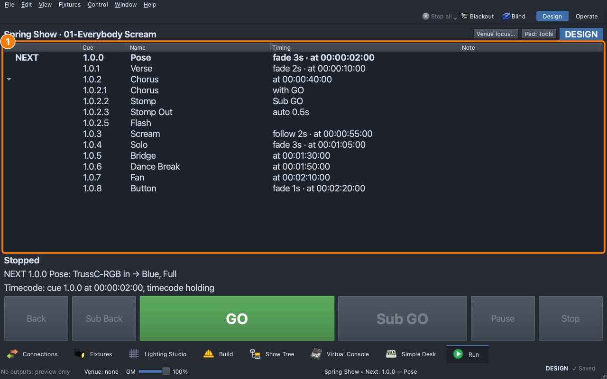

## Why

A song with the music running from QLab can be lit two ways. QLab calls the cue ("GO 1.0.2") and the cue goes when the sound op's cue goes. Or both computers follow one clock, and each cue goes at its time with nobody pressing anything. A person can change their mind; a clock repeats exactly, every night. A show usually wants both: the clock for the song, a hand on GO for what isn't on the music ([Lesson 0.7](../0-7/)).

## On paper

The song map from [Lesson 0.5](../0-5/): write the time of each section change and the cue that belongs there. Which of them must land on the beat, and which are a few seconds either side?

Roles: **Driver** (mouse), **Navigator** (reads each step aloud and checks *You should see*), **Designer** (holds the song map). Switch every few steps.

## Steps

1. **File ▸ Open** → `lesson-3-5-start.qlcc` (the song as Lesson 2.7
   left it). Open the **Show Tree** tab (⇧⌘5).
2. **Connections ▸ Devices**: scroll to **Show control & sync**. Click
   its three rows in turn: **OSC in**, **MIDI Show Control in**, **MIDI
   timecode**. Each says what it is listening to, and what it last heard.
   Change nothing: today the clock is the show's.
3. Back in the Show Tree, click the list **01-Everybody Scream** and tick
   **Follow timecode**.

   
4. Click **1.0.0 Pose**. On its **Timing** tab, in **At timecode**, type `00:00:02:00` and press
   **Return**. Do the same for each cue in the table below.

   

   | Cue | At timecode |
   |---|---|
   | 1.0.0 Pose | 00:00:02:00 |
   | 1.0.1 Verse | 00:00:10:00 |
   | 1.0.2 Chorus | 00:00:40:00 |
   | 1.0.3 Scream | 00:00:55:00 |
   | 1.0.4 Solo | 00:01:05:00 |
   | 1.0.5 Bridge | 00:01:30:00 |
   | 1.0.6 Dance Break | 00:01:50:00 |
   | 1.0.7 Fan | 00:02:10:00 |
   | 1.0.8 Button | 00:02:20:00 |

   Leave **1.0.2.5 Flash** empty. A stab that lands on a drum hit is
   fired by hand, not by the clock.
5. Open the **Run** tab (⇧⌘8).
   - *You should see:* **at 00:00:10:00** on the Verse's row, and the
     other times down the list. The Flash has none.

     
6. Click **Operate**, then **GO** and **GO** again. A GO by hand still
   plays, whatever the clock says. Click **Stop**, then **Design**.
7. **File ▸ Show Settings…**: find **Allow GO from the phone Run page**.
   Leave it off. Read its tooltip.
8. **File ▸ Save As** → `Lesson3-5-yourname.qlcc`.

**Stuck?** No **At timecode** box: click a cue, not the list, then its **Timing** tab. A red box
around the time: write all four parts, `hh:mm:ss:ff`. No times on the
Run tab: tick **Follow timecode** on the list first.

## When the song changes

Cut a verse for time and every cue after it goes late. So a song section can
start at a time of its own, and its cues count from that start. Click the
section's header row (**1 — …**) and set **Starts at**: change that one
number and every cue in the song follows. When the music comes from a Logic
session, its markers can set the starts (**Import Logic Markers…** on the
list's page), or you tap **Learn section starts** as each section plays.

## One GO

Whichever way a GO arrives, it is the same GO: the key, the Run tab's
button, a pad, the phone page, QLab (OSC or MSC), a cue on the clock. It
holds the Design previews first, and in Design it offers Operate. A
rule on one door holds on all of them; the phone page is the door that
has its own switch, and its own PIN.

- **QLab fires by number.** QLab's cue says "GO cue 1.0.2" and the lights
  go to 1.0.2. Renumber the cues the night before and QLab fires the wrong
  ones, so a number is a promise to the sound op.
- **The pad.** Hold **LB + RB** (L1 + R1) for half a second to arm it; it
  stays armed until you hold them again. Armed, hold **LT** (L2, the
  safety) and press **A** (Cross): GO. B is Back, X and Y the sub-cue
  GO and Back, and **RT** fires the armed hit, named on the Run tab before you pull it (**Hit ▸** and its name; the same with **off** when the next pull lets it go). All four held at once (**LB + RB + LT + RT**) is the emergency stop. It works from every connected pad, whatever jobs that pad has and
  whatever it is doing: a second pad running a focus can stop the show too. A press without LT does nothing, so a pad knocked
  off a stool moves no cue. The pad never picks the list: the Run tab does.
- **The phone page.** It shows the cues and GO, Back and Stop. Stop takes
  two taps.
- **This computer's desk.** A MIDI desk's STOP, Grand Master, GO and Back
  belong to the computer, not the show: learn them once at the top of
  **Connections ▸ Control surfaces** and they work in every show opened
  there. GO is one press on the Run tab's list. If the show you open does not
  patch the desk, the footer shows a red **Desk not patched: Patch It** chip: click it to patch
  it. The show keeps its own stop too, so a computer with no desk learned
  can still stop the show.
- **A desk that needs its own setting.** Some desks must be set on the
  device itself first: a PMJ Black 1 straight from the factory lights the
  wrong keys, an APC40 mkII must be in Ableton mode. **Connections ▸ Control
  surfaces ▸ Controller setup ▸ Set Up…** checks it and fixes it (**Align
  Lamps**, with a backup and **Undo Align**). Do it before the show, not in
  Operate. A desk that never shows up at all is usually power or the cable:
  **Rescan** says so.
- **Pages.** A page is a labelled layer of the desk: colour on the faders,
  moves on the knobs. The board's page keys switch it, and its map names
  every control's job. Pages edit in Design only; in Operate the controls
  are the show's again.
- **Edit Live.** During a run the cue is close but a wash is too hot or a
  mover lands off its mark. Turn on **Edit Live** (Run tab, or the footer;
  the show's PIN if it has one), select the fixtures and move the page
  control: only that attribute changes on stage. The red footer chip lists
  what you moved; **Store** writes it into the look that set it (in an
  earlier cue, if this one tracks it), one undo step. GO never waits: trims
  you did not store drop with the cue, and **Store to Cue N** stays offered
  for 30 seconds.

## Exit ticket

1. Why would the lights follow timecode instead of the board op pressing GO on the music?
2. QLab fires cue 1.0.2. What goes wrong if someone renumbers the cues the night before?
3. What does a cue with no time do in a list that follows timecode, and how do you play it?
4. The phone Run page is off in every show. Where is it turned on, and what else keeps a stranger from using it?

## At home

Do one:

- **App:** Open your `Lesson3-5-yourname.qlcc`. The sound op has a slower recording: every time is 10 seconds later after the Verse. Change them, and read the Run tab to check the order. Save it as `Lesson3-5-Home-yourname.qlcc` and bring it in.
- **Paper:** For a song you know, write eight cues as time · number · what happens. Mark the two you would not put on the clock, and say why.
