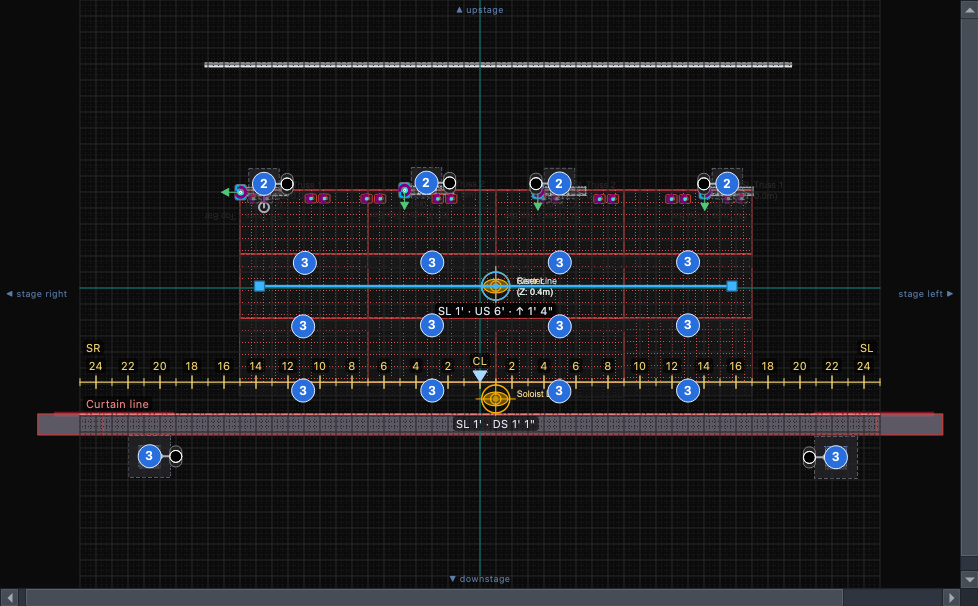
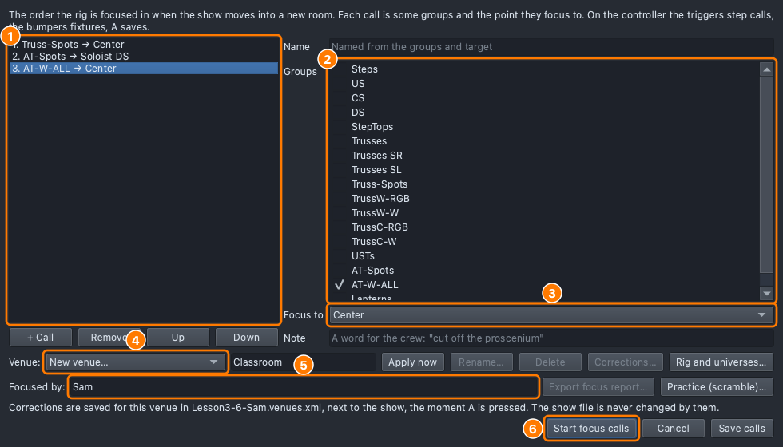
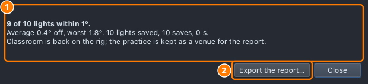

# Lesson 3.6 — Focus and calibration

**Student handout**

## Why this matters

A cue is only as good as where its light lands. Aimed a foot off, a
special misses the soloist and the look loses its focus
([Lesson 0.4](../../level-0/lesson-04/handout.md)). Focus puts every
light back on its mark in each room.

## Today you will

- read a target's place on stage from the stage marks: "SL 1 · DS 1";
- write the show's **focus calls** and run them from the controller,
  keeping the corrections for this **venue**;
- focus a scrambled rig back onto its marks, for a score, and hand in
  the **focus report**;
- change a cue from the stage with **Focus this cue**, and say how that differs
  from focusing.

## Words for today

| Word | Means |
|---|---|
| **Focus** (the rig) | Pointing, sizing and sharpening each light so it lands where the design says. Done once per room, before the cues are run. |
| **Focus call** | A step of the focus: some lights and the point they focus to ("Truss-Spots → Center"). The show keeps its calls in order, so every room is focused the same way. |
| **Hot spot** | The brightest part of a beam, usually its centre. "Hot spot on me" means: put the centre of the beam on the designer's face. |
| **Home** | Where a moving light points when it has no position: pan and tilt at the middle of their travel. A light that has wandered off is "sent home" and found again from there. |
| **Spot down / flood out** | Make the beam narrower / wider (the zoom). |
| **Sharp / soft** | A hard, crisp edge on the beam / a blurred one (the focus of the lens). |
| **Correction** | How far a light is off in this room (a pan and a tilt, in degrees), kept so the cues land where they should. Also called calibration. |
| **Venue** | One room the show plays in. Its corrections, its truss heights and its target positions are kept in a file beside the show, not in the show. |
| **House rig / tour package** | The lights a room already has / the lights that travel with the show. |
| **Stage marks** | The lines a crew spikes and focuses by: the centre line, the curtain line, the number line and the apron. On the plot they are the **Stage** layer. |
| **Curtain line** | Where the main curtain hangs: the line up- and downstage distances are measured from. |
| **Number line** | A line across the front of the stage, numbered in feet out from centre (**CL**, the centre line), so a crew can say how far left or right something is. |
| **Apron** | The part of the stage in front of the curtain line. |
| **Focus report** | The record of a focus: every light, where it went, its correction, who checked it and when. |
| **Scramble** | A practice: every moving light is knocked off its target by a random amount, and you focus them back. You are scored on how far off each light ends up, how long it takes and how many saves you make. Your real venues are never touched. |
| **Focus this cue** | Changing a cue's own values from the stage with the controller. Venue focus fixes the rig for a room; Focus this cue changes what a cue does. |

## Part 1 — How a focus call runs (everyone, no computer)

On a real focus call, two people work each light:

- **The electrician is at the light** (on the ladder or the lift, or
  holding the controller for a mover) and moves it.
- **The designer is at the point**: standing where the light should land,
  **back to the light**, reading the shadow of their own head. The hot
  spot is on them when the shadow is sharpest and the light is brightest
  on the back of their neck. Nobody looks into the beam.

The designer talks in short, fixed words, so nothing is misheard over the
noise of a load-in: "Unit 3. Hot spot on me." "Up a little." "Stage left."
"Spot down." "Sharper." "Lock it." The electrician answers "Locked" and
moves to the next unit. On our rig, "lock it" is **A** on the controller:
the light's correction is kept.

The board op, the electrician and the designer are often on headset. The
laptop says each call and light aloud; with its sound fed into the
headset system, everyone hears "Call 2 of 3, AT-Spots to Soloist DS" at
the same moment.

1. Which way does a designer face during a focus, and why?
2. What does the designer say when the light is right?

## Part 2 — At the laptop

Roles: **Electrician** (keyboard or controller), **Designer** (watches the
Rig Overview and calls the moves in focus words), **Scribe** (reads the
steps aloud, checks each *You should see*). Switch roles at each part.

**On Windows or Linux:** where it says ⌘, press **Ctrl**. **No
controller?** Every step gives the keys too.

### Get ready

1. Open qlcconsole. **File → Open** → `ShowChoir-Classroom.qlcc`.
2. **File → Save As** → `Lesson3-6-yourname.qlcc` in **Documents →
   qlcconsole**. *Do this first:* a venue's corrections are kept in a file
   beside your show, and the course file must stay as it is.
3. Click the **Lighting Studio** tab (⇧⌘3). Open **View → Rig Overview**
   (⇧⌘R) and put it beside the window.

### A. Read the stage marks

4. In the **Plot layers** panel on the left of the plot, find the **Stage**
   layer. Click the eye on **Centre line / DSC mark**, **Curtain line** and
   **Number line** to show them. (**Show ▸ Target positions**, on the plot's
   bar, is ticked already.)
   - *You should see:* the **Curtain line** in red across the stage, at
     the main drape; the number line in yellow along the front of the
     risers, numbered 2, 4, 6… out from **CL** in the middle, **SR** at one
     end and **SL** at the other.

   

   The blue numbered circles are the plot's own **count badges**: where
   several lights are hung in one spot, it draws one circle with how many.

5. Beside each target the plot writes where it is. Copy them down:

   | Target | Reads |
   |---|---|
   | Soloist DS | |
   | Center | |

   "SL 1' · DS 1' 1"" means 1 foot stage left of the centre line and a
   foot downstage of the number line. Center has a third part, **↑ 1' 4"**:
   it is on the CS riser, that far above the floor.

### B. Write the focus calls

6. On the Lighting Studio's toolbar click **Focus ▾**, then **Edit focus
   calls…**.
7. Click **+ Call**. Under **Groups** tick **Truss-Spots**; set **Focus
   to** **Center**.
   - *You should see:* **1. Truss-Spots → Center** in the list.
8. **+ Call** again: tick **AT-Spots** (and untick any other group), Focus
   to **Soloist DS**. In **Note** type
   `Off the proscenium` (a word for the crew, shown while the call runs).
9. **+ Call**: **AT-W-ALL** to **Center**. Untick any other group.

   

10. **Venue:** leave **New venue…** and type `Classroom` beside it.
    **Focused by:** your name.
11. Click **Save calls**: the calls are kept in the show. Under the venue
    the dialog says where its corrections will go:
    `Lesson3-6-yourname.venues.xml`, next to your show.

### C. Run the calls

12. Click **Start venue focus**. The venue Classroom is made now, and the
    calls begin. The footer, beside the GM slider, now says **Venue:
    Classroom**; clicking it opens the venue menu, the same one as
    **Focus ▸ Venues**.
    - *You should see:* the panel says **Call 1 of 3: Truss-Spots →
      Center**. On the stage the first truss spot comes up white, aimed at
      Center, and blinks three times; the others in the call are dim. The
      laptop says the call and where Center is.
13. Step through the lights and correct one:

    | Do | Controller | Keys |
    |---|---|---|
    | Next / previous light | RB / LB | ] / [ |
    | Nudge | left stick (right stick: fine) | arrows (⇧: 1° a press) |
    | Lock it (keep for Classroom) | A | Return |
    | Back to the last save | B | Backspace |
    | The whole call at once | Y | G |
    | Next / previous call | RT / LT | PgDn / PgUp |
    | Spot down / flood out | D-pad up / down | , / . |
    | Sharper / softer | D-pad right / left | ' / ; |
    | Say the light | right stick click | W |
    | Leave | Menu | Esc |

    Press **]** for the second spot, **⇧→** once, then **Return**.
    - *You should see:* the laptop says the spot was kept for Classroom;
      the lamp on the panel goes back to blue with a tick.
14. Press **G**: the whole call. A nudge now moves all four truss spots
    together (a truss hung a little low). Press **⇧→**, then **Backspace**
    to put them back.
15. **PgDn** to call 2, the AT spots. Press **,** twice (spot down) and
    **'** twice (sharper).
    - *You should see:* the beam angle on the panel goes down. The laptop
      says "Spot down." and "Sharper."
16. **Esc** to leave. If it asks about lights not saved, choose
    **Discard**.

### D. The scramble (scored)

The scramble is a classroom feature. If **Focus ▾** has no **Practice
(scramble)…**, open **File ▸ Show Settings…**, tick **Teaching mode**, and
press **OK** (your teacher may have done it for you).

17. Click **Focus ▾**, then **Practice (scramble)…**. The dialog says
    what a scramble does. Choose **Easy: 1–3° off** (not the default,
    Medium), **OK**.
    - *You should see:* the calls start again, in a practice venue named
      with today's date. On the plot and in the Rig Overview the beams no
      longer land on their marks.
18. For each light, call by call: the designer calls the moves, the
    electrician nudges until the beam lands on the target figure, and
    locks it (**A** / Return). **RB** / **]** for the next light, **RT** /
    **PgDn** for the next call. The clock runs from the start to your last
    save.
19. When every light is locked, press **Menu** / **Esc** to end. (RT on
    the last call goes round to the first again.)
    - *You should see:* the score: how many of the 10 lights are within 1°,
      the average and the worst, and how many saves you took.

    

20. Click **Export the report…**, choose **PDF**, and save it as
    `Lesson3-6-yourname focus report.pdf` beside your show. **This is
    your hand-in.** Write your score here: ____ of 10 within 1°, average
    ____°.

    Classroom comes back on the rig when the practice ends; the practice
    is kept as a venue of its own, for the report.

### E. Focus this cue: changing a cue, not the rig

21. Click the **Show Tree** tab (⇧⌘5). Click the **Command** line and
    type each line, then **Return**:

    ```
    production "Spring Show"
    list "Solo"
    cue + "Solo"
    AT-Spots colour White dimmer Full aim "Soloist DS"
    ```

    - *You should see:* a cue **1 Solo** with a layer on **AT-Spots**:
      White, Full, Aim Soloist DS.
22. On the cue's page click **Focus ▾** (top right), then **Focus this
    cue…**.
23. Press **,** twice (spot down), then **Return**.
    - *You should see:* the laptop says the change was kept in cue 1. The
      cue's AT-Spots layer now has a **Zoom** row. That is the cue's own
      value: focus didn't change.
24. Press an arrow. It refuses: the layer is aimed at Soloist DS, and
    moving it by degrees would stop it following the target. Press **G**
    until the panel says **Fixture**, then **→** twice and **Return**.
    - *You should see:* a new row under the AT-Spots layer in the tree: an
      exception, just that one spot with a position of its own.
25. **Esc** to leave. **File → Save** (⌘S).

## Stuck?

| Problem | Try |
|---|---|
| "Save the show first" in the focus calls | Step 2: **File → Save As** under your own name. |
| Nothing blinks, nothing moves | **Blackout** is on, or the **GM** slider is down. The laptop says which. |
| The keys do nothing | Click the Focus panel first so it has the keyboard. |
| A light won't spot down | It has no zoom: the truss spots don't, the AT spots do. |
| Focus this cue says it can't move the layer | It's aimed at a target. Pick one spot (**G** until **Fixture**) or move the target. |
| The score dialog closed | **Focus ▸ Edit focus calls…**, pick the practice venue, **Export focus report…**. |

## Done early? (Extension)

1. **Say the light.** In the calls, press **W**. **⇧W** (on the
   controller: hold the right stick click) switches the feedback: lights
   only, voice only, both. Beside **Feedback** on the panel, **Voice**
   sets how much is said: **Terse** ("F1 Spot 3"), **Standard** or
   **Verbose**. Which would you want on a loud load-in, and which during
   a rehearsal?
2. **Medium.** Run the scramble again on **Medium: 2–6° off**. Compare
   the two reports: where did the time go?
3. **Touring.** Click **Focus ▸ Venues ▸ Rig and universes…** (with
   Classroom applied). Read the page. If the show moved to the high school
   auditorium next week, what would change in this file, and what would
   stay in the show?

## In the user guide

The app's own help (F1) has the full story of each tool used today:

- [Stage marks](https://github.com/sandinak/qlcconsole/blob/main/docs/features/lighting-studio.md#stage-marks-centre-line-curtain-line-number-line)
  and [the Focus menu](https://github.com/sandinak/qlcconsole/blob/main/docs/features/lighting-studio.md#the-focus-menu)
- [Venue focus](https://github.com/sandinak/qlcconsole/blob/main/docs/features/focus-calls.md): the calls, venues,
  the focus report and the scramble practice
- [Focus this cue](https://github.com/sandinak/qlcconsole/blob/main/docs/features/refine.md)
- [House rig and tour package](https://github.com/sandinak/qlcconsole/blob/main/docs/features/venues.md): the venue
  chip, the venue page and the clash check
