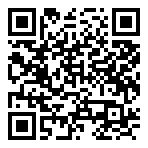

# Lesson 3.6 — Focus and calibration

**Teacher guide** · Level 3, lesson 6 · 50 minutes (two periods work
better: see [Timing](#timing))

**Give students:** <https://sandinak.github.io/qlcconsole/class/3-6/> (the show file, the steps, the exit ticket and the at-home task; nothing else)

**Builds on:** Lesson [0.4](../../level-0/lesson-04/teacher-guide.md). Open with the handout's *Why this matters* before any clicks.

## Objectives

Students can:

1. run a focus call the way a crew does: who stands where, the words
   for each move, and what "lock it" means on our rig;
2. read a target's place from the stage marks (curtain line, number
   line, centre line) and say it the way a call says it ("SL 1, DS 1");
3. focus a scrambled rig back onto its marks from the controller, keep
   the corrections for the venue, and hand in the focus report;
4. say the difference between Venue focus (the rig, for one room) and
   Focus this cue (a cue, for every room).

## Before class

- [ ] qlcconsole on the projector computer and the class laptops.
- [ ] `ShowChoir-Classroom.qlcc` on each laptop (from `docs/course/shows/`).
- [ ] An Xbox or PlayStation controller per station if you have them
  (USB or Bluetooth). Without one, every step has keys.
- [ ] Sound on the projector computer: the laptop's voice is part of the
  lesson. For Part 3, the voice into the headset system (**Voice to:** in
  the focus calls list, **Focus ▸ Edit focus calls…**, picks the output).
- [ ] On the projector: the show saved as `Lesson3-6-demo.qlcc`, the
  **Lighting Studio** tab, **View → Rig Overview** beside it.
- [ ] **Teaching mode** on in the show the students use: the scramble is
  only offered in a Teaching show. Either they tick it (**File ▸ Show
  Settings… ▸ Teaching mode**, the handout says where), or you hand out a
  copy made with **Make Student Handout…** (same dialog): Teaching on, real
  output held, an optional PIN so it stays on, and no practice answer key
  in the venue file. Keep your own copy without Teaching mode.
- [ ] Print the [handout](handout.md) and the [exit ticket](exit-ticket.md).

## Vocabulary (introduce in this order)

**focus**, **hot spot**, **home**, **sharp / soft**, **spot down / flood
out**, **focus call**, **stage marks**, **curtain line**, **number line**, **apron**,
**correction**, **venue**, **house rig / tour package**, **scramble**,
**focus report**, **Focus this cue**. Each is in the handout's word table and the
[Glossary](../../GLOSSARY.md).

## Timing

| Min | Part | What happens |
|---|---|---|
| 0–10 | **Design idea** (no computers) | A focus call, acted out: electrician, designer, the words |
| 10–18 | **Teacher demo** (projector) | Stage marks; the three calls; one light locked; the voice |
| 18–43 | **Hands-on** (triads, roles) | Handout Parts A–D: marks, calls, run, scramble and report |
| 43–45 | **Focus this cue** (projector) | Handout Part E shown, not done |
| 45–50 | **Exit ticket** | On paper |

**Over two periods** (recommended): period 1 is the design idea, the demo
and Parts A–C, ending with a practice scramble on Easy that doesn't
count; period 2 opens with the touring piece below, then the scored
scramble (Part D), the report, and Focus this cue (Part E) hands-on.

## 1. Design idea (10 min)

Act a focus call out in the room, with the classroom lights or a
flashlight on a stand.

- One student is **the designer**: stands on a tape mark, **back to the
  light**, and reads the shadow of their head. Ask why the back: so the
  designer is never blinded and can watch the edge of the beam on the
  floor.
- One student is **the electrician** at the light, and moves it only on a
  call.
- The designer calls in the fixed words: "Unit 1. Hot spot on me." "Up a
  little." "Stage left." "Spot down." "Sharper." "Lock it." The
  electrician answers "Locked." Point out that the words are short so
  they survive a noisy load-in and a headset.

Then the two words students mix up: **sharp and soft** is the edge of the
beam (the lens's focus); **spot down and flood out** is its size (the
zoom). And **home**: where a mover points with no position at all,
pan and tilt at the middle; a lost mover is sent home and found again.

**Key idea to land:** the design is written once, but every room is
different. A focus makes this room match the design; it is not a change
to the design.

### Touring: why the corrections live in the venue (period 2, 5 min)

A touring show carries its own lights, the **tour package**, and uses
the lights each room already has, the **house rig**. Every room hangs
the pipes at other heights, puts its marks somewhere else, and has its
own network, so even the tour package needs correcting in each room.

qlcconsole keeps all of that with the **venue**, in a file beside the
show: the corrections, the trims and target positions, the room's own
house lights, and which output each universe goes to there (an Art-Net
node at one school, a USB interface at the next). The show file never
changes. Ask: "We play the high school on Friday and the middle school
on Saturday. What do we take, and what do we do when we get there?"
(*the show, the tour package, and the venue file for each room; in a new
room, a new venue, then the focus calls*)

## 2. Teacher demo (8 min)

1. **Lighting Studio**, **Plot layers ▸ Stage**: show the curtain line,
   number line and centre mark with their eyes. Drag the curtain line a
   foot upstage and back (⌘Z) so they see the marks are objects you can
   move. Read Soloist DS aloud from the plot: "SL 1, DS 1."
   Point out that DS here means downstage of the number line, and the ↑
   on Center is its height on the riser.
2. **Focus ▸ Edit focus calls…** (the **Focus** drop-down on the
   Lighting Studio toolbar holds every focus tool): build the three calls of the handout in front of
   the class. Name the venue `Classroom` and say why the show was saved
   first.
3. **Start venue focus**. Let the class hear the voice. Step to the
   second truss spot, nudge it, lock it with A. Point at the footer:
   **Venue: Classroom**. Open Finder beside the show: the `.venues.xml`
   file is there and the show file's date has not changed.
4. Press **Y** (whole call), nudge, then **B**: everything back.

## 3. Hands-on (25 min)

- Roles: **Electrician / Designer / Scribe**, switching at each part.
  The designer may not touch the laptop; they call the moves from the
  Rig Overview.
- Students without a laptop: the **design station**: Part 1's questions,
  then a focus chart on paper (below).

### What to watch for

| You see | Likely cause | Say |
|---|---|---|
| "Save the show first" | They skipped Save As | "Step 2: your own copy first; the venue file goes beside it." |
| Nothing lights in the calls | Blackout on, or the GM down | "Listen to the laptop: it says which." |
| The keys do nothing | The panel doesn't have the keyboard | "Click the Focus panel once." |
| Students nudge with their eyes on the panel numbers | They aren't watching the stage | "The designer calls it from the stage. Eyes on the Rig Overview." |
| A truss spot won't spot down | It has no zoom | "Right: only the AT spots have a zoom. Try call 2." |
| The scramble score is poor and fast | Saving before the beam lands | "Locked means it's right. Look, then lock." |
| Focus this cue refuses to move the layer | The layer is aimed at a target | "Pick one spot (G), or move the target in the Studio." |

## 4. Check for understanding (while circulating)

- "Where does the designer stand, and which way do they face?" (*on the
  point, back to the light, reading the shadow*)
- "You locked a light. Did the show file change?" (*no: the correction
  went into the venue's file beside it*)
- "What's the difference between 'sharper' and 'spot down'?" (*edge vs
  size*)
- "Read me Center from the plot." (*SL 1' · US 6', 1' 4" up*)

## 5. Exit ticket (5 min)

[Exit ticket](exit-ticket.md) — answers below.

## Extension (fast groups)

The handout's extensions: Say the light, Feedback and Voice; a
Medium scramble compared with the Easy one; the venue's **Rig and
universes…** page. For the last, ask what a house fixture is and where
it is saved (*the room's own light; saved in that venue's file, not the
show*).

## Part 3 — On the real rig (with Branson)

On the theatre's rig, with the real movers patched:

- Run the class's calls for real. One student at the point (back to the
  light), one on the controller at the stage edge, one on the laptop
  with the voice in the headsets. The laptop is not watched: the stage
  is. On a busy headset channel, set **Voice** (beside **Feedback** on
  the panel) to **Terse**: "F1 Spot 3", "Saved".
- Click both sticks together (or press **H**) to hold every light while
  someone walks to a mark; again to release.
- **View + X** (or **D**) marks a light with a lamp out **dead**; it shows
  in the report.
- Export the real focus report and compare it with the practice one:
  who checked each light and when.
- A pad that drops out (asleep, flat) lets go of everything it held and
  the laptop says "Controller lost. Lights held." When it is back the
  laptop says "Controller back." and the pad drives again once the keys
  are still (with **Keyboard** chosen on the panel, click **Use the
  controller**).

## In the user guide

Background for the teacher, in the app's help (F1):
[Venue focus](https://github.com/sandinak/qlcconsole/blob/main/docs/features/focus-calls.md) (the calls, venues, the
report, the scramble, the venue focus cue),
[Focus this cue](https://github.com/sandinak/qlcconsole/blob/main/docs/features/refine.md),
[House rig and tour package](https://github.com/sandinak/qlcconsole/blob/main/docs/features/venues.md) (the venue
chip and the venue page) and the Lighting Studio's
[stage marks](https://github.com/sandinak/qlcconsole/blob/main/docs/features/lighting-studio.md#stage-marks-centre-line-curtain-line-number-line).

## At home

[At home](at-home.md): a focus chart for a room at home, or a scramble on
Medium.

## Answer key

- **Part 1 (handout):** 1 — back to the light, so they aren't blinded and
  can read the shadow of their head; 2 — "Lock it" (on our rig, A).
- **Exit ticket:** 1 — the electrician moves the light; the designer
  stands at the point and calls the moves. 2 — spot down and flood out
  change the size of the beam (zoom); sharp and soft change its edge
  (focus). 3 — 1 foot stage left of the centre line and 1 foot downstage
  of the number line. 4 — in the venue's file beside the show; the show
  file isn't changed, so the next room starts clean (or from this one).
  5 — Venue focus corrects the rig for one room; Focus this cue changes the cue
  itself, in the show, for every room.

## How this lesson was checked

The course test (`ui/test/courseshow`, `lessonFocusAndCalibration`) runs
it offscreen on the real app, on the classroom show saved under a
student's name: the four stage-mark items by their names, Soloist DS
reading `SL 1' · DS 1' 1"` and Center `SL 1' · US 6' · ↑ 1' 4"` (and
"SL 1, DS 1" spoken); the three calls built in the Venue Focus dialog as
the handout says, named "Truss-Spots → Center" and so on; the venue
Classroom made beside the student's show; the calls run on the keys (],
⇧→ and Return keep a correction for Classroom, G the whole call, PgDn the
AT spots, , and '); the Easy scramble of all 10 moving heads focused back
and scored (9 of 10 within 1° when one is left 1.8° off), its PDF report
written, Classroom back on the rig; and the typed Solo cue focused with Focus this cue (spot
down kept in the cue; a move refused on the aimed layer and kept as a
one-spot exception). It takes this lesson's pictures with `COURSE_SHOTS`
set. It doesn't drive the difficulty picker or the file dialog.
