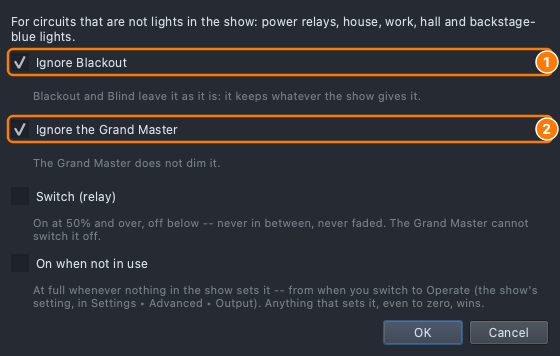
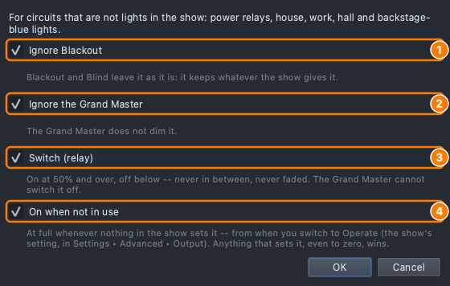

## Why

House lights and work lights aren't part of the design, but they frame
it: the house going out tells the audience the show is starting
([Lesson 0.7](../0-7/)), and a work light must never vanish on a
Blackout while the crew is on stage.

## On paper

For a show day (load-in, house opens, the show, intermission, strike):
who's in the room, and are the house lights, work lights and stage power
on?

Roles: Driver, Navigator, Designer. Switch after each fixture.

## Steps

1. **File → Open** → `ShowChoir-Classroom.qlcc`.
2. Click the **Fixtures** tab (⇧⌘2); open **View → Rig Overview** (⇧⌘R).
3. **Add ▾ → Add Fixture…** → **Generic → Generic**. **Name**
   `House Lights`, **Channels** 1, **OK**.
4. The same for `Work Lights` and `Stage Power`.
5. Right-click **House Lights** → **Output Rules…**: tick **Ignore
   Blackout** and **Ignore the Grand Master**, **OK**. An amber badge
   appears on its icon.

   

6. The same for **Work Lights**.
7. **Stage Power** → **Output Rules…**: tick **Switch (relay)**, **Ignore
   Blackout**, **Ignore the Grand Master** and **On when not in use**,
   **OK**.

   

   Its icon gets an **S**: it now *behaves as* a **Switch**. A switch, a
   curtain or a kabuki drop moves only when the show runs (GO, Back),
   never because you clicked a cue while building, and a stop leaves it
   as it is. Fog, flame and strong lasers are **Hazards**: a click never
   fires them, and a GO fires them only as the **spotter** lets it. A
   flame or CO₂ jet (**Burst**) fires only while the spotter holds their
   **Hazard hold** button; fog, haze and lasers (**Running**) once the
   spotter has pressed **Hazard arm**, until **Hazard kill**. Why: the
   person who can see the stage decides, not the operator at the desk. A
   cue that reaches a hazard the spotter hasn't let fire skips it, and the
   footer says so.

8. **Settings** (⌘,) → **Advanced**: leave **"On when not in use"
   fixtures come on** at **When you switch to Operate**. Close Settings.
9. Click the **Show Tree** tab (⇧⌘5), click the **Command** line, and type
   each line, then **Return**:

   ```
   production "Spring Show"
   list "00-Preshow"
   cue + "House up"
   "House Lights" dimmer Full
   TrussC-RGB colour Blue dimmer Full
   cue + "House to half"
   "House Lights" dimmer Half
   cue + "House out"
   "House Lights" dimmer Out
   ```

10. Click **0.0.0 House up**: blue cyc, house lights at full.
11. Click **Blackout** (top right). The cyc goes dark; the house lights
    stay. Click **Blackout** again.
12. Drag the **GM** slider down, then up. The cyc follows; the house
    lights and relay don't.
13. **File → Save As** → `Lesson3-7-yourname.qlcc`.

**Stuck?** **Add ▾** greyed out: click **Design**. "Can't find House":
quote names with spaces, `"House Lights"`. Cyc stays dark: Blackout is
on, or the GM is down.

## Exit ticket

1. What are **house lights** and **work lights** for?
2. Which output rules did you give the house lights, and why?
3. Why is a power **relay** a switch and not a dimmer? Why shouldn't
   clicking a cue while you build switch it?
4. When does our Stage Power relay come on by itself, and where is that
   set?

## At home

Do one:

- **App:** in your `Lesson3-7-yourname.qlcc`, add an intermission: a cue
  that brings the house to full and the stage to a quiet look, and one
  that takes the house out for Act 2. Bring in
  `Lesson3-7-Home-yourname.qlcc`.
- **Paper:** fill in the show-day table for a show you've seen or worked,
  then write its preshow and intermission as cues: number, name, house,
  stage, fade time.
