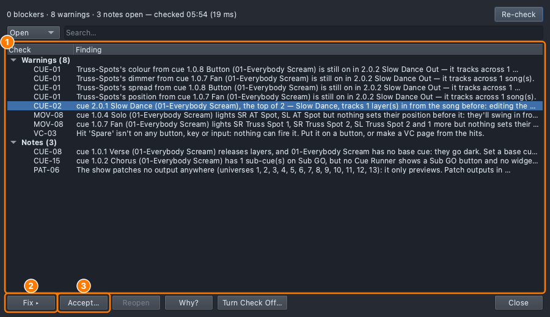
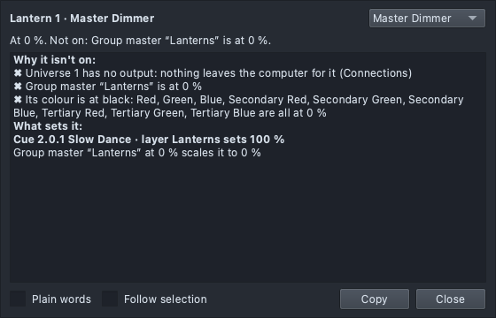
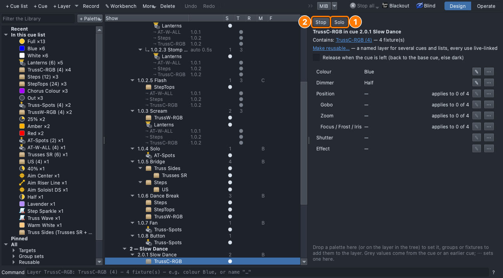

## Why

Things go wrong at the worst time, and in two kinds. Something saved in the show is wrong (a song that carries into the next, a button that fires nothing), and it is wrong on every computer. Or something is wrong now, here (Blackout is on, an output is down). Read the show first, ask the light second, and change the least you can. What is deliberate gets a note, so the next person who opens the show reads the decision and not a fresh warning.

## On paper

A light won't come on at 7:20. Write the order you would check things in. Which of the checks take ten seconds? Which can wait until after the house opens?

Roles: **Driver** (mouse), **Navigator** (reads each step aloud and checks *You should see*), **Designer** (holds the list from the page above). Switch every few steps.

## Steps

1. **File ▸ Open** → `lesson-3-9-start.qlcc`: the show from Lesson 3.8, left in a
   state. Open the **Show Tree** tab (⇧⌘5) and **View ▸ Rig Overview** (⇧⌘R).
2. If the footer says **Not ready**, click it and read. The classroom
   show has no outputs, so one line there is expected. That list is about
   now, on this computer.
3. Click **Review** in the footer.
   - *You should see:* findings, worst first. Hover a row for why it
     matters. Look for **CUE-02**, and for four **CUE-01** under it.

   
4. Select **CUE-02** and click **Fix ▸**. It takes you to the second song.
   Click the header **2 — Slow Dance** and tick **Block at section start**.
   Click **Re-check**.
   - *You should see:* CUE-02 and the four CUE-01 gone. They were one
     fault: the Button's spread still on in Slow Dance.
5. Select **VC-03**, a hit called *Spare* that no button fires. **Accept…**,
   write `Kept for the encore`, your name, **OK**. Show **Accepted**.
   - *You should see:* the finding moves to Accepted, with your note.
6. Leave the two **MOV-08** warnings and the notes. They are about the
   real rig's moving lights, and about the classroom having no outputs.
   Tell your partner which you would fix first on the real rig, and why.
7. Click **2.0.1 Slow Dance**. The Lanterns should be amber at full, and in
   the Rig Overview they are dark. Right-click a lantern → **Why is this
   on?** (or select it and press ⌘I).
   - *You should see:* under **Why it isn't on**, a line *Group master
     "Lanterns" is at 0 %*. The line about the universe having no output is the
     classroom.

   
8. Open the **Run** tab (⇧⌘8). Double-click the name under the **Lanterns**
   fader to put it back to full. Look at the Rig Overview again.
9. Back in the Show Tree, click the **TrussC-RGB** layer of 2.0.1 and press
   **Solo**. Only that layer plays: the lanterns go out. Press **Solo**
   again, and the cue is whole.

   
10. **File ▸ Save As** → `Lesson3-9-yourname.qlcc`.

**Stuck?** No **Review** chip: it appears a couple of seconds after the show
opens. **Fix ▸** greyed: select a finding first. **Accept…** needs a note.
The lanterns still dark: the Grand Master (**GM** in the footer) or Blackout.
Ask the light again.

## If it's wrong and the house is opening

Undo is ⌘Z, in the order you did things. A show that crashed leaves a
recovery copy beside it (*Show*.qlcc.autosave); Open it with **All Files**
and Save As under a new name. Change the least you can, and write down
what you changed.

## Exit ticket

1. What is the difference between what Show Review reports and what the footer's Not ready list reports?
2. A finding is on purpose. What do you do with it, and who benefits?
3. A light is dark and the cue says it should be on. What do you ask, and what is the first thing it tells you?
4. A cue looks wrong and has six layers. How do you find the one that does it?

## At home

Do one:

- **App:** Open `lesson-3-9-start.qlcc` again, and put a fault of your own into your copy: a song that doesn't Block, a hit nobody fires, or a group master at 0. Save it as `Lesson3-9-Home-yourname.qlcc` and swap with someone. Find theirs.
- **Paper:** Write a troubleshooting card for the op, one side of an index card: the first three things to ask when a light is dark, in order, and where each is answered.
