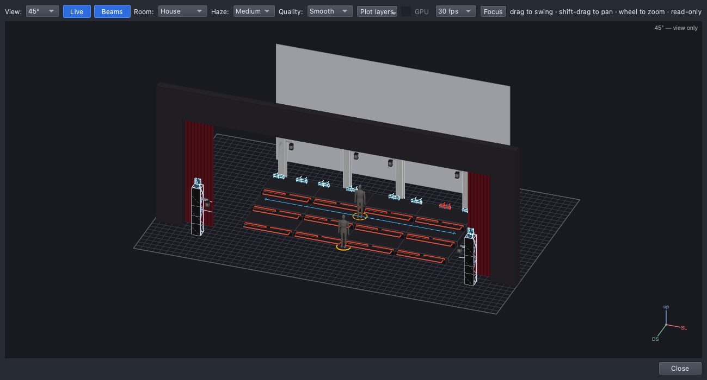

# The teaching show: our virtual stage

`shows/ShowChoir-Classroom.qlcc` is a show choir stage built from a real
one (DanceHysteria), scaled down for class. It has the rig,
the groups, a few stage targets and a set of colours and levels — and no
show yet: students build that.

**It is never connected to real lights.** No universe has an output and
no light talks to the network, so it can't send anything on the school
network. The **Rig Overview** (View → Rig Overview, ⇧⌘R) is the stage.

## The stage

- **Risers (steps):** three rows — **US** (top, at the back), **CS**,
  **DS** (front) — of four units each, numbered **1–4 from stage right**.
- **Cyc** (cyclorama): the white cloth upstage.
- **Trusses:** four upright trusses across the back, two each side. On each
  side **1 is the outside truss** (nearest the wings), 2 the inside one.
- **Audience towers (AT1 SR, AT2 SL):** one each side, in the house.
- Proscenium and an open main drape.

## The lights (68)

| Lights | How many | Where | Kind |
|---|---|---|---|
| **US/CS/DS Step 1–4** | 12 | an LED strip along each step front | pixel strip (64 pixels), colour only |
| **… Step N Top SR / SL** | 24 | two bars on top of each riser unit, lighting up | pixel bar (colour + white), colour only |
| **SR/SL Truss Wash 1–2** | 4 | on the trusses, facing out over the stage | pixel box (XL-450: RGB + white pixels), colour only |
| **SR/SL Truss Cyc 1–2** | 4 | on the trusses, facing the cyc | pixel box (XL-450), colour only |
| **SR/SL Truss Spot 1–2** | 4 | top of each truss | moving spot with a colour ring |
| **SR/SL AT Spot** | 2 | the audience towers | moving spot (for soloists), with a dimmer and a shutter |
| **SR/SL AT Wash 1–2** | 4 | the audience towers | moving wash, with a dimmer |
| **UST 1–8** | 8 | upstage, standing along the top riser | two-arm moving beam |
| **Lantern 1–6** | 6 | hanging from the trusses (one on AT1) | LED lantern |

"Colour only" lights have no dimmer of their own: a colour plays at full
and a level dims the colour.

## Groups (Library → All → Groups)

The names follow the real show's (DanceHysteria): where it is, then what.

| Folder | Group | Lights |
|---|---|---|
| Steps | **Steps** | all 12 step fronts |
| | **US**, **CS**, **DS** | one row's step fronts |
| | **StepTops** | all 24 step-top bars |
| Trusses | **Trusses** | everything on the four trusses |
| | **Trusses SR**, **Trusses SL** | everything on that side's trusses |
| | **Truss-Spots** | the 4 truss spots |
| | **TrussW-RGB**, **TrussW-W** | the wash boxes' colour pixels / white pixels |
| | **TrussC-RGB**, **TrussC-W** | the cyc boxes' colour pixels / white pixels |
| | **USTs** | the 8 upstage beams |
| AT | **AT-Spots** | the 2 audience-tower spots |
| | **AT-W-ALL** | the 4 audience-tower washes |
| Lanterns | **Lanterns** | the 6 lanterns |

A group with **-RGB** or **-W** holds only that kind of pixel of a pixel
box, so a colour on TrussC-RGB doesn't also turn on the white pixels.

## Stage targets (Library → All → Targets)

| Target | Kind | Where |
|---|---|---|
| **Soloist DS** | a person | centre, just downstage of the risers |
| **Center** | a person | centre of the CS riser row |
| **Riser Line** | a line | across the CS row, SR to SL |

Each has an Aim palette (**Aim Soloist DS**, **Aim Center**, **Aim Riser
Line**) under Palettes → Position.

## Palettes

| Type | Palettes |
|---|---|
| Colour | White, Warm White, Red, Amber, Yellow, Green, Cyan, Blue, Lavender, Magenta |
| Dimmer | Full, 75%, Half, 25%, 10%, Out |
| Position | Aim Soloist DS, Aim Center, Aim Riser Line |
| Shutter | Open (the AT-Spots' shutter is closed until a look opens it) |

A level you type that isn't there (`dimmer 30`) makes a new palette named
the same way: **30%**.

## The footer

It says **Not ready** in red: "13 universe(s) with fixtures but no
output". That's on purpose. Clicking it also lists "5 definition(s) came
with this show": the show carries the descriptions of the lights the app
doesn't ship, so it opens complete on any computer.
